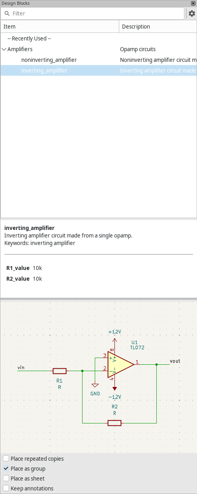
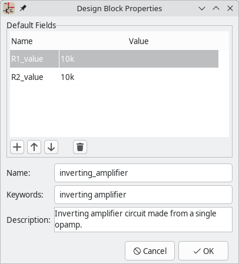

:experimental:

[[schematic-design-blocks]]
== Design blocks

Design blocks are a design-reuse feature that lets you save a portion of a
schematic (and optionally a corresponding PCB layout) as a named, reusable
fragment stored in a design block library.
You can instantiate a design block any number of times within the same project
or across different projects.
Design blocks are organized in libraries in the same way that symbols and
footprints are organized in their respective libraries.

A single design block can contain a schematic fragment, a PCB layout fragment,
or both.
When you place a schematic design block, the saved schematic fragment is
inserted into the current schematic sheet or into a new hierarchical subsheet.
If the design block also contains a layout fragment, you can later apply that
layout to the footprints that were placed as a result of the schematic fragment.
This makes design blocks well suited for circuits that appear repeatedly across
projects, such as power supply subcircuits, filter networks, protection circuits,
and interface conditioning stages.

Typically, design blocks are created first as a schematic fragment, with the
layout added later once the circuit has been placed and routed on a board.
Reusing layout fragments in design blocks is covered in the
xref:../pcbnew/pcbnew.adoc#pcb-design-blocks[PCB Editor manual].

[[design-block-concepts]]
=== Design block concepts

==== Two ways to place a design block

When you place a design block into a schematic you choose between two
fundamentally different placement modes:

**Place inline (no sheet):**
The contents of the design block are inserted directly into the current
schematic sheet alongside all other schematic objects.
The content becomes part of the current sheet and can be edited in place.

**Place as sheet:**
The contents of the design block are placed into a new
<<hierarchical-schematics,hierarchical subsheet>>.
The current schematic sheet receives a hierarchical sheet symbol whose contents
are the design block's schematic.
Placing as a sheet is useful when the design block represents a logically
distinct functional block, when you want the design block contents to be
visually separate from the parent schematic, or when you plan to reuse the same
sheet multiple times as a repeated hierarchical sheet.
Default fields defined in the design block's properties are applied as
hierarchical sheet fields when placing as a sheet.

In either mode, also enable the **Place as group** option to wrap the placed
content in a <<groups,group>> with a _library link_.
Without a group, features including saving changes back to the library, placing
additional linked instances, and applying the stored layout to the corresponding
footprints in the PCB editor are not available.
The **Place as group** option works with both placement modes: when enabled
alongside **Place as sheet**, a group wrapping the sheet symbol is added to the
parent schematic.

NOTE: Design blocks do not support nested hierarchical sheets.
      If the sheet you are saving as a design block contains hierarchical sheet
      symbols (subsheets), the save operation will be rejected.

==== The library link

When a design block is placed as a group, the group stores a _library link_
in the format `<library>:<block>` — for example,
`analog_filters:sallen_key_lowpass`.
This link connects the placed instance to its source in the library and
enables the following operations:

- **Save to Linked Design Block** — push edits made to the placed group back to
  the library, updating the stored design block schematic.
- **Place Linked Design Block** — place another instance of the same design
  block as a new linked group, without reopening the Design Blocks panel.
- **Apply Design Block Layout** — in the PCB editor, apply the layout stored in
  the linked design block to the group of footprints corresponding to this
  design block instance.
  As an alternative, the
  xref:../pcbnew/pcbnew.adoc#multichannel[multichannel tool] can replicate a
  manually completed layout from one group to another without requiring a stored
  layout fragment in the design block.

A group that does not have a library link cannot use any of these operations.
If you manually grouped the contents of a design block without using the
Design Blocks panel, you can add the library link retroactively in the group's
properties dialog (see <<setting-a-library-link-manually>>).

[[setting-a-library-link-manually]]
===== Setting a library link manually

If you have a group in your schematic that contains the same content as an
existing design block but the group does not have a library link, you can add
the link without re-placing the design block:

. Select the group and open its properties (right click -> **Group Properties...**,
  or press kbd:[E] with the group selected).
. In the **Library link** field, enter the design block identifier in the format
  `<library>:<block>`.
  For example, `power_circuits:ldo_3v3`.
. Click **OK**.

The group will now behave as a linked group and all library-linked operations
will be available.

If you want the design block's schematic contents to also be grouped in the PCB,
either for organizational purposes or so you can apply a design block layout,
use the <<update-pcb-from-schematic,Update PCB from Schematic>> tool with the
**Group footprints based on symbol groups** option enabled.

==== Design block library structure

Design block libraries are stored as directories on the filesystem.
The directory structure has two levels of nesting:

* The library itself is a directory whose name ends with `.kicad_blocks`
  (for example, `my_power_circuits.kicad_blocks`).
* Each design block within the library is a subdirectory inside the library
  directory, with the suffix `.kicad_block`
  (for example, `ldo_3v3.kicad_block`).
* Inside each design block directory, KiCad stores:
  ** A schematic file (`<block_name>.kicad_sch`) — present if the design block
     contains a schematic fragment.
  ** A board file (`<block_name>.kicad_pcb`) — present if the design block
     contains a layout fragment.
  ** A metadata file (`<block_name>.json`) — always present; stores the
     design block's description, keywords, and default fields.

Because libraries and design blocks are plain filesystem directories, they can
be managed with ordinary file manager tools, version control systems, or shared
over a network filesystem.
The library tables (see below) must be updated if library directories are moved
or renamed outside of KiCad.

==== Global and project library tables

As with symbol and footprint libraries, design block libraries are registered
in library tables before KiCad can use them.
There are two library tables:

* The **global design block library table** lists libraries that are available
  in every KiCad project.
  The global table is shared across all projects on the same machine.
* The **project design block library table** lists libraries that are available
  only in the current project.
  The project table is stored alongside the project files.

Both tables are managed through
**Preferences** -> **Manage Design Block Libraries...**.
The dialog behaves identically to the symbol and footprint library table
dialogs.
See the <<managing-symbol-libraries,symbol library table documentation>> for
a full description of the library table interface.

=== The Design Blocks panel

To use schematic design blocks, first show the Design Blocks panel by clicking
**View** -> **Panels** -> **Design Blocks**.
This opens a docked panel on the right side of the schematic editor.
To close the panel, use the same menu entry again,
click the close button in the top right of the panel,
or right click in the panel and choose **Hide Library Tree**.

The Design Blocks panel lets you create design block libraries and create, edit, and place design blocks in the schematic.

The panel has three main areas:

* A **filter textbox** at the top, for searching across all libraries by name,
  description, and keywords.
  By default results are ranked by best match.
  To sort alphabetically instead, select **Sort Alphabetically** under the
   settings menu.
* A **library tree** that lists all registered design block libraries and the
  design blocks they contain.
  Libraries can be expanded or collapsed.
  A **Recently Used** pseudo-library at the top of the tree records design
  blocks you have placed recently.
  Right click a library and choose **Pin Library** to keep it at the top of
  the list regardless of recent usage.
* A **preview area** below the tree that shows the name, description, keywords,
  and a graphical preview of the currently selected design block.

=== Creating and managing design blocks

Design blocks are saved in design block libraries, so you need to add a library
before you can save any design blocks.

==== Creating a new design block library

To create a new library, right click in the library tree and select **New Library...**.
This opens a file browser for you to choose a location and name for the new library.
Design block libraries are saved as a folder;
the folder name is the library name plus the suffix `.kicad_blocks`.

The file browser also lets you choose whether the new library should be added to the global design block library table or the project design block library table.
Libraries in the global library table will be available to all projects,
while libraries in the project library table will only be available in the current project.

NOTE: The global and project design block library tables are managed using
      **Preferences** -> **Manage Design Block Libraries...**.
      This includes deleting and renaming design block libraries.
      The design block library tables behave in the same way as the symbol and footprint library tables.
      For more information about managing library tables, see the
      <<managing-symbol-libraries,symbol library table documentation>>.

After choosing a name, location, and library table, a new, empty library is created.
When you create new design blocks, you can save them in this library.

==== Creating a new design block

In the schematic editor, design blocks can be created either from the entire contents of a schematic sheet or from a selection of schematic objects.
To create and save a new design block, select the desired source objects, either by opening the desired sheet or selecting the objects in the editing canvas.
Then right click the design block library that will contain the block and select
**Save Current Sheet as Design Block...** or **Save Selection as Design Block...** as appropriate.

The two creation commands differ in what they capture:

* **Save Current Sheet as Design Block** captures everything on the current
  schematic sheet.
  Navigate to the sheet you want to save before invoking this command.
  This is the most convenient option when the circuit you want to capture
  already exists on its own dedicated sheet.

* **Save Selection as Design Block** captures only the objects that are
  currently selected in the canvas.
  Select the symbols, wires, labels, and other schematic objects you want to
  include before invoking this command.
  If the selection is a single hierarchical sheet symbol, KiCad saves the
  contents of that subsheet (equivalent to **Save Current Sheet** for that
  sheet).
  If the selection contains multiple items or a single group, those items are
  saved as the design block content.

After invoking either command, the **Design Block Properties** dialog opens.

This brings up the Design Block Properties dialog, where you can edit the
properties of the new design block.

* **Name**: this is the name of the new design block, which is shown in the library tree and the preview pane.
  It is also used when filtering design blocks with the filter textbox.
  When design blocks are added as a group or as a schematic sheet,
  this is the default name of the new group or sheet.
  The name may not contain the characters `/ : ; \ | < > " * ?` or any
  character that is illegal in a library item name.
* **Keywords**: these are space-separated keywords describing the design block.
  They are displayed in the design block preview pane and used when filtering
  design blocks with the filter textbox.
* **Description**: this is a description of the design block, which is shown in
  the library tree and the preview pane. It is also used when filtering design
  blocks with the filter textbox.
* **Default Fields**: these are key/value pairs which are included as
  <<hierarchical-schematics,hierarchical sheet fields>> when the design block's schematic is placed as a sheet.
  Fields are ignored when the design block is not placed as a sheet.
  Use default fields to pre-populate sheet-level parameters such as supply
  voltage, channel number, or other values that are expected to be overridden
  when the design block is placed as a sheet.

After filling in the properties and clicking **OK**, the design block is saved
to the selected library.
If a design block with the same name already exists in the library, KiCad will
ask for confirmation before overwriting it.

When you save a selection as a design block (as opposed to saving an entire
sheet), KiCad automatically groups the selected objects and sets the group's
library link to point to the newly created design block.
This means the selection is ready for further design block operations
immediately after saving.

You can edit a design block's properties after creating it by right clicking
the design block in the design block library tree and selecting
**Properties...**.

==== Deleting a design block

To delete a design block from a library, right click the design block in the
library tree and select **Delete Design Block**.
KiCad will ask for confirmation before permanently removing the design block
and its directory from the filesystem.
This operation cannot be undone.

Deleting a design block from the library does not affect any schematic objects
that were previously placed from that design block.
Existing placed groups that had a library link to the deleted design block
retain their content; they simply lose the ability to use library-linked
operations.

[[updating-an-existing-design-block]]
==== Updating an existing design block

There are multiple ways to push schematic changes back to an existing design
block in the library.
All of them replace the schematic content stored in the design block with new
content; they do not merge changes.

===== Updating from a selection

This is the most general approach and works regardless of how the design block
was originally placed:

. Select the schematic objects that represent the new content for the design
  block.
. In the Design Blocks panel, right click the design block you want to update
  and choose **Update Design Block from Selection**.

The stored schematic of the design block is replaced by the selection.
If the design block previously had a schematic but you are updating with a
new one, KiCad will ask for confirmation before overwriting.

===== Updating from the current sheet

If the current sheet contains exactly the content you want to store in the
design block (for example, if the design block was originally placed as a
hierarchical sheet and the sheet has since been edited):

. Navigate to the sheet whose contents you want to store.
. In the Design Blocks panel, right click the design block you want to update
  and choose **Update Design Block from Current Sheet**.

The stored schematic of the design block is replaced by everything on the
current sheet.

===== Saving from a linked group

If the design block was placed as a group and the group has a library link:

. Edit the schematic contents inside the group.
. Right click the group in the canvas and choose **Save to Linked Design Block**.

This is the most direct workflow when iterating on a placed design block
instance: edit in place, then push back to the library with a single right
click.

NOTE: Updating a design block in the library does not automatically update
      previously placed instances of that design block.
      Placed instances are independent copies of the design block content at
      the time they were placed.
      To bring an existing placed instance in line with the current library
      version, delete it and place the updated design block again.

[[using-schematic-design-blocks]]
=== Using design blocks in a schematic

You can place a design block into a schematic using the Design Blocks panel.

The Design Blocks panel contains a library tree that lists your design block
libraries and the design blocks contained in each library. Each library can be
expanded or collapsed to show or hide the design blocks in that library. There
is a **Recently Used** pseudo-library at the top of the tree that contains any
design blocks that you have recently placed. You can pin any libraries to the
top of the list by right clicking the library and selecting **Pin Library**.

You can filter design blocks by their name, description, and keywords using the
filter textbox at the top of the Design Blocks panel.
By default, matches are sorted by best match,
but you can change to sorting alphabetically by selecting **Sort Alphabetically** under the  menu.

When you select a design block in the library tree, the design block's name and
metadata are displayed below the library tree along with a graphical preview of
the design block. The metadata includes the block's description and keywords.

To add a design block to the schematic, double click it in the library tree or
right click a design block and select **Place Design Block**.

==== Placement options

There are several options controlling how the design block is placed:

* If the **Place repeated copies** checkbox is enabled, KiCad will begin placing the design block again when you finish placing the previous block.
  To cancel placing the next block, press kbd:[Esc] or right click and select **Cancel**.

* If the **Place as group** checkbox is enabled,
  the contents of the design block will be added to a <<groups,group>> in the schematic,
  and the group's library link will be set to point to the source design block and library.
  Grouping a design block keeps its contents together as a single unit in the schematic
  and enables library-linked operations such as saving changes back to the library,
  placing additional linked instances, and applying the design block layout in the PCB editor.
  The group can also be <<update-pcb-from-schematic,copied to the corresponding footprints>> in the board.

* If the **Place as sheet** checkbox is enabled,
  you will need to click twice in the editing canvas to place two corners of a <<hierarchical-schematics,hierarchical sheet>>.
  The design block contents will be placed in the new sheet.
  If the **Place as sheet** checkbox is not enabled,
  clicking once in the canvas will place the contents of the design block directly into the current schematic.
  **Place as group** and **Place as sheet** can be enabled simultaneously:
  when both are enabled, a new hierarchical sheet is created and a group
  containing the sheet symbol is added to the parent schematic.

* If the **Keep annotations** checkbox is enabled,
  KiCad will insert the design block without changing the symbol annotations as defined in the saved design block.
  If it is not enabled, KiCad will reset the symbol annotations while inserting the design block and reannotate all of the symbols in the block according to the current annotation settings.
  Keeping annotations is useful when you intend to place only a single instance
  of the design block in the schematic and the original reference designators
  are meaningful.
  When placing multiple instances, disable this option so that KiCad assigns
  unique reference designators to each instance automatically.

==== After placement

Once placed in a schematic, the contents of a design block behave the same as
any other schematic objects and can be edited, moved, deleted, etc. exactly as
if they were added to the schematic normally.
If the design block was placed as a group, the group boundary is visible in the
canvas.
You can enter the group to edit individual items inside it, or select the
entire group as a unit to move, copy, or delete all of its contents together.

=== Practical workflows

==== Workflow: creating a reusable power circuit

This workflow demonstrates saving a power supply subcircuit as a design block
and reusing it in multiple projects.

. **Draw the circuit.**
  In the schematic editor, draw the power supply circuit including symbols,
  wires, net labels, and power symbols.
  Annotate the schematic and verify it passes ERC.

. **Create or select a library.**
  Open the Design Blocks panel (**View** -> **Panels** -> **Design Blocks**).
  If you do not already have a suitable library, right click in the library
  tree and choose **New Library...**.
  Give the library a descriptive name (for example, `power_circuits`) and save
  it to an appropriate location.
  Add it to the global library table so it is available in all projects.

. **Select the circuit.**
  In the canvas, draw a selection box around all the symbols, wires, and labels
  that make up the power supply circuit.

. **Save as design block.**
  Right click the target library in the Design Blocks panel and choose
  **Save Selection as Design Block...**.
  In the Design Block Properties dialog, enter a meaningful name, a brief
  description, and relevant keywords (for example, `LDO 3.3V linear regulator`).
  Click **OK**.
  KiCad saves the design block and automatically groups the selected objects
  with a library link to the new design block.

. **Reuse in another project.**
  Open a different project.
  Open the Design Blocks panel and expand the `power_circuits` library.
  Find the design block you created (use the filter if needed).
  Enable **Place as group** and, if the reference designators should be
  reassigned, disable **Keep annotations**.
  Double click the design block to begin placement and click in the canvas to
  place it.

. **Update the design block later.**
  If you improve the power supply circuit, select the placed group, edit it as
  needed, then right click the group and choose **Save to Linked Design Block**
  to push the changes back to the library.

==== Workflow: sheet-based reuse with hierarchical parameters

This workflow is suited for a design block that represents a complete functional
block with parameters that vary between instances, such as a per-channel
analog conditioning circuit.

. **Draw the circuit on a dedicated sheet.**
  Create a hierarchical sheet in your project and draw the channel circuit on
  it, using hierarchical labels for signals that connect to the parent sheet.
  If the circuit has configurable values (such as a gain-setting resistor
  value), note which sheet fields you will use to communicate these.

. **Define default fields.**
  Open the Design Blocks panel and save the sheet as a design block using
  **Save Current Sheet as Design Block...**.
  In the Design Block Properties dialog, add default fields for each
  hierarchical parameter.
  For example, add a field named `GAIN_R` with a default value of `10k`.

. **Place as a sheet.**
  In the parent schematic, open the Design Blocks panel, select the design
  block, enable **Place as sheet**, and click twice in the canvas to define
  the sheet symbol boundary.
  KiCad creates a new hierarchical sheet symbol and populates it with the
  default fields from the design block.

. **Customize each instance.**
  For each placed hierarchical sheet, open the sheet properties and adjust the
  field values to match the requirements for that particular instance
  (for example, different resistor values for different gain settings).
  The sheet contents are shared (all instances use the same underlying
  schematic file from the design block), but the field values are
  per-instance.

. **Updating.**
  If the underlying circuit changes, save the modified sheet as an update to
  the design block using **Update Design Block from Current Sheet**.
  All instances of the hierarchical sheet in the project will automatically
  reflect the updated schematic, because they all reference the same subsheet
  file.
