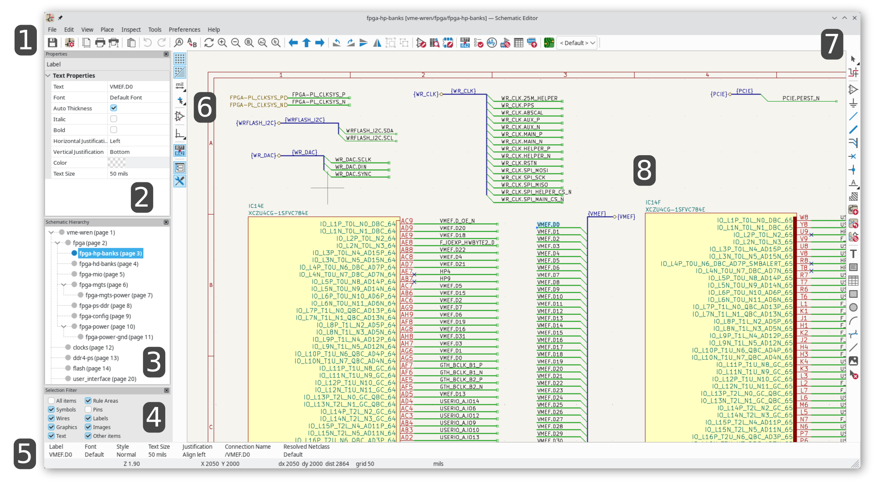
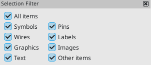
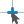

:experimental:

== Introduction to the KiCad Schematic Editor

The KiCad Schematic Editor is a schematic capture application distributed as a
part of KiCad and available for the following operating systems:

* Linux
* Apple macOS
* Windows

Regardless of the OS, all KiCad files are 100% compatible from one OS to
another.

The Schematic Editor is an integrated application where all functions of 
schematic drawing, PCB footprint selection, library management, and data
transfer to and from the PCB design software are carried out within the editor
itself.

The KiCad Schematic Editor is intended to communicate directly with the KiCad
PCB Editor for designing printed circuit boards without using any intermediate
files. It can also export netlist files, which list all the electrical
connections, for other packages.

The Schematic Editor includes a symbol library editor, which can create and
edit symbols and manage libraries.
It also integrates the following additional but essential functions needed for
modern schematic capture software:

* Electrical rules check (ERC) for automatic detection of incorrect and missing
  connections
* Circuit simulation using ngspice
* Export of plot files in many formats (Postscript, PDF, HPGL, and SVG)
* Bill of Materials generation (via Python or XSLT scripts, which allow many flexible formats).

The Schematic Editor supports multi-sheet schematics in several ways:

* Flat hierarchies (schematic sheets are not explicitly connected in a master
  diagram).
* Simple hierarchies (each schematic sheet is used only once).
* Complex hierarchies (some schematic sheets are used multiple times).

Hierarchical schematics are described in detail
<<hierarchical-schematics,later in the manual>>.

=== The Schematic Editor User Interface

// note: SVG template for this at kicad-doc/helpers/eeschema_user_interface.svg

The main Schematic Editor user interface is shown above, with some key elements indicated:

1. Top toolbars (file management, zoom tools, editing tools)
2. <<editing-object-properties,Properties panel>>
3. <<navigating-between-sheets,Schematic hierarchy navigator panel>>
4. <<selection,Selection filter panel>>
5. Message panel and status bar
6. <<left-toolbar,Left toolbar (display options)>>
7. <<schematic-editing-operations,Right toolbar (drawing and design tools)>>
8. Editing canvas

=== Navigating the editing canvas

The editing canvas displays the schematic being designed. You can pan and zoom
to different parts of the schematic and open any schematic sheet in the design.

By default, dragging with the middle or right mouse button will pan the canvas
view and scrolling the mouse wheel will zoom the view in or out. You can change
this behavior in the Mouse and Touchpad section of the preferences (see
<<configuration-and-customization,Configuration and Customization>> for
details).

Several other zoom tools are available in the top toolbar:

*  zooms in on the center of the
  viewport.

*  zooms out from the center of
  the viewport.

*  zooms to fit the
  frame around the drawing sheet.

*  zooms to
  fit every item in the schematic (not including the drawing sheet). For
  instance, if there are items placed outside of the drawing sheet, they will be
  visible after zooming to objects.

*  allows you to
  draw a box to determine the zoomed area.

The cursor's current position is displayed at the bottom of the window (X and
Y), along with the current zoom factor (Z), the cursor's relative position (dx,
dy, and dist), the grid setting, and the display units.

The relative coordinates can be reset to zero by pressing kbd:[Space]. This is
useful for measuring distance between two points or aligning objects.

=== Hotkeys

The kbd:[Ctrl+F1] shortcut displays the current hotkey list. The default hotkey
list is included in the <<eeschema-actions-reference,Actions Reference>> section
of the manual.

The hotkeys described in this manual use the key labels that appear on a
standard PC keyboard. On an Apple keyboard layout, use the kbd:[Cmd] key in
place of kbd:[Ctrl], and the kbd:[Option] key in place of kbd:[Alt].

Many actions do not have hotkeys assigned by default, but hotkeys can be
assigned or redefined using the hotkey editor (**Preferences** ->
**Preferences...** -> **<<preferences-controls,Hotkeys>>**).

NOTE: Many of the actions available through hotkeys are also available in
context menus. To access the context menu, right-click in the editing canvas.
Different actions will be available depending on what is selected or what tool
is active.

Hotkeys are stored in the file `user.hotkeys` in KiCad's configuration
directory. The location is platform-specific:

* Windows: `%APPDATA%\kicad\10.0\user.hotkeys`
* Linux: `~/.config/kicad/10.0/user.hotkeys`
* macOS: `~/Library/Preferences/kicad/10.0/user.hotkeys`

KiCad can import hotkey settings from a `user.hotkeys` file using the **Import
Hotkeys** button in the hotkey editor.

[[selection]]
=== Selection and the selection filter

Selecting items in the editing canvas is done with the left mouse button.
When no tool is active, single-clicking on an object will select it.
Pressing kbd:[Esc] will always cancel the current tool or operation and return to the selection tool.
Pressing kbd:[Esc] while the selection tool is active will clear the current selection.

You can also select items using a rectangle or lasso selection.
These tools can be useful for selecting many items at once.
You can switch between rectangular and lasso selection modes using the  /  palette in the right toolbar.

NOTE: To switch between multiple tools in a palette,
      show the palette by clicking and holding the left mouse button on the tool icon
      or by clicking and dragging the mouse from the tool icon.
      Release the mouse button on the desired tool to choose it.

With the rectangular selection mode active (),
clicking and dragging will perform a rectangular selection.
A rectangular selection from left to right will only select items that are fully inside the box.
A rectangular selection from right to left will select any items that touch the box.
A left-to-right selection box is drawn in yellow, with a cursor that indicates exclusive selection,
and a right-to-left selection box is drawn in blue with a cursor that indicates inclusive selection.

With the lasso selection mode active (),
clicking and dragging will begin a lasso selection.
Any items in the existing selection are deselected.
Dragging with the left mouse button held draws a freeform shape.
Releasing the button stops drawing the freeform shape and starts drawing a straight line.
Clicking again completes the straight line.
Any number of freeform or straight segments can be drawn by repeatedly clicking or dragging.
Double click to finish drawing the lasso.
Similar to a rectangular selection,
a lasso drawn in a clockwise direction will only select items that are fully inside the lasso.
A lasso drawn in a counter-clockwise direction will select any items that touch the lasso.
A clockwise lasso is drawn in yellow, with a cursor that indicates exclusive selection,
and a counter-clockwise lasso is drawn in blue with a cursor that indicates inclusive selection.

The selection action can be modified by holding modifier keys while clicking or dragging.
Modifiers cannot be used with lasso selections.

The following modifier keys apply when clicking to select single items:

[options="header",cols="20%,20%,20%,40%",]
|====
| Modifier Keys (Windows) | Modifier Keys (Linux)   | Modifier Keys (macOS)
  | Selection Effect
| kbd:[Ctrl]              | kbd:[Ctrl]              | kbd:[Cmd]
  | Toggle selection.
| kbd:[Shift]             | kbd:[Shift]             | kbd:[Shift]
  | Add the item to the existing selection.
| kbd:[Ctrl + Shift]      | kbd:[Ctrl + Shift]      | kbd:[Cmd + Shift]
  | Remove the item from the existing selection.
| long click              | long click or kbd:[Alt] | long click or kbd:[Option]
  | Clarify selection from a pop-up menu.
|====

The following modifier keys apply when dragging to perform a rectangular selection:

[options="header",cols="20%,20%,20%,40%",]
|====
| Modifier Keys (Windows)   | Modifier Keys (Linux)     | Modifier Keys (macOS)
  | Selection Effect
| kbd:[Ctrl] | kbd:[Ctrl] | kbd:[Cmd]
  | Toggle selection.
| kbd:[Shift] | kbd:[Shift] | kbd:[Shift]
  | Add item(s) to the existing selection.
| kbd:[Ctrl + Shift]        | kbd:[Ctrl + Shift]        | kbd:[Cmd + Shift]
  | Remove item(s) from the existing selection.
|====

The selection filter panel in the lower left corner of the Schematic Editor window controls which types of
objects can be selected with the mouse.  Turning off selection of unwanted object types makes it
easier to select items in a busy schematic.

The **All items** checkbox is a shortcut to turn the other
items on and off.  You can right-click any object type in the
selection filter to quickly change the filter to only allow selecting that type of object.

If you repeatedly try to select an object whose type is disabled in the selection filter,
the selection filter will visually flash the checkbox for that object type as a reminder that
selecting that object type is disabled.

Selecting an object displays information about the object in the message panel
at the bottom of the window. Double-clicking an object opens a window to edit
the object's properties.

[[left-toolbar]]
=== Left toolbar display controls

The left toolbar provides options to change the display of items in the
Schematic Editor.

Some toolbar buttons have more than one item available in a palette.
These buttons are indicated with a small arrow in the lower-right corner of the button:

To show the palette, you can click and hold the mouse button on the button or click and drag the mouse.
The palette will show the selected item when it is closed.

The default contents of the left toolbar are shown below.

NOTE: You can edit the toolbar's contents in the **Toolbar** page of the Schematic Editor Preferences.

[width="100%",cols="5%,95%",]
|=======================================================================

| 
    | Turns grid display on/off.

    *Note:* by default, hiding the grid does not disable <<snapping,grid snapping>>.
    This behavior can be changed in the Display Options section of Preferences.

| 
    | Turns item-specific <<snapping,grid overrides>> on/off.

| 

  

  
    | Display/entry of coordinates and dimensions in inches, mils, or millimeters.
      Clicking the button toggles to the next unit, or you can choose a unit directly by expanding the palette (click and hold/drag).

| 

  

  
    | Switches the cursor crosshair between small, fullscreen, and 45-degree-rotated fullscreen.
      Clicking the button toggles to the next crosshair type, or you can choose a crosshair directly by expanding the palette (click and hold/drag).

| 
    | Turns invisible pin display on/off.

| 

  

  

    | Switches the line mode between free angle, 90 degree mode, and 45 degree mode for
      placement of new wires, buses, and graphical shapes.
      Clicking the button toggles to the next line mode, or you can choose a line mode directly by expanding the palette (click and hold/drag).
      You can also toggle between line modes using kbd:[Shift+Space].

| 
    | Turns automatic <<reference-designators-and-symbol-annotation,symbol annotation>> on/off.
      When on, symbols will have their reference designators automatically set to the lowest
      available reference when they are added to the schematic.

| 
    | Opens and closes the docked <<navigating-between-sheets,Hierarchy Navigator>> panel.

| 
    | Opens and closes the docked <<editing-object-properties,Properties Manager>> panel.

|=======================================================================
