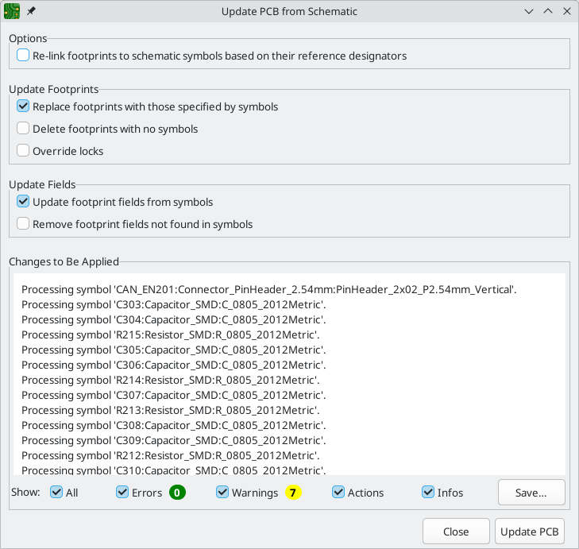
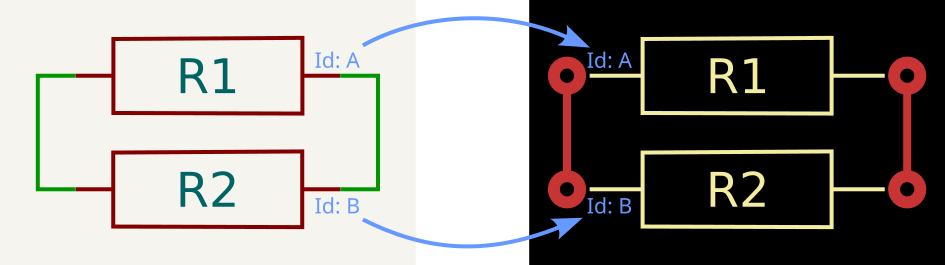
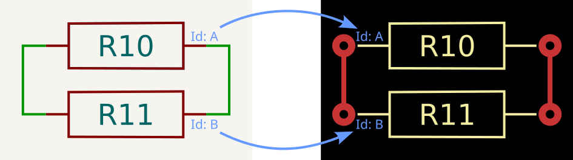
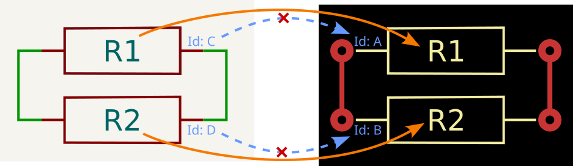
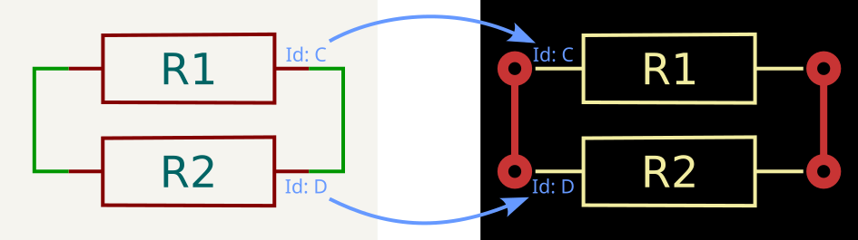
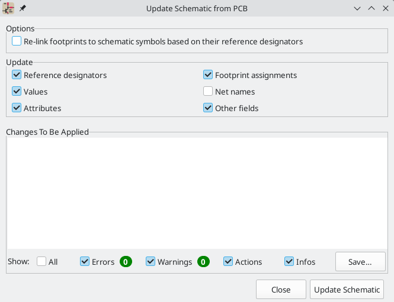

:experimental:

[[schematic-to-pcb]]
== Forward and back annotation

[[update-pcb-from-schematic]]
=== Update PCB from Schematic (forward annotation)

Use the Update PCB from Schematic tool to sync design information from the
Schematic Editor to the Board Editor. The tool can be accessed with **Tools** ->
**Update PCB from Schematic** (kbd:[F8]) in both the schematic and board
editors. You can also use the

icon in the top toolbar of the Board Editor. This process is often called
forward annotation.

NOTE: Update PCB from Schematic is the preferred way to transfer design
information from the schematic to the PCB. In older versions of KiCad, the
equivalent process was to export a netlist from the Schematic Editor and import
it into the Board Editor. It is no longer necessary to use a netlist file.

The tool adds the footprint for each symbol to the board and transfers updated
schematic information to the board. In particular, the board's net connections
are updated to match the schematic. Symbols with the
<<editing-symbol-properties,**Exclude from board** attribute>> are not
transferred to the PCB.

The changes that will be made to the PCB are listed in the _Changes To Be
Applied_ pane. The PCB is not modified until you click the **Update PCB**
button.

You can show or hide different types of messages using the checkboxes at the
bottom of the window. A report of the changes can be saved to a file using the
**Save...** button.

==== Options

The tool has several options to control its behavior.

[cols="1,2"]
|===
| Option | Description

| Re-link footprints to schematic symbols based on their reference designators
| Footprints are normally linked to schematic symbols via a unique identifier
created when the symbol is added to the schematic. A symbol's unique identifier
cannot be changed, but will be lost when the symbol is deleted, even if a symbol
with the same reference designator replaces it.

If checked, each footprint in the PCB will be re-linked such that each footprint
has its unique identifier updated to match the symbol that has the same
reference designator as the footprint.

This option should generally be left unchecked. See <<re-linking,below>> for more
details on when to use this option.

| Group footprints based on symbol group
| If checked, footprints will be added to groups in the PCB if their linked symbols are <<groups,grouped>>.

| Replace footprints with those specified by symbols
| If checked, footprints in the PCB will be replaced with the footprint that is
specified in the corresponding schematic symbol.

If unchecked, footprints that are already in the PCB will not be changed, even
if the schematic symbol is updated to specify a different footprint.

| Delete footprints with no symbols
| If checked, any footprint in the PCB without a corresponding symbol in the
schematic will be deleted from the PCB. Footprints with the "Not in schematic"
attribute will be unaffected.

If unchecked, footprints without a corresponding symbol will not be deleted.

| Override locks
| If checked, locking a footprint will not affect whether a footprint is deleted
or replaced based on changes in the schematic.

If unchecked, locked footprints will never be deleted or replaced even if they
otherwise would be.

| Update footprint fields from symbols
| If checked, new and updated fields in symbols will be transferred to the
corresponding footprints, keeping symbol and footprint fields in sync.

If unchecked, footprint fields will not be updated when fields change in the
corresponding symbols.

| Remove footprint fields not found in symbols
| If checked, footprint fields will be removed if they do not exist in the corresponding symbol.

If unchecked, footprint fields that do not exist in the corresponding symbol
will not be removed, allowing footprints to have additional fields compared to
the corresponding symbols.

|===

[[re-linking]]
==== Re-linking symbols and footprints

Symbols and footprints are linked together using unique identifiers (also
called UUIDs). These are handled automatically within KiCad and are not usually
visible to users. They allow a symbol and its partner footprint to keep their
connection between schematic and PCB, even if the reference designator is
changed. New objects get assigned their identifiers upon creation.

===== Re-linking by unique identifier (default)

In normal use, the **Re-link footprints to schematic symbols based on their
reference designators** option should be unchecked. In this mode, symbols with
the same identifier as a footprint will update that footprint, regardless of the
reference designator. Symbols which have an identifier that doesn't match any
footprint will add a new footprint linked to that identifier.

For example, in the below schematic, both `R1` and `R2` are linked via their
unique IDs to footprints on the PCB:

If symbol reference designators are changed in the schematic (e.g. by
re-annotation), running the **Update PCB from Schematic** process will update
the reference designators on the PCB.

===== Re-linking by reference designator

If the checkbox is checked, the linking process is done using the reference
designators. This can be useful for workflows that result in a symbol being
deleted and replaced by another one, rather than being updated in-place. For
example, cut-and-pasting a block of schematic or a sheet and copy-pasting and
re-annotating will usually break the identifier-based links.

For example in the below case, the resistors `R1` and `R2` have been
deleted and replaced, then re-annotated. While the reference designators are
the same, the internal identifiers have changed. Updating the PCB by identifier
would cause the existing footprints to be deleted and new ones added - to KiCad,
the existing footprints have no matching symbol. This would cause the footprints
to lose their positions and need placing again.

Re-linking the footprints by reference designator causes KiCad to re-create
the links, using the matching reference designators as a guide.

Because the links have been re-established, the next forward annotation should
use the normal identifier-based linking (i.e. the checkbox should be unchecked).

[[backannotation]]
=== Update Schematic from PCB (back annotation)

The typical workflow in KiCad is to make changes in the schematic and then sync
the changes to the board using the Update PCB From Schematic tool. However, the
reverse process is also possible: design changes can be made in the board and
then synced back to the schematic using **Tools** -> **Update Schematic From
PCB** in either the schematic or board editors. This process is also known as
backannotation.

The tool syncs changes in reference designators, values, attributes (like DNP or
Exclude From BOM), footprint assignments, other fields, and net names from the
board to the schematic. Each type of change can be individually enabled or
disabled.

The changes that will be made to the schematic are listed in the _Changes To Be
Applied_ pane. The schematic is not modified until you click the **Update
Schematic** button.

You can show or hide different types of messages using the checkboxes at the
bottom of the window. A report of the changes can be saved to a file using the
**Save...** button.

==== Options

The tool has several options to control its behavior.

[cols="1,2"]
|===
| Option | Description
| Re-link footprints to schematic symbols based on their reference designators
| If checked, each footprint in the PCB will be re-linked to the symbol that has
the same reference designator as the footprint. This option is incompatible with
updating symbol reference designators.

If unchecked, footprints and symbols will be linked by unique identifier as
usual, rather than by reference designator.

| Reference designators
| If checked, symbol reference designators will be updated to match the
reference designators of the linked footprints.

If unchecked, symbol reference designators will not be updated.

| Values
| If checked, symbol values will be updated to match the values of the linked
footprints.

If unchecked, symbol values will not be updated.

| Attributes
| If checked, symbol attributes (like exclude from BOM and DNP) will be updated
to match the corresponding attributes of the linked footprints.

If unchecked, symbol attributes will not be updated.

| Footprint assignments
| If checked, footprint assignments will be updated for symbols which have had
their footprints changed or replaced in the board.

If unchecked, symbol footprint assignments will not be updated.

| Net names
| If checked, the schematic will be updated with any net name changes that have
been made in the board. Net labels will be updated or added to the schematic as
necessary to match the board.

If unchecked, net names will not be updated in the schematic.

| Other fields
| If checked, other symbol fields will be updated to match the corresponding
fields of the linked footprints. Reference designator, value, and footprint are
each controlled by their own separate option.

If unchecked, other fields will not be updated in the schematic.
|===

NOTE: The xref:../pcbnew/pcbnew.adoc#geographical-re-annotation[Geographical Reannotation]
      feature can be used in combination with backannotating reference
      designators to reannotate all components in the design based on their
      location in the layout.

==== Back annotation with CMP files

Select changes can also be synced from the PCB back to the schematic by
exporting a CMP file from the PCB editor (**File** -> **Export** -> **Footprint
Association (.cmp) File...**) and importing it in the Schematic Editor (**File**
-> **Import** -> **Footprint Assignments...**).

NOTE: This method can only sync changes made to footprint assignments and
footprint fields. It is recommended to use the Update Schematic from PCB tool
instead.
