:experimental:
[[simulator]]
== Simulator ==

KiCad provides an embedded electrical circuit simulator using
http://ngspice.sourceforge.net[ngspice] as the simulation engine. ngspice is a
SPICE simulator derived from the original widely used Berkeley SPICE program.
KiCad's simulator can also run simulations using IBIS models of device pins.

The process of creating and running a simulation in KiCad has two main parts:

1. Drawing a simulation schematic in KiCad's Schematic Editor. Schematics for
   simulations are similar to normal schematics (and can even be identical), but
   they typically include simulation-specific devices, such as sources, and may
   exclude devices that are irrelevant for simulation, such as connectors.
   Creating a schematic simulation requires ensuring all symbols in the
   schematic have appropriate models assigned. Finding or creating simulation
   models, and then validating them, can be a significant portion of the
   process. KiCad includes some simple simulation models for basic devices such
   as sources, passive devices, and generic semiconductor devices, but beyond
   those you will need to find or create your own models.
2. Running the simulation using the simulator tool. This includes choosing the
   type of analysis (transient, AC, etc.) and configuring its options. Multiple
   different analyses can be performed. The simulator provides a plot window to
   view and analyze simulation results.

When drawing schematics for simulation, the `Simulation_SPICE` symbol library,
installed with KiCad by default, may be useful. It contains common elements used
for simulation such as voltage and current sources, generic semiconductor
symbols, and other simulation-specific devices. The symbols in this library are
described in detail <<sim-default-library-symbols,below>>.

While these elements enable a great variety of simulation work, users familiar with SPICE in other environments will be used to incorporating models of commercially-available semiconductors, integrated circuits, and other devices as more complex SPICE models. Indeed, semiconductor manufacturers often freely supply these to help users simulate and develop circuits using their parts. Note that while KiCad does not include any commercial SPICE models in its distribution, you are free to use any models you may have, or have used with other circuit simulators, in KiCad's simulator.

In general, if a model works with other SPICE simulators, it should work with the KiCad simulator, although some SPICE simulators implement extensions that are unsupported by ngspice. ngspice offers several compatibility modes to improve compatibility with other simulators.

Finally, to quickly showcase the capabilities of the KiCad simulator, some demonstration projects are included in the KiCad distribution. They can be found in the `demos/simulation` directory.

[[simulation-model-editor]]
=== Assigning models

You need to assign simulation models to symbols before you can simulate your
circuit.

Each symbol can have only one model assigned, even if the symbol consists of
multiple units. For symbols with multiple units, you should assign the model to
the first unit.

SPICE model information is stored as text in symbol fields. Therefore you may
define it in either the symbol editor or the schematic editor. To assign a
simulation model to a symbol, open the Symbol Properties dialog and click the
**Simulation Model...** button, which opens the Simulation Model Editor dialog.

You can exclude a symbol from simulation entirely by checking the
**exclude from simulation** checkbox in the Symbol Properties dialog. Symbols
with this attribute set are drawn with a grey outline and a small simulation
icon next to them, as shown below.

[[sim-inferred]]
==== Inferred models

Resistor, inductor, and capacitor models can be inferred, which means that KiCad
will detect that they are passives and automatically assign an appropriate
simulation model. Therefore they do not require any special settings; users only
need to set the `Value` field of the symbol.

KiCad infers simulation models for symbols based on the following criteria:

* The symbol has exactly two pins,
* The reference designator begins with `R`, `L` or `C`.

Inferred models are ideal models. If the simulation requires a non-ideal model, for example an inductor with parasitic capacitance included, you must explicitly assign a model that includes it.

[[sim-built-in]]
==== Built-in models
KiCad offers several standard simulation models. They do not require an
external model file, and their parameters can be edited in KiCad's Simulation
Model Editor GUI. The following devices are available:

* Resistors (including potentiometers)
* Capacitors
* Inductors
* Transmission lines
* Switches
* Voltage and current sources
* Diodes
* Transistors (BJTs, MOSFETs, MESFETs, and JFETs)
* XSPICE code models
* Raw SPICE elements

To add a built-in model to a symbol, open the Simulation Model Editor dialog
(**Symbol Properties** -> **Simulation Model...**) and select
**Built-in SPICE model**. You can then select the kind of device from the
**device** dropdown and the device subtype from the **device type**
dropdown.

Refer to the https://ngspice.sourceforge.io/docs.html[ngspice documentation] for
more details about these models and their parameters.

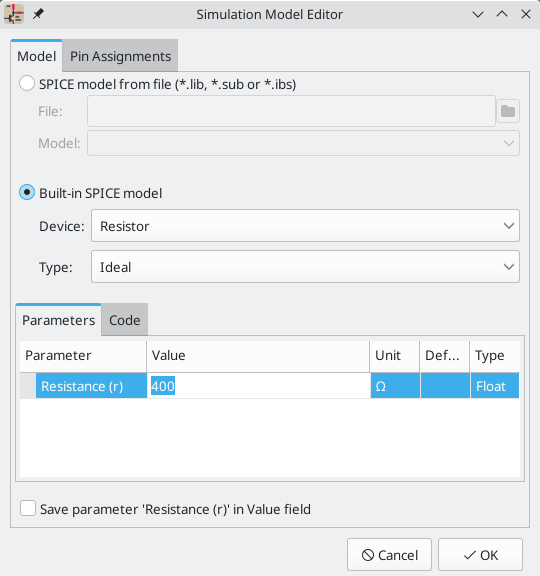

**Device** sets the type of device to simulate: a resistor, BJT, voltage source,
etc. This value is stored in the symbol's `Sim.Device` field.

**Device type** selects the type of model to use for the device. Most devices
have several types of models to choose from. Models may vary in their degree of
accuracy, which characteristics they are optimized for, what parameters they
have available, and how many pins they have. For example, the **ideal**
resistor type models a simple resistor with two terminals and a single
`resistance` parameter, while the **potentiometer** resistor type models an
adjustable resistor with three terminals and an additional parameter for wiper
position. Some devices have an especially large number of types to choose from:
N-channel MOSFETs, for example, have 17 available types, each of which uses a
different mathematical model to simulate the transistor behavior. One model may
be more or less appropriate than another for simulating a specific device or
circuit or for performing a particular analysis. Refer to the
https://ngspice.sourceforge.io/docs.html[ngspice documentation] for detailed
information about models and their parameters. The **device type** value is
stored in the symbol's `Sim.Type` field.

The **parameters** tab displays the parameters of the model and lets you edit
them. For example, a resistor's resistance, a voltage source's waveform, a
MOSFET's width and length, etc. Any parameters that differ from the model's
defaults are stored in the symbol's `Sim.Params` field.

The **code** tab displays the generated SPICE model as it will be written to the
SPICE netlist for simulation.

The **Save parameter '<parameter name>' in Value field** checkbox uses the
symbol's `Value` field for storing parameters instead of the `Sim.Params` field.
This may make it easier to edit simple models from the schematic, without
opening the Simulation Model Editor. This option is only available for ideal
passive models (R, L, C) and DC sources. If the field `Sim.Params` exists in the
symbol, it will take priority over the `Value` field.

[[sim-library]]
==== External models

KiCad can also load SPICE models from external files. This is typically how you
will add a SPICE model of a specific commercially-available part (for example, a
555 timer or a TL071 operational amplifier) to your simulation. Models such as
these are readily available from numerous sources, including manufacturers' web
sites. These models must be in a standard SPICE format and must not be
encrypted.

An external model can be one of the following types:

- A device model (`.model`). This is an intrinsic device (a passive, diode,
  transistor, etc.) with a set of parameter values defining its behavior. The parameters for a device model are editable in the Simulation Model Editor GUI.
- A subcircuit model (`.subckt`). This is a model that uses a collection of
  other ngspice circuit elements to define its behavior. If a subcircuit model
  contains parameters (in a `params:` sequence in its definition), the
  parameters are editable in the Simulation Model Editor GUI.
  
To load a model from an external file, open the Simulation Model Editor dialog
(**Symbol Properties** -> **Simulation Model...**) and select
**SPICE model from file**.

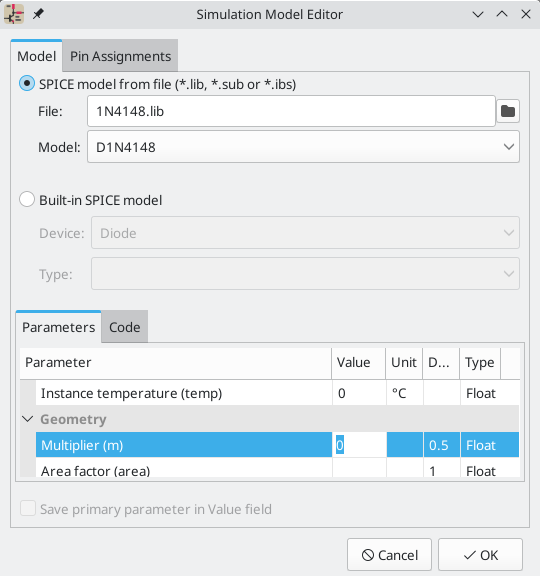

**File** is the path to the model file to use. Unencrypted model files are plain, human-readable text files and often have extensions such as `.lib`, `.sub` etc., although KiCad will accept a valid model with any extension.

The path to the file can be absolute, or relative to the project folder. The path can also be relative to the value of `SPICE_LIB_DIR` if you have
xref:../kicad/kicad.adoc#kicad-environment-variables[defined that path variable].
If you enable the **Embed File** checkbox in the file browser, the library file will be <<sch-embedding-files,embedded>> in the schematic (or symbol library). This makes the schematic (or schematic) more portable as it doesn't rely on an external library file.
The library filename is saved in the symbol's `Sim.Library` field.

**Model** is the name of the desired model in the model file. A model file may contain multiple models, and if so they will all be shown in the list. You can filter the list of models using the search box. The selected model is listed in the symbol's `Sim.Name` field.

Parameters can be overridden (or additional parameters specified) using the
**Parameters** tab. For device models, all parameters for that type of device
are editable. For subcircuit models, any parameters included in the subcircuit
definition are editable. Any parameters that are overridden in the
**Parameters** tab are stored in the symbol's `Sim.Params` field.

The **Code** tab displays the generated SPICE model as it will be written to the
SPICE netlist for simulation.

[NOTE]
KiCad is not distributed with SPICE models for specific commercial devices. These models are usually available from device manufacturers or other internet sources.

[[ibis-library]]
==== IBIS models

IBIS (I/O Buffer Information Specification) files are an alternative to SPICE
models for modeling the behavior of input/output buffers on digital parts. In
order to load an IBIS file, users should follow the procedure for SPICE library
models, but provide a `.ibs` file.

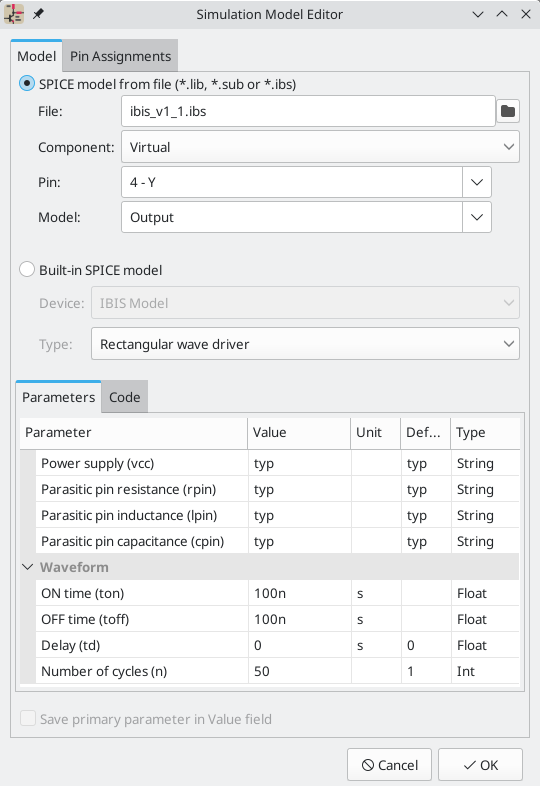

**File** is the path to the model file to use. The path can be absolute or
relative to the project folder. The path can also be relative to the value of
`SPICE_LIB_DIR` if you have
xref:../kicad/kicad.adoc#kicad-environment-variables[defined that path variable].
The library filename is saved in the symbol's `Sim.Library` field. If an IBIS
model file is loaded, the remaining fields in the dialog will relate to the IBIS
model.

**Component** selects which component from the IBIS file to use, as IBIS files
can contain multiple components. The component name is saved in the symbol's
`Sim.Name` field.

// TODO, mention "differential" checkbox
**Pin** selects which pin in the IBIS model to simulate. The selected pin must
be mapped to a symbol pin in the **Pin Assignments** tab. The chosen pin's
number is saved in the symbol's `Sim.Ibis.Pin` field.

**Model** is the list of models available for the selected pin, for example an
input or an output. The chosen model name is saved in the symbol's
`Sim.Ibis.Model` field.

**Type** selects what the pin should do in the simulation. A pin can be a passive
**device** that doesn't drive any value; it can be a **DC driver** that drives
high, low, or high-impedance; or it can be a **rectangular wave** or
**PRBS driver**.  This value is stored in the symbol's `Sim.Type` field.

The **Parameters** tab lets you see and edit the parameters of the model. For
each parameter, you can switch between a minimum, typical, or maximum value, as
defined in the IBIS file. You can also choose the parameters of the driven
waveform, depending on the pin's chosen **type**. Any parameters that differ
from the defaults are stored in the symbol's `Sim.Params` field.

[NOTE]
KiCad does not ship with IBIS models for symbols. IBIS models are usually
available from device manufacturers.

[NOTE]
KiCad's `Simulation_SPICE` symbol library provides several symbols that may be
useful for IBIS simulations. `IBIS_DEVICE` can be used for device (input) pins,
while `IBIS_DRIVER` can be used for simulating driver pins. There are also
variants of each for differential pins.

[[simulation-pin-assignment]]
==== Pin Assignment

Simulation models may have their pins numbered differently than the
corresponding symbol. For example, SPICE models for diodes usually consider
pin 1 to be the anode, while schematic symbols are usually drawn with pin 1 as
the cathode. Operational amplifier models are also very likely to have model pin assignments that do not match package or schematic pin numbers.

You can use the Simulation Model Editor's **Pin Assignments** tab to map the
symbol's pins to the simulation model pins.

NOTE: Always make sure symbol pins are correctly mapped to simulation model
      pins. Mistakes here can lead to erroneous or confusing simulation results, or a failure to simulate at all.

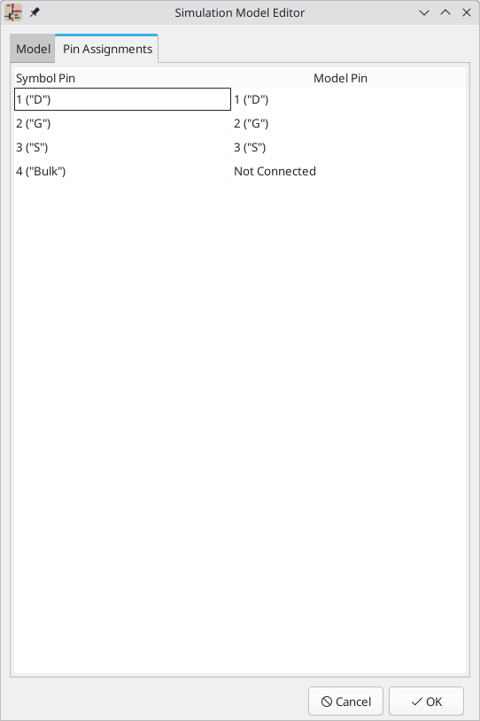

The left column displays the name and number of each symbol pin, i.e. the pin numbers and names that appear on the schematic part in KiCad. The right column displays the corresponding pin as defined in the model file in use. For each symbol pin, you can select the corresponding pin from the simulation model in the dropdown in the right column. In the cases where a schematic part has pins that are not in the model, as in the case of an operational amplifier with 'nulling' pins that are not modeled, the schematic part pin may be assigned to the 'Not Connected' option in the Pin Assignments dropdown. Unlike other pin assignments, 'Not Connected' may be assigned to multiple pins if necessary.

When you use a subcircuit model, the dialog displays the model's code under the
pin assignments for use as a reference while assigning pins. A well-written model will often include a helpful reference section (as a set of comments) to inform the user how the model pins are mapped.

=== Value notation

The simulator supports several notations for writing numerical values in
simulation model parameters, simulation analysis setup options, and SPICE
directives:

* Plain notation : `10100`, `0.003`,
* Scientific notation: `1.01e4`, `3e-3`,
* Prefix notation: `10.1k`, `3m`.
* RKM notation: `4k7`, `10R`.

You can mix prefix and scientific notations. As such, `3e-4k` is a
valid input and is equivalent to `0.3`. The list of valid prefixes is shown
below. They are case sensitive.

[width="50%",cols="1,1,1",]
|====
| Prefix | Name | Multiplier

| a | atto | 10^-18^
| f | femto | 10^-15^
| p | pico | 10^-12^
| n | nano | 10^-9^
| u | micro | 10^-6^
| m | milli | 10^-3^
| k | kilo | 10^3^
| M | mega | 10^6^
| G | giga | 10^9^
| T | tera | 10^12^
| P | peta | 10^15^
| E | exa | 10^15^
|====

[NOTE]
<<sim-builtin,Raw SPICE Element>> models and <<sim-directives,directives>> are
passed to ngspice directly, without KiCad reformatting the values for ngspice to
consume. ngspice uses a different, case-insensitive notation: 1 mega (10^6^) is
denoted there as `1Meg`, while `1M` is 1 milli (10^-3^). Depending on the
compatibility mode selected, ngspice may not support the same value notations as
KiCad, so care should be taken when using raw SPICE elements and simulation
directives.

[[sim-directives]]
=== SPICE directives

It is possible to add SPICE directives by placing them in text fields on a
schematic sheet. This approach is convenient for defining the default
simulation type. The list of supported directives in text fields is:

* Directives starting with a dot (e.g. `.tran 10n 1m`)
* Coupling coefficients for inductors (e.g. `K1 L1 L2 0.89`)

It is not possible to place additional components using text fields.

If a simulation command is included in schematic text, the simulator will use it as the simulation command when you open the simulator.
However, you can override it by choosing a different simulation type in the Simulation Command dialog.
You can also specify simulation commands with raw SPICE commands by using the <<sim-custom,Custom analysis type>>.

Refer to the https://ngspice.sourceforge.io/docs.html[ngspice documentation] for
more details about SPICE directives.

=== Running simulations

Circuits for simulation are drawn in the Schematic Editor, but simulations are run in the Simulator window.

After creating a schematic for simulation, the following steps are needed to run
a simulation:

1. Open the simulator window by clicking **Inspect** -> **Simulator** in the
   Schematic Editor or using the
    button in the top toolbar.
2. Create at least one analysis by clicking **Simulation** ->
   **New Analysis Tab...** (kbd:[Ctrl+N]) or using the
    button. This lets you choose a type
   of simulation and configure its options. These options are explained
   <<simulation-types,below>>. Each analysis has its own tab, and multiple
   analyses can be created. The options for an analysis can be adjusted after
   it is created with **Simulation** -> **Edit Analysis Tab...** or by clicking
   on the  button.
3. Run the simulation by clicking **Simulation** -> **Run Simulation** (kbd:[R])
   or by clicking the  button. This only runs
   the simulation in the active analysis tab. You can stop a running simulation
   at its current point by clicking the 
   button.
4. Examine the <<sim-results,simulation results>>. Most analyses result in
   plots; for these you will need to select the signals to be plotted. Other
   analyses print their results in the output log window.

NOTE: Once a simulation has been set up, the configuration can be saved in a
      <<sim-workbooks,workbook>>.

==== Simulator window

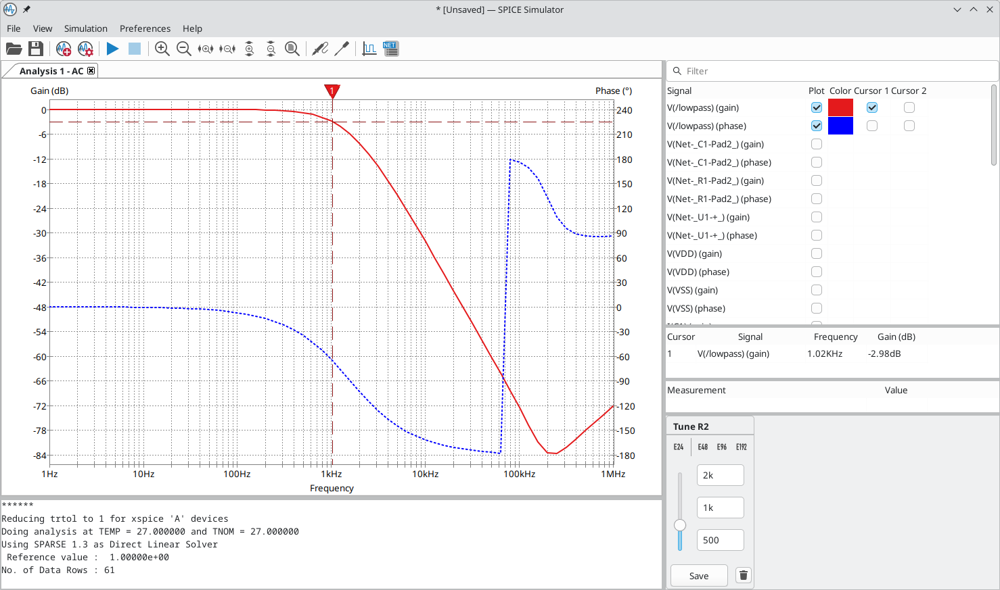

The simulator window is divided into several sections:

* The top of the window has a toolbar with buttons for commonly used actions.

* The main part of the window graphically shows the simulation results. The
  simulation needs to run and signals need to be selected from the list of
  available signals or probed before they are displayed in the plot.

* Below the plot panel, the output log window shows logs from the ngspice simulation
  engine. Some types of analyses print their results here.

* The right side of the window displays a list of signals, a list of active
  cursors, measurements, and a tuning tool for adjusting component values based
  on simulation results.

[[simulation-types]]
==== Simulation types

Each simulation is a specific type of analysis. The following analysis types are
available:

* <<sim-op,**OP** -- DC Operating Point>>
* <<sim-dc,**DC** -- DC Sweep Analysis>>
* <<sim-ac,**AC** -- AC Small-signal Analysis>>
* <<sim-tran,**TRAN** -- Transient Analysis>>
* <<sim-pz,**PZ** -- Pole-zero Analysis>>
* <<sim-noise,**NOISE** -- Noise Analysis>>
* <<sim-sp,**SP** -- S-parameter Analysis>>
* <<sim-fft,**FFT** -- Frequency-content Analysis>>
* <<sim-custom,**Custom** -- Custom SPICE Analysis (raw SPICE command)>>

Each analysis type and its options are explained below. You can configure an
analysis when you create it ( button) or
by editing an existing analysis (
button). These analysis types are explained in more detail in the
https://ngspice.sourceforge.io/docs.html[ngspice documentation].

NOTE: Another way to configure a simulation is to type
      <<sim-directives,SPICE directives>> into text fields on schematics. Any
      text field directives related to a simulation command are overridden by
      the settings selected in the dialog. This means that once a simulation has
      run, the dialog overrides the schematic directives until the simulator is
      reopened.

[[sim-op]]
===== Operating point analysis (OP)

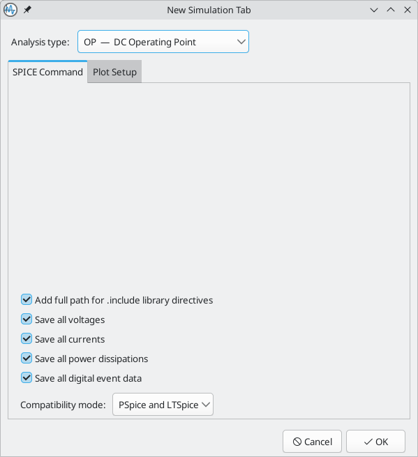

Calculates the DC operating point of the circuit. This analysis has no options.

Operating point analyses do not have any plotted results. Results are printed in
the output log window. You can also display the node voltages and device
currents calculated by this analysis as
<<sim-operating-point-annotations,annotations>> in the schematic.

[[sim-dc]]
===== DC sweep analysis (DC)

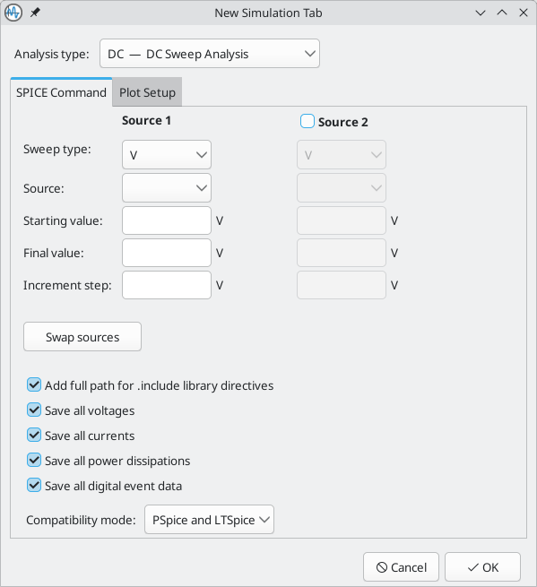

Calculates the DC behavior of the circuit while sweeping one or two parameters.
The following parameters can be swept:

- value of an independent voltage source
- value of an independent current source
- value of a resistor
- simulation temperature

DC analyses have the following options, which are listed here with the
corresponding ngspice parameter name:

* **Sweep type**: the type of variable to sweep. This can be a voltage source, a
  current source, a resistor, or the simulation temperature.
* **Source**: the particular voltage source, current source, or resistor to
  sweep (`srcnam`). The list is populated with each item in the schematic of the
  relevant type. It is disabled for temperature sweeps.
* **Starting value**: the starting value for the sweep (`vstart`).
* **Final value**: the ending value for the sweep (`vstop`).
* **Increment step**: the amount to increase the value at each step of the sweep
  (`vincr`). Smaller increments result in more output points.

If **Source 2** is enabled, the same options are available to simultaneously sweep a second source.
When sweeping two sources, Source 1 is swept over its entire range for each value of Source 2.
In other words, each value for Source 2 results in a separate curve,
and each curve shows a full sweep of Source 1 with Source 2 held constant at a particular value.

Clicking the **Swap sources** buttons swaps Source 1 with Source 2.

The output is displayed as a plot.

TIP: The <<sim-tuning,tuning tool>> is another way to see how component values affect circuit behavior.
     Unlike DC sweeps, the tuning tool can be used with other types of simulations, like transient or AC analyses.

[[sim-ac]]
===== AC small-signal analysis (AC)

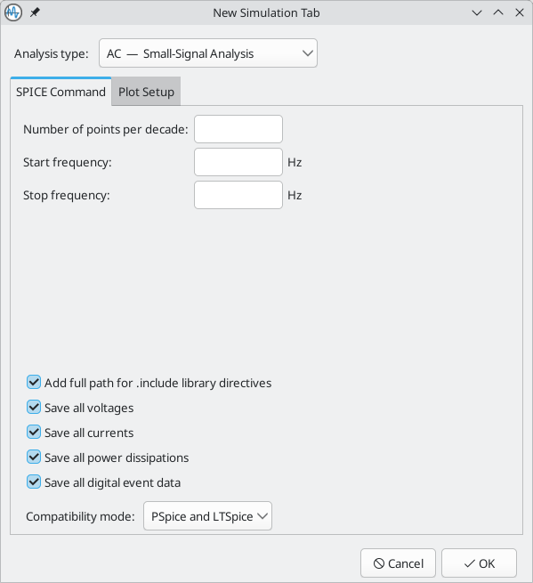

Calculates the small-signal AC behavior of the circuit in response to a
stimulus. Performs a decade sweep of stimulus frequency.

To run an AC analysis you must choose a number of points to measure per decade
and the start and end frequencies for the decade sweep.

AC analyses have the following options, which are listed here with the
corresponding ngspice parameter name:

* **Number of points per decade**: the number of points to calculate per decade
  (`nd`).
* **Start frequency**: the lower bound of the frequency range to analyze
  (`fstart`).
* **Stop frequency**: the upper bound of the frequency range to analyze
  (`fstop`).

The output is displayed as a Bode plot (output magnitude and phase vs. frequency).

[[sim-tran]]
===== Transient analysis (TRAN)

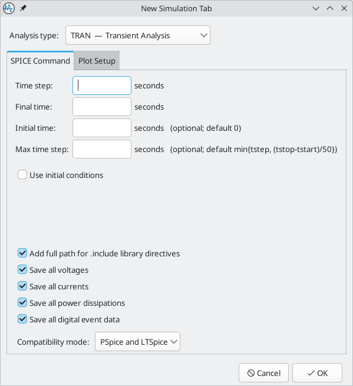

Calculates the time-varying behavior of the circuit.

Transient analyses have the following options, which are listed here with the
corresponding ngspice parameter name:

* **Time step**: a suggested time step (`tstep`).
* **Final time**: the time at which the simulation will end (`tstop`).
* **Initial time**: the time at which the simulation will start (`tstart`). If
  not specified, this defaults to 0.
* **Max time step**: the maximum time step (`tmax`). If not specified, this
  defaults to the suggested time step or the total simulation duration divided
  by 50, whichever is smaller.
* **Use initial conditions**: if enabled, the simulator will not calculate the
  quiescent operating point before starting the transient simulation. Instead,
  the simulation will use the initial conditions specified in a `.ic` directive
  and element `IC` parameters. This corresponds to ngspice's `uic` option.

The output is displayed as a plot.

[[sim-pz]]
===== Pole-zero analysis (PZ)

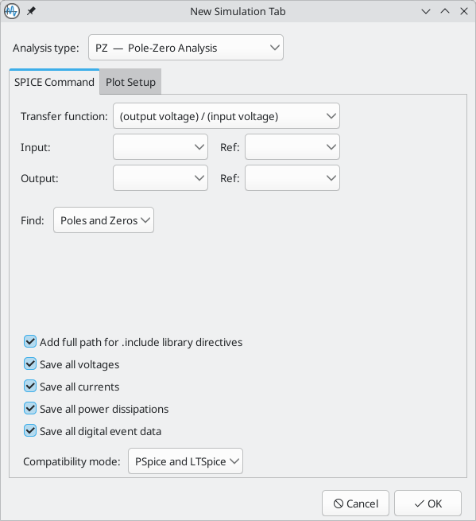

Calculates the poles and zeroes of the small-signal (AC) transfer function of
the circuit.

Pole-zero analyses have the following options, which are listed here with the
corresponding ngspice parameter name:

* **Transfer function**: selects between calculating the transfer function as
  output voltage divided by input voltage or output voltage divided by input
  current. These correspond to ngspice's `vol` and `cur` options, respectively.
* **Input**: the input node (`node1`) and the reference node for the input
  (`node2`).
* **Output**: the output node (`node3`) and the reference node for the output
  (`node4`).
* **Find**: selects between calculating poles and zeroes, only poles, or only
  zeroes. These correspond to ngspice's `pz`, `pol`, and `zer` options,
  respectively.

Operating point analyses do not have any plotted results. Results are printed in
the output log window.

[[sim-noise]]
===== Noise analysis (NOISE)

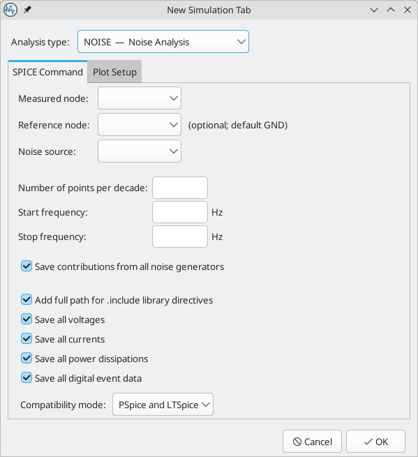

Calculates the noise generated by the devices in the circuit, both as output
noise and input-referred noise. The noise spectrum (V/&radic;Hz or A/&radic;Hz)
of the circuit can be plotted, and the total noise over the specified frequency
range is reported. Optionally, the noise contributions of each device are
reported individually.

Noise analyses have the following options, which are listed here with the
corresponding ngspice parameter name:

* **Measured node**: the node at which output noise is measured (`output`).
* **Reference node**: the reference node for measuring the output noise (`ref`).
  The output noise is calculated as the noise at the measured node minus the
  noise at the reference node. If it is not specified, the default is the ground
  node.
* **Noise source**: a source that is considered the circuit's input for the
  purposes of calculating input-referred noise (`src`). The source must specify
  an AC magnitude, i.e. the source must have an `ac` parameter.
* **Number of points per decade**: the number of points to calculate per decade
  (`pts`).
* **Start frequency**: the lower bound of the frequency range to analyze
  (`fstart`).
* **Stop frequency**: the upper bound of the frequency range to analyze
  (`fstop`).
* **Save contributions from all noise generators**: if enabled, noise magnitudes
  of individual noise generators are saved and reported. If disabled, only the
  overall output and input-referred noise over the specified frequency range are
  reported.

The output and input-referred noise spectra can be plotted. Total noise values
for the specified frequency range are printed in the output log window.

[[sim-sp]]
===== S-parameter analysis (SP)

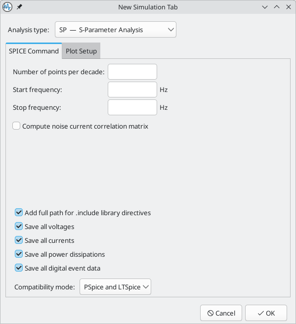

Calculates the scattering parameters, admittance matrix, and impedance matrix
for the circuit. Optionally calculates the noise current correlation matrix.
Note that this analysis requires at least two voltage sources configured as RF
ports as described in the ngspice manual.

S-parameter analyses have the following options, which are listed here with the
corresponding ngspice parameter name:

* **Number of points per decade**: the number of points to calculate per decade
  (`nd`).
* **Start frequency**: the lower bound of the frequency range to analyze
  (`fstart`).
* **Stop frequency**: the upper bound of the frequency range to analyze
  (`fstop`).
* **Compute noise current correlation matrix**: if enabled, the noise current
  correlation matrix is also calculated. This corresponds to ngspice's `donoise`
  option.

The output is displayed as a plot.

[[sim-fft]]
===== Frequency content analysis (FFT)

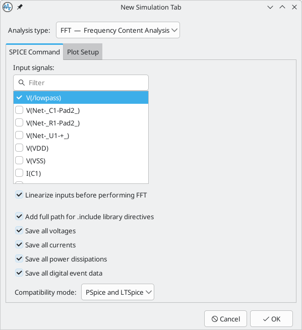

Calculates an FFT based on an existing analysis tab. Any of the signals from an
existing analysis can be used as inputs to the FFT. The signals are windowed
using a Hanning window.

FFT analyses have the following options, which are listed here with the
corresponding ngspice parameter name:

* **Input signals**: the signal(s) to perform an FFT on. An FFT is independently
  applied to each selected signal.
* **Linearize inputs before performing FFT**: When enabled, the input vector is
  converted to have equidistant time points prior to performing the FFT.
  Corresponds to ngspice's `linearize` command.

The output is displayed as a plot.

[[sim-custom]]
===== Custom analysis

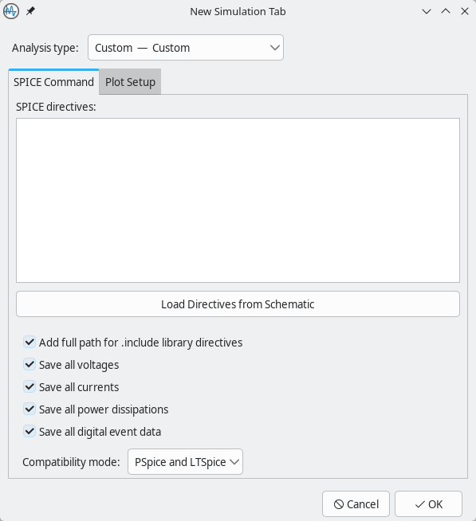

Performs a SPICE analysis defined by raw SPICE analysis commands
(`.tran`, `.ac`, `.dc`, `.noise`, etc.).
For details on such analysis commands and their syntax, refer to the
https://ngspice.sourceforge.io/docs.html[ngspice documentation].

The analysis commands given on each line of the **SPICE directives** textbox are run as separate analyses.
If you click the **Load Directives from Schematic** button,
any <<sim-directives,SPICE directives>> in schematic text are copied into the textbox.

===== Additional simulation settings

There are several simulation options that apply to all types of simulations.
These are located at the bottom of the dialog.

* **Add full path for .include library directives**: if enabled, relative paths
  to SPICE models will be converted to absolute paths in the SPICE netlist.

* **Save all voltages**: if enabled, the simulator will save voltages for each
  node in the simulation results so that they can be plotted. This corresponds
  to ngspice's `.save all` command in the SPICE netlist. If disabled, voltages
  will not be saved in the results, and therefore cannot be plotted, unless a
  SPICE directive is used to manually probe a node voltage.

* **Save all currents**: if enabled, the simulator will save currents through
  each device pin in the simulation results so that they can be plotted. This
  corresponds to ngspice's `.probe alli` command in the SPICE netlist. If
  disabled, currents will not be saved in the results, and therefore cannot be
  plotted, unless a SPICE directive is used to manually probe a current.

* **Save all power dissipations**: if enabled, the simulator will save power
  dissipations for each device in the simulation results so that they can be
  plotted. This corresponds to ngspice's `.probe P(<device>)` command in the
  SPICE netlist for each device in the schematic. If disabled, power
  dissipations will not be saved in the results, and therefore cannot be
  plotted, unless a SPICE directive is used to manually probe a power
  dissipation.

* **Save all digital event data**: if enabled, the simulator will save digital
  event data for digital (event-driven) simulation models. This corresponds to
  ngspice's `.esave all` command. If disabled, digital event data will be
  discarded.

* The **Compatibility mode** dropdown selects the compatibility mode that the
  simulator uses to load models. The **User configuration** option refers to the
  user's `.spiceinit` ngspice configuration file. Compatibility modes are
  described in the
  https://ngspice.sourceforge.io/docs.html[ngspice documentation].

[[sim-results]]
=== Viewing simulation results

Each analysis has its own tab, containing its own separate plot, signal list, and output log window. Only the active tab is updated when a simulation is run. In this way it is possible to compare simulation results between different runs.

Simulation results from most analysis types are visualized as
<<sim-plotted-results,plots>>. However, DC Operating Point (OP) and Pole-zero
(PZ) analyses do not generate plots. Instead, they
<<sim-numerical-results,print their results>> in the output log at the bottom of
the simulator window. OP analysis results can additionally be displayed as
<<sim-operating-point-annotations,annotations>> on the schematic canvas.

[[sim-plotted-results]]
==== Plotted results

Most types of analyses display their results in a plot. The type of plot depends
on the analysis: transient simulations display signal values over time, for
example, while AC simulations display results in a Bode plot.

You can zoom and move a plot using the following gestures:

* Scroll mouse wheel to zoom in/out. kbd:[Shift], kbd:[Ctrl], and kbd:[Alt] can
  modify the scroll action depending on the configuration in the Simulator panel
  in the Schematic Editor Preferences.
* Right click to open a context menu to adjust the view.
* Draw a selection rectangle to zoom in the selected area.
* Drag a cursor marker to move the cursor.

The list of signals that can be plotted in the active plot is shown in the
Signals pane on the right side of the simulator window. The following types of
signals can be plotted:

- Node voltages: the voltage of each net in the schematic, displayed as
  `V(<net>)`.
- Device node currents: the current for each device in the schematic, displayed
  as `I(<device>)` or `I(<device:terminal>)`. For two-terminal devices, the
  device's current is listed as a single signal corresponding to the current
  into the device's pin 1. For devices with more than two terminals, the current
  into each terminal is a separate signal.
- Device power dissipations: the power dissipated by each component, displayed
  as `P(<device>)`.
- <<sim-user-defined-signals,User-defined signals>>: custom signals defined as
  an expression based on other signals. User-defined signals can be arbitrary
  mathematical expressions. One common use for user-defined signals is to plot a
  voltage differential, i.e. the voltage between two points.

To plot a signal, check the box in the plot column next to the signal of
interest. To remove a signal from the plot, clear its checkbox.

You can also interactively select signals to plot by using the Probe Schematic
tool. To activate the tool, use **Simulation** -> **Probe Schematic...**
(kbd:[P]) or click the () button. When
activated, the tool lets you click elements in the schematic to plot the
corresponding signal. Different types of signals are probed depending on what
you click:

- Clicking on a wire plots the voltage of that net. When you hover over a wire,
  the net is highlighted to indicate that its voltage can be probed.
- Clicking on a symbol pin plots the current going into that pin. When you hover
  over a pin, the cursor changes to a current clamp to indicate that clicking
  will probe the current.

NOTE: KiCad does not support ngspice's `.plot` directive. This directive has no
      effect when a simulation is run using KiCad.

===== Plot settings and appearance

Colors of individual signals may be set by clicking the color field associated
with each signal in the Signals grid. You may choose from a predefined palette
(**Defined Colors**), or select a custom color (**Color Picker**). You can
toggle the color of the plot background from black to white with **View** ->
**Dark Mode Plots** (this affects all analysis tabs, not just the active tab).

Many plot settings can be configured in the **Plot Setup** tab of the Analysis
Setup window ( button).

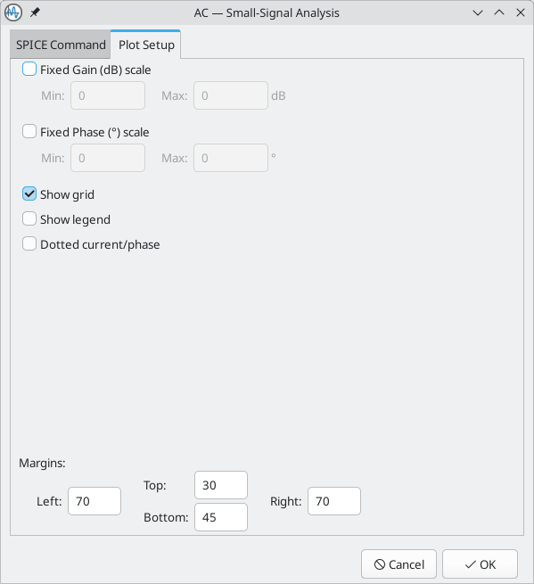

- **Fixed scale**: when enabled, this fixes the vertical and/or horizontal plot
  scales to the specified ranges. Manually zooming will not affect an axis if
  its scale is fixed.
- **Show grid**: when enabled, a grid will be shown behind the plotted signals.
  You can also turn the grid on or off with **View** -> **Show Grid**.
- **Show legend**: when enabled, a legend will be shown on the plot for the
  enabled signals. You can reposition the legend by dragging it.
- **Dotted current/phase**: when enabled, plotted signals representing current
  (transient simulations) or phase (AC simulations) are displayed using dotted
  lines instead of solid lines. You can also enable this setting with **View**
  -> **Dotted Current/Phase**.
- **Margins**: this controls the padding on each side of the plot.

===== Cursors

For precise measurement, cursors are available in the plot window. You can add a
cursor to a signal by checking the **Cursor 1** or **Cursor 2** checkbox for the
signal in the signal grid on the right.

Once cursors have been added, the horizontal position of each cursor is shown by
a number in a triangular marker at the top of the plot display. You can
reposition each cursor by clicking and dragging its marker. The vertical
position of each cursor tracks its assigned signal. The horizontal and vertical
value for each cursor are shown in the cursor grid on the right of the simulator
window. If cursors 1 and 2 are both enabled, the difference between them is also
shown.

To precisely position a cursor, you can directly edit its horizontal position in
the cursors grid. You can also modify the display format (unit range and number
of significant digits) by right clicking a value in the cursors grid and
clicking **Format** for the relevant quantity.

You can also add more cursors beyond the two default cursors. To create more
cursors, right click on a signal in the signals grid and click **Create new
cursor**. To remove an extra cursor, right click in a one of the extra cursor
columns and click **Delete cursor 3** (or whichever cursor you want to delete).

===== Measurements

You can add automatically calculated measurements for any plotted signal, such
as a minimum, average, or peak-to-peak measurement.

NOTE: Measurements are made over all the data resulting from the simulation, not
      just the data that is visible in the plot window at the current zoom
      setting.

NOTE: It is not necessary to have selected a signal for plotting (by selecting
      its Plot checkbox) in order to make a measurement on it. Even unplotted
      signals can be measured.

To add a predefined measurement to a signal, right click on a signal in the
signals grid and select a measurement. The following measurements are available:

* **Measure Min**: measures the minimum value of the entire signal
* **Measure Max**: measures the minimum value of the entire signal
* **Measure RMS**: measures the root-mean-square value of the entire signal
* **Measure Peak-to-peak**: measures the peak-to-peak value of the entire signal
* **Measure Time of Min**: measures the time at which the minimum value of the
  entire signal occurs
* **Measure Time of Max**: measures the time at which the maximum value of the
  entire signal occurs
* **Measure Integral**: computes the time integral value of the entire signal
* **Perform Fourier Analysis**: performs a Fourier analysis of the selected
  signal based on a specified fundamental frequency. Calculates the amplitude of
  the harmonics of the fundamental as well as the total harmonic distortion.
  This measurement is only available for transient analyses, and its results are
  printed in the simulation log window instead of in the measurement panel.

Measurement results are displayed in the Measurement pane at the lower right of
the simulator window. Multiple measurements will display as multiple rows in
this area. You can delete a measurement by right clicking it and clicking
**Delete Measurement**. To modify the display format of a measurement result
(unit range and number of significant digits), right click the value and click
**Format Value...**.

The above context menu options are a shortcut for directly specifying
measurements in the the Measurement pane. To manually create a new measurement,
click in an empty row in the Measurement pane and type in an ngspice measurement
function. You can also edit existing measurements by clicking on them. For more
information about measurements and their syntax, refer to the ngspice manual.

[[sim-numerical-results]]
==== Numerical results

While most analyses display their results as plots, DC Operating Point (OP) and
Pole-zero (PZ) analyses do not result in plots. Instead, these analyses print
their results as text in the simulation log window.

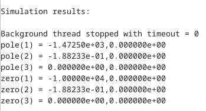

[[sim-operating-point-annotations]]
===== Operating point annotations

For the OP analysis, annotations can also be added to the schematic indicating
the operating point voltage and current values at the nodes. Operating point
voltage annotations can be shown or hidden for every node with
**View** -> **Show OP Voltages**. Operating point current annotations can be
shown or hidden for every symbol pin with **View** -> **Show OP Currents**.
These annotations are globally shown or hidden for every node or every pin. You
can control the formatting of these annotations in the
<<schematic-setup-formatting,Formatting panel of Schematic Setup>>.

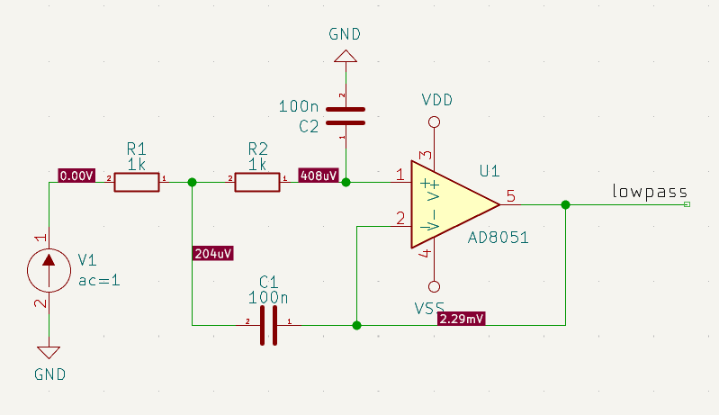

You can also display operating point results using text variables. Using text
variables requires more work to set up but provides more control over how the
data is displayed. For example, you can use text variables to display only
certain voltages or currents, or to control the display formatting of particular
values. You can also use text variables to display power dissipation
measurements.

To use text variables to display an operating point voltage for a net, add a
<<labels,label>> to the net, then add a field to that label. The label can
contain any text as long as it contains the `${OP}` text variable. The text
variable can contain formatting specifiers in the form
`${OP.<precision><unit>}`, but both the precision and unit are optional.
Precision is the number of significant digits to display, which is 3 by default.
Unit is the unit to use, including a prefix, such as `mV` for millivolts.

As an example, a label field containing the text `Vout: ${OP}`, attached to
a net with an operating point voltage of 5.123V, displays as "Vout: 5.12V". The
text `${OP.4mV}` displays as "5123mV", `${OP.2}` displays as "5.1V", and
`${OP.mV}` displays as "512mV".

Using text variables to display an operating point current into a device pin is
similar, but uses symbol fields instead of label fields. The field can contain
any text as long as it contains the `${OP:<pin>}` text variable. The pin can be
specified as a pin name or a pin number. For two-terminal devices, the pin can
be omitted, and the current into the device's pin 1 will be reported. The
same optional formatting specifiers are supported as for voltages, in the form
`${OP:<pin>.<precision><unit>}`.

For example, in a symbol with an operating point current of 5.123mA through pin
1 (pin name `C`), a symbol field containing the text `Ic: ${OP:C}` displays
as "Ic: 5.12mA". The text `${OP:C.2mA}` displays as "5.1mA", `${OP:1.4}`
displays as "5.123mA", and `${OP:C.A}` displays as "0.00512A".

You can also use text variables to display a device's power dissipation. This
works identically to current, but with `power` instead of a pin name or number.
For example, in a symbol with an operating point power dissipation of 5.123mW, a
symbol field containing `${OP:power.2mW}` displays as "5.1mW".

NOTE: Don't forget to set the label field or symbol field to visible, or it will
      not be displayed.

[[sim-user-defined-signals]]
==== User-defined signals

In addition to the list of signals that come from the nets in the schematic, you
can define your own signals which behave like normal signals in most respects.
User defined signals are defined as mathematical operations on one or more basic
signals.

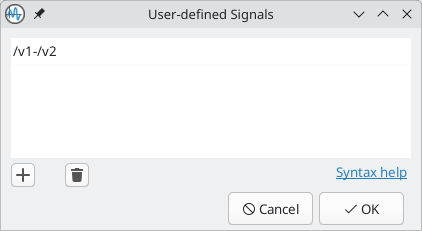

To add a user-defined signal, open the User-defined Signal dialog with
**Simulation** -> **User-defined Signals...**
(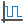 button) and add a signal. The new
signal will appear in the Signal grid, where it can be plotted and used like any
other signal. User-defined signals are also included in OP results.

NOTE: Unlike normal signals, which are plotted incrementally as a simulation
      progresses, user-defined signals are not plotted until the simulation
      completes.

One use for user-defined signals is to plot a differential voltage, i.e. the
voltage between two arbitrary nodes. For example, to plot the voltage difference
between the nets `/v1` and `/v2`, you can create a user-defined signal with the
expression `/v1-/v2` and then plot it. This expression could also be written in
a number of different ways, for example `V(/v1)-V(/v2)` or `V(/v1,/v2)`, which
are both equivalent.

A number of mathematical functions are available for use in user-defined
signals. To see a list, click the **Syntax help** link in the User-defined
Signals dialog. Refer to the ngspice manual for details on each of these
functions.

NOTE: Net names may contain special characters that have particular meaning to
      the ngspice interpreter. In particular, ngspice interprets the dash
      character (`-`) as a subtraction operation. To ensure that net names are
      interpreted correctly, surround the net name with double quote (`"`)
      characters when referring to it in a user-defined signal.

[[sim-tuning]]
=== Tuning components

The simulator has a tuning tool, which lets you observe how changing a component value affects the simulation results.
Each time the component value is tuned, the simulation is re-run with the new component value.
You can then save the tuned component value back to the schematic if desired.

The following components can be tuned:

* Resistors
* Inductors
* Capacitors
* DC Voltage sources
* DC Current sources

NOTE: You can only tune components when running analyses that result in a plot.
      In other words, you cannot tune components when running an operating point
      analysis.

To tune a component, use **Simulation** -> **Add Tuned Value...**, the keyboard
shortcut kbd:[T], or the  button in
the toolbar, and then click on the component to tune in the schematic. This adds
a tuning control for that component in the bottom right corner of the simulator
window. Multiple components can be tuned at once, with a separate tuning control
per component.

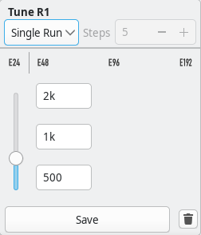

* The dropdown menu at the top switches between **Single Run** and **Multi Run** modes.
  ** In Single Run mode, the simulation is run using the tuned value from the middle text field.
     Each time this value changes, the simulation is re-run with the new value,
     and the new results replace the old results.
  ** In Multi Run mode, the simulation is run multiple times using different values for the tuned value.
     All runs are plotted simultaneously to show the spread of results.
     The **Steps** control sets the number of runs.
     The minimum is two runs, as the minimum and maximum values of the tuning range are always included.
* The top text field sets the top end of the tuning range.
  In Multi Run mode, this sets the value for the last simulation run.
* The bottom text field sets the bottom end of the tuning range.
  In Multi Run mode, this sets the value for the first simulation run.
* The middle text field sets the actual component value that is used in the simulation in Single Run mode.
  This value can also be adjusted using the slider.
  In Multi Run mode, the middle text field is disabled.
* The **Save** button updates the schematic symbol with the tuned value.
  Until you press the **Save** button, the schematic symbol will keep its original value.
  In Multi Run mode, the **Save** button is disabled because there is no single value to save back to the schematic.
* The  button removes the
  component from the Tune panel and restores its original value.

In addition, it is possible to restrict the component values to those from a particular series of Preferred Values -- either of the E24, E48, E96 or E192 series. This is particularly useful when it is necessary to restrict component values to commercially available parts.

[[sim-workbooks]]
=== Saving simulation setups

You can save a simulation setup in a workbook. Workbooks are files that store information about a simulation setup, including which analyses are configured
and what their settings are, which signals are plotted for each analysis,
user-defined signals, measurements, cursors, and display settings.
A workbook can be saved and reloaded later to restore the previously configured
settings in a new session. Workbooks can include more than one simulation: for
example, it may contain separate tabs for transient, operating point, and AC
analyses which you added as you worked.

You can save a workbook using **File** -> **Save Workbook** and load one using
**File** -> **Open Workbook**. The most recently used workbook is automatically
loaded when the simulator is opened.

NOTE: Workbooks store simulation setup information, but they do not store
      simulation results. You can export simulation results to PNG (graphics) or
      CSV (simulation data values) with **File** ->
      **Export Current Plot as PNG...** and **File** ->
      **Export Current Plot as CSV...**. To recreate the results of simulations
      stored in a workbook, select the appropriate analysis tab in the Simulator
      window and run the simulation again (kbd:[R] or **Simulation** ->
      **Run Simulation**).

=== Exporting simulation results

KiCad's simulator offers two ways to export results:

* as a PNG (Portable Network Graphics format) image of a simulation data plot,
* as a plain text file of simulation data values, in CSV (Comma-Separated Value) format.

Only simulations that produce plots (see above) can be exported as an image or a CSV file. The results of OP and PZ analyses cannot be exported in this way.

==== Exporting results as graphics

The currently-visible Simulator plot may be exported as a PNG file using the command **File** -> **Export Current Plot as PNG...**.

The size and aspect-ratio of the saved image will match that of the displayed plot in the Simulator.

You can also copy an image of the active plot to the clipboard using **File** ->
**Export Current Plot to Clipboard**, or insert an image of the active plot into
the schematic using **File** -> **Export Current Plot to Schematic**. Exporting
a plot to the schematic is equivalent to exporting the plot to the clipboard
and then pasting it into the schematic.

==== Exporting results as numerical data

The currently-visible Simulator plot may be exported as a CSV file using the command **File** -> **Export Current Plot as CSV...**.

The data in the simulation plot is exported as multiple columns. The precise format is dependent upon the analysis type. In general, there will be multiple columns of data, one corresponding to each variable selected for plotting. The first row of the file is a header row, containing the name of the variable in the column (i.e. 'time', 'V(/Vout)1' or similar).

[NOTE]
When exporting to CSV, only variables selected using their Plot checkbox will be included in the exported file.

[NOTE]
The data in the exported file contains all the data that would be plotted if the entire plot were displayed. If the plot is zoomed in to show a particular region this will still be the case, resulting in the output file containing more data than the user might expect.

[NOTE]
This function exports the data with data separated by semicolons (`;`) rather than commas. Programs reading this data may need to be configured to expect a semicolon as a delimiter.

=== Troubleshooting simulations

Sometimes a simulation will fail, either with or without errors being reported. Paying attention to the error messages reported, taking care in the development and entry into KiCad of the circuit to be simulated, and making use of the KiCad, ngspice and general SPICE documentation and information from fellow users in forums is very worthwhile and can often point the way to a solution.

It's worth noting, for users unfamiliar with SPICE, ngspice or circuit simulation in general that some 'common' and interesting circuits can sometimes be tricky to simulate accurately or reliably. These include apparently simple circuits such as oscillators, which in some cases may fail to oscillate at all! It is nearly always possible to build a working simulation but sometimes this can more require SPICE experience than might be initially apparent, or the guidance of someone who already has it. The ngspice documentation, once again, is worth reading for insights into good and effective simulation practices if you are encountering difficulty.

==== Incorrect netlist

It is possible to inspect the SPICE netlist with **Simulation** ->
**Show SPICE netlist...** ( button). This
method of troubleshooting requires some SPICE
knowledge, but spotting errors in the netlist can help determine the cause of
simulation problems, as well as providing confirmation of what input ngspice is actually acting on.

==== Simulation error messages

The output console displays messages from the simulator. It is advisable to check
the console output to verify there are no errors or warnings. Messages appearing
in the console may be conveniently selected, copied, and pasted if you wish to
share them.

A common error message is "timestep too small". This message means that the
simulation engine is unable to calculate the next point in the simulation, even
when using the minimum possible time increment. This error can have many causes,
including numerical convergence issues with a simulation model used in the
circuit or with the circuit itself. It can also be caused by mistakes in
drawing the circuit, such as incorrectly
<<simulation-pin-assignment,assigning pins to the simulation model>> or
forgetting to provide a voltage supply.

==== Convergence problems

In case the simulation does not converge in a reasonable amount of time (or not
at all), it is possible to add the following SPICE directives. More information
is available in the ngspice manual.

[WARNING]
Changing convergence options can lead to erroneous results. These options should
be used with caution.

....
.options gmin=1e-10
.options abstol=1e-10
.options reltol=0.003
.options cshunt=1e-15
....

* `gmin` is the minimum conductance allowed by the program.
  The default value is `1e-12` (1 pS).
* `abstol` is the absolute current error tolerance of the program. The default
  value is `1e-12` (1 pA).
* `reltol` is the relative error tolerance of the program. The default value is
  `0.001` (0.1%).
* `cshunt` adds a capacitor of the specified value from each voltage node in the
  circuit to ground.

==== Simulation pin assignments

If unexpected results are generated by a simulation despite it running without
obvious errors, it is worth double-checking that the
<<simulation-pin-assignment,assignments between the pins of the part instance in the KiCad schematic and that of the associated model>>
are correct. These have to be correct for each instance of the model in the schematic.

=== Helpful hints

Some helpful tips, hints and advice to help you get the most from using ngspice in KiCad for simulation.

==== The ngspice manual is your friend!

Fundamentally the KiCad Simulator is a user-friendly front-end to the powerful ngspice circuit simulator. Therefore problems with the details of simulation, the correct use of SPICE elements, models, etc. is beyond the scope of the KiCad documentation but is very likely to be fully and completely addressed in the ngspice documentation itself. It's therefore recommended not to overlook this https://ngspice.sourceforge.io/docs.html[valuable resource].

[NOTE]
KiCad updates may result in changes to the ngspice version used by the simulator. The current version of ngspice used in a particular version of KiCad is shown on the **Help** -> **About KiCad** dialog, under the **Version** tab. Referring to the online ngspice documentation will ensure you always have access to the latest information for reference.

==== Organizing third-party models

Although it is certainly possible to keep simulation models (i.e. `.lib`, `.sub` files) in the directories associated with individual KiCad projects, this will likely result in unnecessary copies of model files proliferating as you create simulations. Consider creating a dedicated storage location (directory, folder) for models, perhaps organized by manufacturer or device type, to hold these files. Then they may simply be referenced in simulations at a common location.

[[sim-default-library-symbols]]
==== Simulation symbols and models in KiCad's libraries

The KiCad libraries provide a number of symbols for simulation in the
`Simulation_SPICE` symbol library. Most of these symbols have SPICE models
already assigned as appropriate, although you may need to adjust the model
parameters in order to obtain the desired simulation behavior.

The `Simulation_SPICE` symbol library contains the following symbols:

[cols="30%,70%",]
|====
| Symbol Name | Description
| 0
  | A ground (node 0) symbol. Note that a standard GND symbol from another
    library can also be used.
| BSOURCE
  | A symbol for a SPICE B-source (nonlinear dependent voltage or current
    source). Refer to the
    https://ngspice.sourceforge.io/docs/ngspice-html-manual/manual.xhtml#sec_Non_linear_Dependent_Sources[ngspice
  manual]
    for information on B-sources.
| D
  | A diode symbol. Note that the pin assignment is appropriate for both
    simulation and PCB layout.
| ESOURCE
  | A symbol for a SPICE E-source (linear voltage-controlled voltage source). By
    default it is set up with a gain of 1 V/V. Refer to the
    https://ngspice.sourceforge.io/docs/ngspice-html-manual/manual.xhtml#subsec_Exxxx__Linear_Voltage_Controlled[ngspice manual]
    for more information on E-sources.
| GSOURCE
  | A symbol for a SPICE G-source (linear voltage-controlled current source). By
    default it is set up with a gain of 1 A/V. Refer to the
    https://ngspice.sourceforge.io/docs/ngspice-html-manual/manual.xhtml#subsec_Gxxxx__Linear_Voltage_Controlled[ngspice manual]
    for more information on G-sources.
| IAM
  | A symbol for a SPICE amplitude-modulated independent current source. Refer
    to the 
    https://ngspice.sourceforge.io/docs/ngspice-html-manual/manual.xhtml#sec_Independent_Sources_for[ngspice manual]
    for more information on independent current sources.
| IBIS_DEVICE
  | An IBIS device symbol representing a digital input pin. This symbol is not
    preconfigured with a simulation model. It is intended to be used with an 
    <<ibis-library,external IBIS model>> for a device.
| IBIS_DEVICE_DIFF
  | An IBIS device symbol representing a digital differential input pin. This
    symbol is not preconfigured with a simulation model. It is intended to be
    used with an <<ibis-library,external IBIS model>> for a differential device.
| IBIS_DRIVER
  | An IBIS driver symbol representing a digital output pin. This symbol is not
    preconfigured with a simulation model. It is intended to be used with an
    <<ibis-library,external IBIS model>> for a driver.
| IBIS_DRIVER_DIFF
  | An IBIS driver symbol representing a pair of digital differential output
    pins. This symbol is not preconfigured with a simulation model. It is
    intended to be used with an <<ibis-library,external IBIS model>> for a
    differential driver.
| IDC
  | A symbol for a SPICE DC independent current source. Refer to the 
    https://ngspice.sourceforge.io/docs/ngspice-html-manual/manual.xhtml#sec_Independent_Sources_for[ngspice manual]
    for more information on independent current sources.
| IEXP
  | A symbol for a SPICE exponential independent current source. Refer
    to the 
    https://ngspice.sourceforge.io/docs/ngspice-html-manual/manual.xhtml#sec_Independent_Sources_for[ngspice manual]
    for more information on independent current sources.
| IPULSE
  | A symbol for a SPICE pulsed independent current source. Refer
    to the 
    https://ngspice.sourceforge.io/docs/ngspice-html-manual/manual.xhtml#sec_Independent_Sources_for[ngspice manual]
    for more information on independent current sources.
| IPWL
  | A symbol for a SPICE piecewise linear independent current source. The
    waveform is specified as space-separated time-current pairs. Refer to the 
    https://ngspice.sourceforge.io/docs/ngspice-html-manual/manual.xhtml#sec_Independent_Sources_for[ngspice manual]
    for more information on independent current sources.
| ISFFM
  | A symbol for a SPICE single-frequency frequency-modulated independent
    current source. Refer to the 
    https://ngspice.sourceforge.io/docs/ngspice-html-manual/manual.xhtml#sec_Independent_Sources_for[ngspice manual]
    for more information on independent current sources.
| ISIN
  | A symbol for a SPICE sinusoidal independent current source. Refer to the 
    https://ngspice.sourceforge.io/docs/ngspice-html-manual/manual.xhtml#sec_Independent_Sources_for[ngspice manual]
    for more information on independent current sources.
| ITRNOISE
  | A symbol for a SPICE transient noise independent current source. Refer to
    the 
    https://ngspice.sourceforge.io/docs/ngspice-html-manual/manual.xhtml#sec_Independent_Sources_for[ngspice manual]
    for more information on independent current sources.
| ITRRANDOM
  | A symbol for a SPICE transient random independent current source. Refer to
    the 
    https://ngspice.sourceforge.io/docs/ngspice-html-manual/manual.xhtml#sec_Independent_Sources_for[ngspice manual]
    for more information on independent current sources.
| NJFET
  | A symbol for an N-channel JFET with drain, gate, and source terminals,
    suitable for use with 3-terminal N-JFET models.
| NMOS
  | A symbol for an N-channel MOSFET with drain, gate, and source terminals,
    suitable for use with 3-terminal N-MOSFET models.
| NMOS_Substrate
  | A symbol for an N-channel MOSFET with drain, gate, source, and substrate
    (bulk) terminals, suitable for use with 4-terminal N-MOSFET models.
| NPN
  | A symbol for an NPN transistor with collector, base, and emitter terminals,
    suitable for use with 3-terminal NPN models.
| NPN_Substrate
  | A symbol for an NPN transistor with collector, base, emitter, and substrate
    terminals, suitable for use with 4-terminal NPN models.
| OPAMP
  | A generic single-pole operational amplifier symbol. There are parameters for
    pole frequency, open loop gain, offset voltage, and output resistance. These
    parameters can be edited in the Parameters grid of the SPICE Model Editor
    dialog.
| PJFET
  | A symbol for a P-channel JFET with drain, gate, and source terminals,
    suitable for use with 3-terminal P-JFET models.
| PMOS
  | A symbol for a P-channel MOSFET with drain, gate, and source terminals,
    suitable for use with 3-terminal P-MOSFET models.
| PMOS_Substrate
  | A symbol for a P-channel MOSFET with drain, gate, source, and substrate
    (bulk) terminals, suitable for use with 4-terminal P-MOSFET models.
| PNP
  | A symbol for a PNP transistor with collector, base, and emitter terminals,
    suitable for use with 3-terminal PNP models.
| PNP_Substrate
  | A symbol for a PNP transistor with collector, base, emitter, and substrate
    terminals, suitable for use with 4-terminal PNP models.
| SWITCH
  | A symbol for a voltage-controlled switch. Refer to the
    https://ngspice.sourceforge.io/docs/ngspice-html-manual/manual.xhtml#subsec_Switches[ngspice manual]
    for more information on switches.
| TLINE
  | A symbol for a transmission line. By default it is set up as a lossless
    transmission line but it can also be used for a lossy transmission line.
    Refer to the
    https://ngspice.sourceforge.io/docs/ngspice-html-manual/manual.xhtml#sec_Lossless_Transmission_Lines[ngspice manual]
    for more information on transmission lines.
| VAM
  | A symbol for a SPICE amplitude-modulated independent voltage source. Refer
    to the 
    https://ngspice.sourceforge.io/docs/ngspice-html-manual/manual.xhtml#sec_Independent_Sources_for[ngspice manual]
    for more information on independent voltage sources.
| VDC
  | A symbol for a SPICE DC independent voltage source. Refer to the 
    https://ngspice.sourceforge.io/docs/ngspice-html-manual/manual.xhtml#sec_Independent_Sources_for[ngspice manual]
    for more information on independent voltage sources.
| VEXP
  | A symbol for a SPICE exponential independent voltage source. Refer to the 
    https://ngspice.sourceforge.io/docs/ngspice-html-manual/manual.xhtml#sec_Independent_Sources_for[ngspice manual]
    for more information on independent voltage sources.
| VOLTMETER_DIFF
  | A differential voltmeter symbol that can be used to measure the voltage
    between two arbitrary nodes. The voltage difference between the `+` and
    `-` pins is output as a ground-referenced voltage on the `out` pin.
| VPULSE
  | A symbol for a SPICE pulsed independent voltage source. Refer to the 
    https://ngspice.sourceforge.io/docs/ngspice-html-manual/manual.xhtml#sec_Independent_Sources_for[ngspice manual]
    for more information on independent voltage sources.
| VPWL
  | A symbol for a SPICE piecewise linear independent voltage source. The
    waveform is specified as space-separated time-voltage pairs. Refer to the 
    https://ngspice.sourceforge.io/docs/ngspice-html-manual/manual.xhtml#sec_Independent_Sources_for[ngspice manual]
    for more information on independent voltage sources.
| VSFFM
  | A symbol for a SPICE single-frequency frequency-modulated independent
    voltage source. Refer to the 
    https://ngspice.sourceforge.io/docs/ngspice-html-manual/manual.xhtml#sec_Independent_Sources_for[ngspice manual]
    for more information on independent voltage sources.
| VSIN
  | A symbol for a SPICE sinusoidal independent voltage source. Refer to the 
    https://ngspice.sourceforge.io/docs/ngspice-html-manual/manual.xhtml#sec_Independent_Sources_for[ngspice manual]
    for more information on independent voltage sources.
| VTRNOISE
  | A symbol for a SPICE transient noise independent voltage source. Refer to
    the 
    https://ngspice.sourceforge.io/docs/ngspice-html-manual/manual.xhtml#sec_Independent_Sources_for[ngspice manual]
    for more information on independent voltage sources.
| VTRRANDOM
  | A symbol for a SPICE transient random independent voltage source. Refer to
    the 
    https://ngspice.sourceforge.io/docs/ngspice-html-manual/manual.xhtml#sec_Independent_Sources_for[ngspice manual]
    for more information on independent voltage sources.
|====

Most of these symbols in the `Simulation_SPICE` library use
<<sim-built-in,built-in models>>, but several symbols use <<sim-library,external
models>> from the `Simulation_SPICE.sp` simulation model library. The simulation
model library is a separate file in the same folder as the symbol library. This
simulation model library also contains SPICE models that may be useful for use
with other symbols.

The `Simulation_SPICE.sp` simulation model library contains the following
models:

[cols="30%,70%",]
|====
| Model Name | Description
| kicad_builtin_opamp
  | A generic single-pole operational amplifier model. This model is used by the
    OPAMP symbol in the `Simulation_SPICE` symbol library, and the pins are
    ordered appropriately for use with any standard single-unit opamp symbol.
    There are parameters for pole frequency, open loop gain, offset voltage, and
    output resistance. These parameters can be edited in the Parameters grid of
    the SPICE Model Editor dialog.
| kicad_builtin_opamp_dual
  | A dual version of the kicad_builtin_opamp model, with the same parameters.
    This model is not assigned to any symbols in the `Simulation_SPICE` symbol
    library, but the pins are ordered appropriately for use with standard dual
    opamp symbols.
| kicad_builtin_opamp_quad
  | A quad version of the kicad_builtin_opamp model, with the same parameters.
    This model is not assigned to any symbols in the `Simulation_SPICE` symbol
    library, but the pins are ordered appropriately for use with standard quad
    opamp symbols.
| kicad_builtin_varistor
  | A generic varistor model. This model is not assigned to any symbols in the
    `Simulation_SPICE` symbol library. There are parameters for threshold
    voltage, dynamic resistance, and leakage resistance. These parameters can be
    edited in the Parameters grid of the SPICE Model Editor dialog.
| kicad_builtin_vdiff
  | A differential voltmeter model. The voltage difference between the first two
    terminals is output as a ground-referenced voltage on the third terminal.
    This model is used by the VOLTMETER_DIFF symbol in the `Simulation_SPICE`
    symbol library.
|====
