:author: The KiCad Team
:doctype: book
:toc:
:ascii-ids:
:experimental:

= KiCad

include::../version.adoc[]

_KiCad {kicad-version-short} Reference Manual_

[[copyright]]
*Copyright*

This document is Copyright The KiCad Documentation Contributors.
You may distribute it and/or modify it under the terms of either
the GNU General Public License (http://www.gnu.org/licenses/gpl.html),
version 3 or later, or the Creative Commons Attribution License
(http://creativecommons.org/licenses/by/3.0/), version 3.0 or later.

All trademarks within this guide belong to their legitimate owners.

[[contributors]]
*Contributors*

Jean-Pierre Charras, Fabrizio Tappero, Jon Evans, Graham Keeth.

[[feedback]]
*Feedback*

The KiCad project welcomes feedback, bug reports, and suggestions related to the software or its
documentation.  For more information on how to submit feedback or report an issue, please see the
instructions at https://www.kicad.org/help/report-an-issue/

*Software and Documentation Version*

This user manual is based on KiCad {kicad-version-long}. Functionality and
appearance may be different in other versions of KiCad.

Documentation revision: `{doc-commit}`.

== Introduction

KiCad is an open-source software suite for creating electronic circuit schematics and printed
circuit boards (PCBs).  KiCad supports an integrated design workflow in which a schematic and
corresponding PCB are designed together, as well as standalone workflows for special uses.  KiCad
also includes several utilities to help with circuit and PCB design, including a PCB calculator for
determining electrical properties of circuit structures, a Gerber viewer for inspecting 
manufacturing files, and an integrated SPICE simulator for inspecting circuit behavior.

KiCad runs on all major operating systems and a wide range of computer hardware.  It supports PCBs
with up to 32 copper layers and is suitable for creating designs of all complexities.  KiCad is
developed by a volunteer team of software and electrical engineers around the world with a mission
of creating free and open-source electronics design software suitable for professional designers.

The latest version of this documentation is available at https://docs.kicad.org. 

=== System Requirements

KiCad is capable of running on a wide variety of hardware and operating systems, but some tasks
may be slower or more difficult on lower-end hardware.  For the best experience, a dedicated
graphics card and display with 1920x1080 or higher resolution is recommended.

Please check the KiCad website for the latest system requirements:
https://kicad.org/help/system-requirements/

== Installing and Upgrading KiCad

[[settings]]
=== First time setup

The first time you run a new major version of KiCad, a Welcome window will appear to ask you how to initialize your settings.
Each major release of KiCad has its own configuration, so that you may run multiple KiCad versions
on the same computer without the configurations interfering.

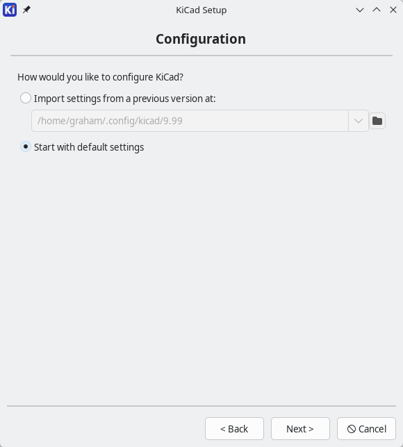

==== Configuration setup

You always have the option to start with default settings for the new version.
If a previous version of KiCad is detected, you will have the option to import the settings from that version.
The location of the previous configuration files is detected automatically,
but you may override it to choose another location if desired.

NOTE: Hotkey configurations are not imported from previous versions.
      You can manually import hotkey configurations by using the **Import Hotkeys...** button on the **Hotkeys** page of Preferences,
      then browsing to the `.hotkeys` file from the old version's configuration directory.
      If you do so, please note that this will replace the current version's hotkey settings.

[[config-file-location]]
KiCad stores the settings files in a folder inside your user directory.  Each KiCad version will
use a different versioned subfolder. For KiCad 10, those folders are:

[width="75%",cols="25%,75%"]
|===========================
|Windows |`%APPDATA%\kicad\10.0`
|Linux   |`~/.config/kicad/10.0`
|macOS  |`/Users/<username>/Library/Preferences/kicad/10.0`
|===========================

==== Libraries setup

You also have options for how to initialize your symbol, footprint, and design block libraries.
In most cases, you should choose the default option, **Start with the built-in KiCad libraries (recommended)**.
This initializes your library tables to include all of the libraries that come with KiCad.

The other options are to import your library table setup from the previously installed KiCad version,
or to start with no libraries and do all of the configuration yourself.
Refer to the xref:../eeschema/eeschema.adoc#managing-symbol-libraries[Schematic Editor]
and xref:../pcbnew/pcbnew.adoc#managing-footprint-libraries[PCB Editor] documentation
for details on how to manually configure libraries.

Depending on your system and how KiCad was installed, some options may not be available.
KiCad may also not be able to locate any libraries installed on your system.
In this case, you should ensure you have installed the libraries, or you can manually configure the libraries after completing setup.

NOTE: On some systems the KiCad libraries are installed as a separate package.

The location of the default library table files depends on operating system and may vary based on installation location.
Below are the defaults for each operating system:

[width="75%",cols="25%,75%"]
|===========================
|Windows |`C:\Program Files\KiCad\10.0\share\kicad\template\`
|Linux   |`/usr/share/kicad/template/`
|macOS  |`/Applications/KiCad/KiCad.app/Contents/SharedSupport/template/`
|===========================

==== Updates & Privacy setup

You can also choose whether to be notified about updates to the KiCad application and to third party packages you may have installed through KiCad's <<plugin-content-manager,Plugin and Content Manager>> (plugins, themes, libraries, etc.).
On Windows, you also have the option to enable anonymous crash reporting, which helps the KiCad team diagnose and fix critical issues in the application.

=== Migrating design files from previous versions

Modern versions of KiCad can open files created in earlier versions, but can only write files in
the latest formats.  This means that in general, there are no special steps to migrate files from
a previous version besides opening the files.  In some cases, the file extension for a file has
changed from one KiCad version to the next.  After opening these files, they will be saved in the
new format with the new file extension.  The old files will not be deleted automatically.

The schematic editor documentation describes several particular considerations
for opening
xref:../eeschema/eeschema.adoc#opening-legacy-schematics[legacy schematics].

In general, files created or modified by one version of KiCad **cannot** be opened by older
versions of KiCad.  For this reason, it is important to keep backup copies of your projects when
testing a new KiCad release, until you are confident that you will not need to use the older
KiCad version anymore.

== Using the KiCad project manager

The KiCad project manager is the window that opens when you start KiCad.
The project manager creates and opens KiCad projects and launches the other KiCad tools:

- the xref:../eeschema/eeschema.adoc[Schematic Editor]
- the xref:../eeschema/eeschema.adoc#creating-and-editing-symbols[Symbol Editor]
- the xref:../pcbnew/pcbnew.adoc[PCB Editor]
- the xref:../pcbnew/pcbnew.adoc#creating-and-editing-footprints[Footprint Editor]
- the xref:../gerbview/gerbview.adoc[Gerber Viewer]
- the Image Converter
- the xref:../pcb_calculator/pcb_calculator.adoc[Calculator Tools]
- the xref:../pl_editor/pl_editor.adoc[Drawing Sheet Editor]
- the xref:../kicad/kicad.adoc#plugin-content-manager[Plugin and Content Manager]

The KiCad project manager window is composed of a tree view on the left showing the files associated with the open project,
and a launcher on the right containing shortcuts to the various editors and tools.

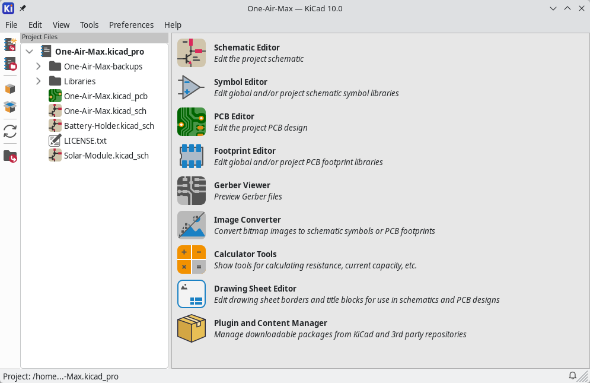

The tree view shows a list of the files inside the project folder.
This includes the KiCad schematic and board design files as well as other files and folders in the project folder.
If the project contains multiple schematic sheets, only the root sheet is shown in the tree view.

NOTE: Only files that KiCad understands how to open are displayed in the project tree view.

Double-clicking on a file in the tree view will open it in the associated editor.
Right-clicking on a file will open a context menu with some file manipulation commands.

If the project is part of a Git repository,
the tree shows icons indicating the <<git-integration,version control status>> of each file
and lists the active branch next to the project name.
While normally the tree view only shows the schematic root sheet, and not any subsheets, 
all sheets are shown when the project is in a Git repository so that modifications to each sheet can be observed individually.

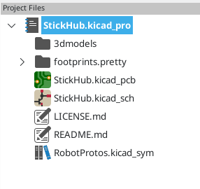

KiCad projects contain at least a project file, a schematic, and a board design. Schematics
may contain multiple sheets, each in its own file, but a project can only contain a single
board. KiCad expects the project file, schematic root sheet file, and board file to all have
the same name.

The toolbar on the left side of the window provides shortcuts for common project operations:

[width="100%",cols="10%,90%",]
|=======================================================================
|
|Create a new project.
|
|Open an existing project.
|
|Create a zip archive of the whole project. This includes schematic
files, libraries, PCB, etc.
|
|Extract a project zip archive into a directory. Files in the destination
directory will be overwritten.
|
|Refresh the tree view, to detect changes made on the filesystem.
|
|Open the project working directory in a file explorer.
|=======================================================================

=== Standalone mode

You can also run the KiCad editor tools in _standalone_ mode, by launching them directly from
your operating system's application launcher rather than from the project manager. It is
usually *not recommended* to run the tools in standalone mode, except for some specific
situations where it is necessary, such as when importing projects from other EDA tools.
When running in standalone mode, some project features are not available, including:

* cross probing between the schematic editor and the board editor
* design synchronization between the schematic and the board

=== Creating a new project

Most KiCad designs start with the creation of a project.
When you create a new project, you always begin by choosing a project template,
even if that template is the default, blank project template.

To create a new project, use the **New Project...** command in the **File** menu,
click the **New Project** button in the top toolbar, or use the keyboard shortcut (kbd:[Ctrl+N] by default).

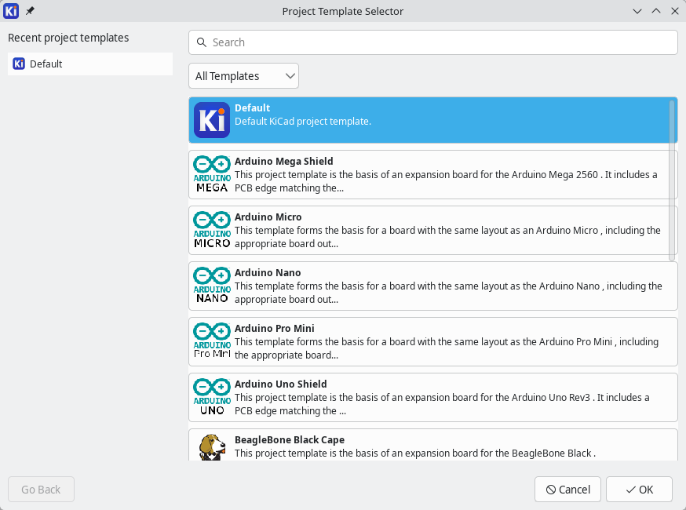

The right side of this dialog shows a list of all installed project templates.
The **Default** template is always available for you to create an empty project.
Clicking one of these templates will show the template's description in a new panel.
The left side of the dialog shows a list of your recently used project templates.

NOTE: Creating new project templates is covered in the <<project-templates,Project Templates>> section.

TIP: Creating your own project templates is a good way to easily create new projects that are preconfigured with your preferred drawing sheets, design rules, PCB outlines, logos, etc.

When you have chosen a template, click the **OK** button to create a new project from that template.

You will be prompted for a name to give your project.  By default, a directory will be created for
your project with the same name.  For example, if you enter the name `MyProject`, KiCad will create
the directory `MyProject` and the project file `MyProject/MyProject.kicad_pro` inside it.

If you already have a directory to store your project files in, you can uncheck the
**Create a new directory for the project** checkbox in the New Project dialog.

NOTE: It is strongly recommended that you store each KiCad project inside its own directory.

Once you select the name of your project, KiCad will create the following files inside the project
directory:

[width="100%",cols="27%,73%",]
|=================================================================
|`example.kicad_pro` |KiCad project file.
|`example.kicad_sch` |Main schematic file.
|`example.kicad_pcb` |Printed circuit board file.
|=================================================================

Other files may also be created, depending on the contents of the template.

=== Importing a project from another EDA tool

KiCad is able to import files created by some other software packages.  Some software formats can
be imported as complete projects.  Others can only be imported as standalone schematics or boards,
and must be manually linked together into a KiCad project.
The following types of projects are supported:

[cols="1,2",options="header"]
|=============================================
| Source EDA Tool
| File Extension(s)
|Altium Designer
|`.PrjPcb`
|CADSTAR archive format
|`.csa`, `.cpa`
|Eagle 6.x or newer (XML format)
|`.sch`, `.brd`
|EasyEDA (JLCEDA) Standard Backup
|`.zip`
|EasyEDA (JLCEDA) Pro Project
|`.epro`, `.zip`
|PADS ASCII Project
|`.asc`, `.txt`
|gEDA / Lepton EDA Project
|`.prj`, `.sch`, `.pcb`
|=============================================

To import a project from one of these tools, choose the appropriate option from the **Import
Non-KiCad Project** submenu of the **File** menu.

Depending on the format, you will be prompted to select either a project, schematic, or a board file in the import file browser dialog.
The imported schematic and board files should have the same base file name (e.g.  project.sch and project.brd).
Once the requested files are selected, you will be asked to select a directory to store the resulting KiCad project.

A greater number of formats can be imported as either schematics or boards, rather than complete projects.
The following schematic formats can be imported into the Schematic Editor:

[cols="1,1",options="header"]
|===
| Source EDA Tool
| File Extension(s)

| Altium Designer
| `.SchDoc`

| Eagle (Autodesk)
| `.sch` (XML)

| LTspice
| `.asc`

| PADS Logic
| `.asc`, `.txt`

| CADSTAR Schematic Archive
| `.csa`

| gEDA / Lepton EDA
| `.sch`

| EasyEDA (JLCEDA) Standard
| `.json`

| EasyEDA (JLCEDA) Professional
| `.epro`, `.zip`
|===

Importing these schematic formats is explained in more detail in the xref:../eeschema/eeschema.adoc#importing-schematics[Schematic Editor documentation].

The following PCB formats can be imported into the PCB Editor:

[cols="1,1",options="header"]
|===
| Source EDA Tool
| File Extension(s)

| Altium Designer
| `.PcbDoc`

| Altium Circuit Maker
| `.CMPcbDoc`

| Altium Circuit Studio
| `.CSPcbDoc`

| Cadence Allegro
| `.brd`

| CADSTAR PCB Archive
| `.cpa`

| Eagle (Autodesk)
| `.brd` (XML)

| EasyEDA / JLCEDA Standard
| `.json`, `.zip`

| EasyEDA / JLCEDA Professional
| `.epro`, `.zip`

| Fabmaster
| `.txt`, `.fab`

| gEDA / Lepton EDA
| `.pcb`

| P-CAD 200x
| `.pcb` (ASCII)

| PADS (ASCII)
| `.asc`

| Solidworks PCB
| `.SWPcbDoc`
|===
Importing these PCB formats is explained in more detail in the xref:../pcbnew/pcbnew.adoc#importing-boards[PCB Editor documentation].

[[project-archive]]
=== Saving and loading project archives

You can archive your project's files into a zip archive with the Archive tool
(**File** -> **Archive Project...**).

You can also unarchive a project using the Unarchive tool (**File** ->
**Unarchive Project...**). When you unarchive a project into the currently
loaded project directory, the project will be reloaded automatically to reflect
any changes that were in the archived version of the project.

The archive tool saves the following files from your project folder into the
archive:

[width="100%",cols="40%,60%",]
|=================================================================
|`\*.kicad_prl`, `*.kicad_pro`,
      `\*.kicad_sch`, `*.kicad_sym`,
      `\*.kicad_pcb`, `*.kicad_mod`,
      `\*.kicad_dru`, `*.kicad_wks`,
      `\*.kicad_jobset`, `*.wbk`, `*.json`,
      `fp-lib-table`, `sym-lib-table`, `design-block-lib-table`
      | KiCad design files
|`\*.pro`, `*.sch`,
      `\*.lib`, `*.dcm`, `\*.cmp`, `*.brd`, `*.mod`
      | Legacy KiCad design files
|`\*.stp`, `*.step`
      | 3D models
|`\*.g?`, `*.g??`,
      `\*.gm??`, `*.gbrjob`
      | Gerber files
|`\*.pos`, `*.drl`, `\*.nc`, `*.xnc`, `\*.d356`, `*.rpt`
      | Manufacturing files
|`*.net`
      | Netlists
|`*.py`
      | Python scripts
|`\*.pdf`, `*.txt`
      | Documentation files
|`\*.cir`, `*.sub`, `*.model`
      | SPICE models
|`\*.ibs`, `*.pkg`
      | IBIS models
|=================================================================

=== Git integration

The KiCad Project Manager integrates with the Git version control tool for
tracking changes in your projects. It can work with an existing local Git
repository, clone a project from a remote repository, or create a new repository
in an existing project. You can use the tool to commit changes from your
project, push and pull from a remote repository, and switch branches.

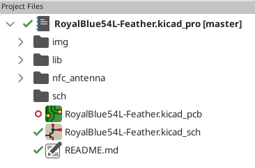

If you open a project that is already under version control with Git, i.e. it is
part of an existing Git repository, you can use KiCad's version control features
to track changes in the project without any additional configuration. The active
branch is displayed next to the project name, and the version control status of
each file in your project is shown graphically in the project files tree. For
example, the  icon indicates a file is
unchanged,  indicates a file has
uncommitted changes, and  indicates a file is
not tracked. No icons are shown if the project is not part of a Git repository.

NOTE: You can disable KiCad's Git integration features in the **Version Control**
      page of the Preferences dialog. The preferences also let you configure the
      remote update interval and the default commit author information.

==== Adding version control to an existing project

If an existing project is not already under version control, you can initialize
a new Git repository in the project by right clicking on one of the files in the
project files tree and clicking **Version Control** ->
**Add Project to Version Control...**. You must configure a remote when
initializing a repository in this way. Configuring the repository requires the
following information:

* **Location**: The URL or file path to the remote. HTTPS, SSH, and local (file)
  connections are supported. The format of the URL is used to automatically
  determine the type of connection and set the authentication options accordingly.
* **SSH private key**: The SSH private keyfile to use for authentication (SSH
  connections only).
* **User name**: The user name to use for authentication. For SSH connections,
  the user name is often `git`.
* **Password**: The password to use for authentication (HTTPS connections only).
* **SSH key password**: The passphrase for your SSH key, if you have configured
  one (SSH connections only).
  
You can check the connection and authentication by clicking the
**Test Connection** button.

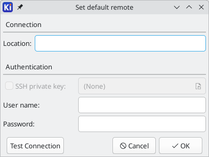

==== Cloning an existing repository

To clone an existing repository and open the cloned project, use **File** ->
**Clone Project from Repository...**. You can clone a remote repository using
SSH or HTTPS, or clone a local repository. The configuration settings for
cloning are the same as the settings for configuring a new repository and remote
for an existing project.

==== Tracking project changes with Git

When you have made changes that you want to commit, you can commit either the
entire project (right click -> **Version Control** -> **Commit Project...**) or
a specific file (right click the file -> **Version Control** -> **Commit
File...**). Both actions open the Commit Changes dialog, but the Commit Project
action shows all changed files in the repository, while the Commit File action
shows only the file that was right clicked.  The Commit Changes dialog lets you
select the changed files you want to include in the commit, provide a commit
message and author, and commit the changes.

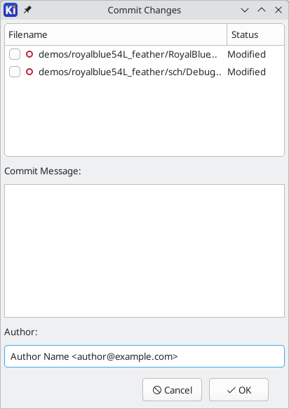

To push changes to the remote, right click in the project files tree and select
**Version Control** -> **Push**. To pull from the remote, right click and select
**Version Control** -> **Pull**. You can switch branches by selecting the
desired branch from the **Version Control** -> **Switch to Branch** menu.

Finally, you can disable version control tracking for the project by right clicking and selecting **Version Control** -> **Disable Git Integration**.
This disables KiCad's Git integration when editing the current project,
but it does not remove the project's Git history or otherwise affect the actual Git repository on disk,
so you can continue to version control the project with another Git tool.
It also does not disable KiCad's Git integration with other projects.
You can disable the Git integration for all projects in the **Version Control** page of the Preferences dialog.

== KiCad files and folders

KiCad creates and uses files with the following specific file extensions (and folders)
for schematic and board editing.

Many of these files include important design information,
especially the project file (`.kicad_pro`), the schematic file(s) (`.kicad_sch`), and the
board file (`.kicad_pcb`). Other files may also be necessary. Such files should always be
included when distributing the project. Some files are not necessary to distribute with the
project, such as the project-local settings file (`.kicad_prl`) or the `fp-info-cache` file.
Files that are unnecessary to distribute are noted in the table below.

=== Project files
[width="100%",cols="20%,80%",]
|=================================================================
|`.kicad_pro` |Project file, containing settings that are shared between the schematic and PCB
|`.pro`
      |Legacy (KiCad 5.x and earlier) project file.
      Can be read and will be converted to a `.kicad_pro` file by the project manager.
|=================================================================

=== Schematic editor files and folders
[width="100%",cols="20%,80%",]
|=================================================================
|`.kicad_sch` |Schematic files, containing all symbol and connection information.
|`.kicad_sym`
      |Schematic symbol library file, containing the symbol descriptions: graphic shape, pins, fields.
       This is a _packed_ library, i.e. all of the symbols in the library are in a single file.

       This can also be an individual symbol in an _unpacked_ library,
       where the library is a folder containing individual `.kicad_sym` files,
       and each file is a separate symbol.
       Unpacked library folders do not have a required extension, but `.kicad_symdir` is a common convention.
|`.kicad_symdir`
      |Schematic symbol library folder.
       The folder itself is the library, and contains individual `.kicad_sym` symbol files.
       This is an _unpacked_ alternative to a `.kicad_sym` _packed_ library, where the library is contained in a single file.
       Note that `.kicad_symdir` is a convention for unpacked symbol libraries but is not required; any folder name can be used.
|`.wbk` |Simulator workbook file containing SPICE simulation setup information.
|`.sch`
      |Legacy (KiCad 5.x and earlier) schematic file.
      Can be read and will be converted to a `.kicad_sch` file on write.
|`.lib` |Legacy (KiCad 5.x and earlier) schematic library file. Can be read but not written.
|`.dcm` |Legacy (KiCad 5.x and earlier) schematic library documentation. Can be read but not written.
|`*-cache.lib`
      |Legacy (KiCad 5.x and earlier) schematic component library cache file.
      Required for proper loading of a legacy schematic (`.sch`) file.
|`sym-lib-table` |Symbol library table: list of symbol libraries available in the schematic editor.
|`design-block-lib-table` |Design block library table: list of design block libraries available in the schematic editor.
|=================================================================

=== Board editor files and folders
[width="100%",cols="20%,80%",]
|=================================================================
|`.kicad_pcb` |Board file containing all info but the page layout.
|`.pretty` |Footprint library folders. The folder itself is the library.
|`.kicad_mod` |Footprint files, containing one footprint description each.
|`.kicad_dru` |Design rules file, containing custom design rules for a certain `.kicad_pcb` file.
|`.brd`
      |Legacy (KiCad 4.x and earlier) board file.
      Can be read, but not written, by the current board editor.
|`.mod`
      |Legacy (KiCad 4.x and earlier) footprint library file.
      Can be read by the footprint or the board editor, but not written.
|`fp-lib-table` |Footprint library table: list of footprint libraries available in the board editor.
|`fp-info-cache`
      |Cache to speed up loading of footprint libraries. Does not need to be
      distributed with the project or put under version control.
|=================================================================

=== Common files
[width="100%",cols="20%,80%",]
|=================================================================
|`.kicad_prl` |Local settings for the current project; helps KiCad remember
the last used settings such as layer visibility or selection filter.
Does not need to be distributed with the project or put under version control.
|`.kicad_wks` |Page layout (drawing border and title block) description file.
|`.kicad_jobset` |Jobset definition file containing output jobsets.
|`.kicad_blocks` |Design block library folders. The folder itself is the library. Design blocks can contain both schematic and layout fragments.
|`.kicad_block`
      |Design block folder for defining a reusable design.
      The folder is the design block,
      and contains a `.kicad_sch` file defining the design block's schematic,
      a `.kicad_pcb` file defining the design block's layout,
      and a `.json` file defining the design block's metadata.
|`.net` |Netlist file created from the schematic, and read by the board editor.
Note that the
xref:../pcbnew/pcbnew.adoc#forward-and-back-annotation[recommended
workflow for transferring information from the schematic to the board] does not
require the use of netlist files.
|`.cmp` |Association between components used in the schematic and their footprints.
It can be created by the Board Editor and imported by the Schematic Editor.
Its purpose is to import changes from the board to the schematic, for users
who change footprints in the Board Editor (for instance using **Exchange
Footprints** command) and want to import these changes back to the schematic.
Note that the
xref:../pcbnew/pcbnew.adoc#forward-and-back-annotation[recommended
workflow for transferring information from the board to the schematic] does not
require the use of `.cmp` files.
|=================================================================

=== Fabrication and documentation files
[width="100%",cols="20%,80%",]
|=================================================================
|`.gbr` |Gerber files, for fabrication.
|`.drl` |Drill files (Excellon format), for fabrication.
|`.pos` |Position files (ASCII format), for automatic insertion machines.
|`.rpt` |Report files (ASCII format), for documentation.
|`.ps`  |Plot files (Postscript), for documentation.
|`.pdf` |Plot files (PDF format), for documentation.
|`.svg` |Plot files (SVG format), for documentation.
|`.dxf` |Plot files (DXF format), for documentation.
|=================================================================

=== Storing and sending KiCad files

KiCad schematic and board files contain all the schematic symbols and footprints used in the
design, so you can back up or send these files by themselves with no issue.  Some important
design information is stored in the project file (`.kicad_pro`), so if you are sending a complete
design, make sure to include it.

Some files, such as the project-local settings file (`.kicad_prl`) and the `fp-info-cache` file,
are not necessary to send with your project.  If you use a version control system such as Git to
keep track of your KiCad projects, you can add these files to the list of ignored files so
that they are not tracked.

[[path-variables]]
== Paths and libraries configuration

In KiCad, one can define paths using a *path variable*.
A few path variables are internally defined by KiCad,
and can be used to define paths for libraries, 3D shapes, etc.

This is useful when absolute paths are not known or are subject to change (e.g.
when you transfer a project to a different computer), and also when one base
path is shared by many similar items. Consider the following which may be
installed in varying locations:

* Schematic symbol libraries
* Footprint libraries
* 3D model files used in footprint definitions

For instance, the path to the `connect.pretty` footprint library,
when using the `KICAD10_FOOTPRINT_DIR` path variable, would be defined as
`$\{KICAD10_FOOTPRINT_DIR\}/connect.pretty`.

The *Preferences* -> *Configure Paths...* menu
allows you to define paths for some built-in KiCad path variables,
and add your own path variables to define personal paths, if needed.

NOTE: KiCad will automatically resolve versioned path variables from
      older versions of KiCad to the value of the corresponding variable from
      the current KiCad version, as long as the old variable is not explicitly
      defined itself. For example, `$\{KICAD9_FOOTPRINT_DIR\}` will
      automatically resolve to the value of `$\{KICAD10_FOOTPRINT_DIR\}` if there
      is no `KICAD9_FOOTPRINT_DIR` variable defined.

[[kicad-environment-variables]]
=== KiCad path variables

[width="100%",cols="30%,70%",]
|=================================================================
|`KICAD10_3DMODEL_DIR`
  |Base path of KiCad's standard 3D footprint model library
  files.
|`KICAD10_3RD_PARTY`
  |Location for plugins, libraries, and color themes installed by the
  <<plugin-content-manager,Plugin and Content Manager>>.
|`KICAD10_FOOTPRINT_DIR` |Base path of KiCad's standard footprint library files.
|`KICAD10_SYMBOL_DIR` |Base path of KiCad's standard symbol library files.
|`KICAD10_TEMPLATE_DIR` |Location of KiCad's standard project template library files.
|`KICAD_USER_TEMPLATE_DIR` |Location of personal project templates.
|`SPICE_LIB_DIR`
  |Location of personal xref:../eeschema/eeschema.adoc#sim-library[simulation model libraries].
  This variable is not defined by default.
|`KIPRJMOD`
  |Absolute path to the current project directory. This variable is set
  automatically and cannot be redefined.
|=================================================================

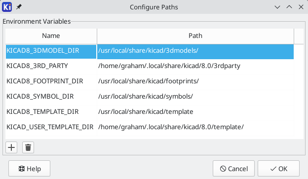

Paths set in the Configure Paths dialog are internal to KiCad and are not
visible as environment variables outside of KiCad. They are stored in
<<config-file-location,KiCad's user configuration files>>.

Paths can also be set as system environment variables outside of KiCad, which
will override any settings in the user's configuration.

NOTE: You cannot override a system environment variable that has been set
      outside of KiCad by using the Configure Paths dialog. Any variable that
      has been set externally will be shown as read-only in the dialog.

Note also that the path variable `KIPRJMOD` is *always* internally
defined by KiCad, and expands to the **current project absolute path**.
For instance, `$\{KIPRJMOD\}/connect.pretty` is always the `connect.pretty`
folder (the footprint library) inside **the current project folder**.
The `KIPRJMOD` variable cannot be changed in the Configure Paths dialog or
overridden by an external environment variable.

=== Advanced environment variables

Some advanced environment variables can be set to customize where KiCad expects
certain files to be located. By default, these locations are set based on your
platform, but they can be overridden by system environment variables. These
variables are not shown in the Configure Paths dialog and cannot be used in path
substitutions.

Changing these variables will not result in KiCad moving any files from the
default location to the new location, so if you change these variables you will
need to copy any desired settings or files manually.

[width="100%",cols="30%,70%",]
|=================================================================
|`KICAD_CONFIG_HOME` |Base path of KiCad configuration files. Subdirectories will be created
    within this directory for each KiCad minor version.
|`KICAD_DOCUMENTS_HOME` |Base path of KiCad user-modifiable documents, such as projects, templates,
    Python scripts, libraries, etc. Subdirectories will be created within this directory for each
    KiCad minor version. This directory is provided as a suggested user data location, but does
    not need to be used.
|`KICAD_STOCK_DATA_HOME` |Base path of KiCad stock data, including default libraries. The data
    in this directory is managed by the KiCad installer or system package manager, and is not
    intended for user-writeable data.
|=================================================================

WARNING: If you modify the configuration of paths, please quit and restart KiCad
to avoid any issues in path handling.

[[libraries-configuration]]
=== Libraries configuration

The *Preferences* -> *Manage Symbol Libraries...* menu lets you manage the
list of symbol libraries
(xref:../eeschema/eeschema.adoc#managing-symbol-libraries[symbol library table]).

Likewise, use the *Preferences* -> *Manage Footprint Libraries...* menu to manage
the list of footprint libraries
(xref:../pcbnew/pcbnew.adoc#managing-footprint-libraries[footprint library table]).

For each type of library (symbol and footprint), there are 2 library tables:
global and project specific. The global library table is located in the
<<config-file-location,user configuration directory>> and contains a list of
libraries available to all projects. The project-specific library table is
optional and contains a list of libraries specific to the project. It is located
in the project directory.

[[jobsets]]
== Jobsets

KiCad lets you configure a list of outputs that are all generated with a single click. The list of output jobs and the destinations where they will be saved is called a __jobset__. For example, a jobset might contain jobs to generate Gerber files, assembly data, a bill of materials, PDF plots of the schematic and PCB, while also running ERC and DRC checks, with all of the outputs saved to a compressed archive. The full list of available jobs is given <<job-types,below>>.

Each __job__ in a jobset defines a single type of generated output, such as a bill of materials or a set of Gerbers. A job can be configured in the same way as if the output was manually generated from the schematic or board editor. The configuration for each job is stored in the jobset and remembered when you load the jobset later. Jobs are configured individually, so if you include the same type of job multiple times in a single jobset, each job will have its own independent configuration. For example, this lets you generate PDF outputs in color as well as black and white.

In addition to the jobs, jobsets also contain __destinations__, which define a list of jobs to run and how to store their outputs. A jobset destination can simply store the chosen jobs' output files in a specified location, or it can add the output files to a compressed archive. Each jobset destination can select a different subset of jobs from the full list of jobs in the jobset. You can run each jobset destination individually or run all jobset destinations at once. As an example, you could set up one jobset destination that generates PDFs of the board and schematic and copies them to an external location, while another destination generates the fabrication files and compresses them in a zip archive to send to the board manufacturer.

Projects can have multiple jobsets, with each jobset defining a different list of jobs and output configurations. Each jobset is stored in a `.kicad_jobset` file, which can be specific to a single project, copied between projects, or even stored in a central location and shared between projects.

To use a jobset, first create a new jobset file in the KiCad project manager (**File** -> **New Jobset File...**) and choose a name and location for it. Alternatively, you can open an existing jobset file with **File** -> **Open Jobset File...**. Jobset files that are stored in the project directory are considered part of the project and are displayed in the project file tree. You can open a jobset file in the project file tree by double clicking on it.

// NOTE: for screenshots in this section, you can use kicad-doc/helpers/fabrication.kicad_jobset
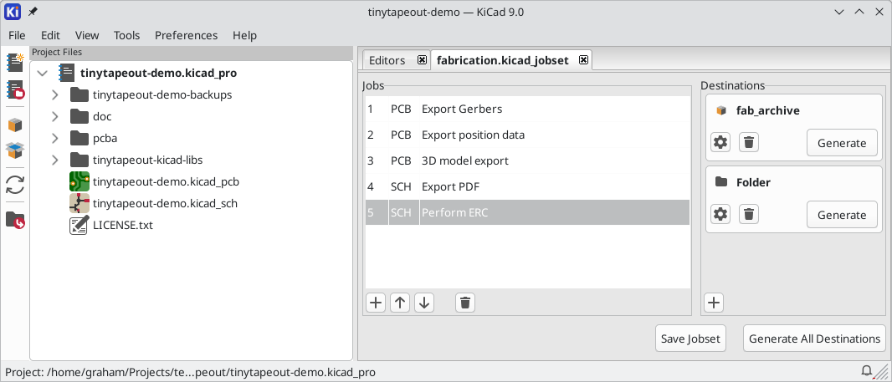

Once you create or open a jobset, it is displayed in a new tab in the project manager. The list of jobs is shown in the middle and the list of jobset destinations is shown on the right. New jobsets will not contain any jobs, but a destination is automatically created to save outputs to a folder. When you make changes to a jobset, you can save the changes by clicking the **Save Jobset** button.

=== Defining jobs

To add a new job, click the  button under the Jobs list. In the Add New Job dialog that appears, select the desired type of job. You can filter which types of jobs are shown in the list by typing in the **Filter** textbox at the bottom.

When you select a job and press **OK**, the settings dialog for that type of output will appear. Each job settings dialog provides the same options you would have if you manually generated that type of output from the schematic or board editor.

NOTE: Output filenames and paths specified in job settings are relative to the <<jobset-destinations,jobset destination>> folder or archive root. You can use certain xref:../eeschema/eeschema.adoc#text-variables[text variables], like `${PROJECTNAME}`, `${CURRENT_DATE}`, and xref:../eeschema/eeschema.adoc#schematic-setup-text-variables[project text variables].

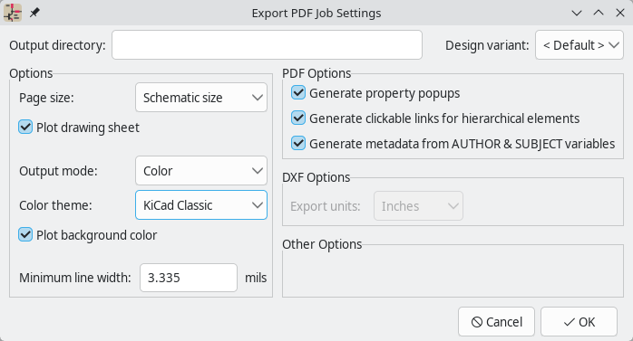

When you accept the job settings dialog, the job is added to the list of jobs, where you can optionally change the new job's description from its default. To change a job's description or settings later, right click the job in the list and select **Edit Job Description** or **Edit Job Settings...**. Double clicking on a job also edits its settings. To remove a job, select the job and click the  button. To reorder the list, select a job and move it up or down using the  or  buttons.

[[jobset-destinations]]
=== Defining jobset destinations

You cannot generate any outputs from a jobset until you add a jobset destination. One destination is created automatically when a jobset is created, but you can add as many destinations as you need.

To add a jobset destination, click the  button under the Destinations list. When the Add New Destination dialog appears, select a type of destination:

* **Archive** saves the outputs generated by the jobs in a compressed zip archive.
* **Folder** saves the outputs generated by the jobs uncompressed in a folder.

Once you have selected a type of output, the Destination options dialog appears. 

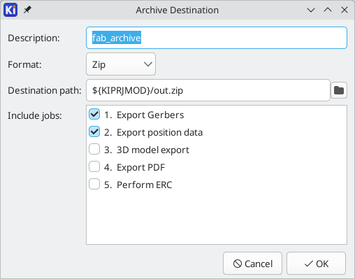

Here you can select which jobs will be run as part of this jobset destination, as well as the folder or archive name that will be used to store them. By default all jobs are enabled. You can also set a description for the destination to be displayed in the Destinations list. The output path controls where the files generated by the jobs will be saved. The path here can be absolute or relative to the project directory, and it can use <<kicad-environment-variables,path variables>> or certain text variables (`${PROJECTNAME}`, `${CURRENT_DATE}`, and xref:../eeschema/eeschema.adoc#schematic-setup-text-variables[project text variables]). Filenames defined in job configurations are relative to the jobset destination directory or archive root.

When you click **OK** in this dialog, the new jobset destination is added to the Destinations list. You can modify an existing jobset destination by clicking its  button, or remove it by clicking its  button.

After configuring your jobs and destinations, you can generate an individual set of outputs by clicking the **Generate** button for the desired destination. You can run all destinations at once by clicking the **Generate All Destinations** button.

If a jobset destination runs and generates its outputs successfully, a blue check is shown that indicates the last run was successful. If a jobset destination fails to complete successfully, a red exclamation point is shown to indicate the run was not successful. Clicking on the success/failure indicator will display the Jobset Run Log dialog, which displays the status of each job in the jobset destination. Clicking on a specific job will display the logged output from that job, if there is any.

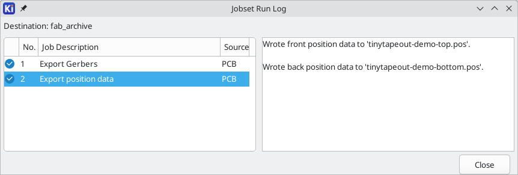

After a jobset destination runs successfully, you can click the destination's **Open Output** button to open a file browser in the destination location.
This button is disabled if the jobset destination has not run or hasn't successfully finished.

==== Jobset destination details

When jobs run, output files are initially generated in a temporary folder. After all jobs in a jobset destination are completed, the output files are moved from the temporary folder to the folder or archive specified by the jobset destination. None of the outputs are moved until all of the jobs finish. Therefore, if a job needs to access files that are generated by another job in the same jobset destination, these files will be located in the temporary folder, not the final jobset destination.

KiCad defines the `${JOBSET_OUTPUT_WORK_PATH}` environment variable while jobs are running and sets it to the temporary path for the current jobset destination. You can use this environment variable if a job needs to be aware of the temporary folder's actual location. For example, if an Execute Command job runs a script that renames the outputs of another job, the script needs to know the temporary location of the outputs being renamed, before they are moved to the jobset destination. `${JOBSET_OUTPUT_WORK_PATH}` provides this location.

[[job-types]]
=== Available job types

The following types of jobs are available:

[width="100%",cols="30%,70%",]
|====
| Job | Description
| PCB: Export 3D Model
      | Exports a xref:../pcbnew/pcbnew.adoc#_3d-export[3D model] of the board. The model format can be STEP, GLB (binary glTF), XAO, BREP (OCCT), PLY, STL, STPZ, U3D, or PDF.
| PCB: Export Board Statistics
      | Generates a xref:../pcbnew/pcbnew.adoc#board-statistics[Board Statistics] report in either JSON or text report format.
| PCB: Export Drill Data
      | Exports a xref:../pcbnew/pcbnew.adoc#drill_files[drill file] from the board.
| PCB: Export DXF
      | Exports the board design to a xref:../pcbnew/pcbnew.adoc#fabrication_outputs_and_plotting[DXF file].
| PCB: Export Gencad
      | Exports the board design in xref:../pcbnew/pcbnew.adoc#gencad[GenCAD format].
| PCB: Export Gerbers
      | Exports the board design to xref:../pcbnew/pcbnew.adoc#fabrication_outputs_and_plotting[Gerber files], with one file per selected layer.
| PCB: Export IPC-2581
      | Exports the board design in xref:../pcbnew/pcbnew.adoc#ipc-2581-export[IPC-2581 format].
| PCB: Export ODB{pp}
      | Exports the board design in xref:../pcbnew/pcbnew.adoc#odb-export[ODB{pp} format].
| PCB: Export PDF
      | Exports the board design to xref:../pcbnew/pcbnew.adoc#fabrication_outputs_and_plotting[PDF files], with one file per selected board layer. You can also generate a single PDF with multiple layers depending on the plot configuration.
| PCB: Export Position Data
      | Exports a xref:../pcbnew/pcbnew.adoc#component_placement_files[position (component placement) file] from the board.
| PCB: Export PostScript
      | Exports the board design to a xref:../pcbnew/pcbnew.adoc#fabrication_outputs_and_plotting[PostScript file].
| PCB: Export SVG
      | Exports the board design to a xref:../pcbnew/pcbnew.adoc#fabrication_outputs_and_plotting[SVG file].
| PCB: Perform DRC
      | Performs a xref:../pcbnew/pcbnew.adoc#design-rule-checking[Design Rule Check] on the board and generates a report. If DRC violations are found, this job can optionally report a job failure.
| PCB: Render
      | Generates a xref:../pcbnew/pcbnew.adoc#threed-viewer[raytraced rendering of the 3D model of the board] as a PNG or JPG file.
| Schematic: Export DXF
      | Exports the schematic to a xref:../eeschema/eeschema.adoc#plotting[DXF file].
| Schematic: Export Netlist
      | Exports a xref:../eeschema/eeschema.adoc#netlist-export[netlist] from the schematic, with various formats available.
| Schematic: Export PDF
      | Exports the schematic to a xref:../eeschema/eeschema.adoc#plotting[PDF file].
| Schematic: Export Postscript
      | Exports the schematic to a xref:../eeschema/eeschema.adoc#plotting[PostScript file].
| Schematic: Export SVG
      | Exports the schematic to a xref:../eeschema/eeschema.adoc#plotting[SVG file].
| Schematic: Generate Bill of Materials
      | Exports a xref:../eeschema/eeschema.adoc#bom-export[bill of materials] from the schematic.
| Schematic: Perform ERC
      | Performs an xref:../eeschema/eeschema.adoc#erc[Electrical Rule Check] on the schematic and generates a report. If ERC violations are found, this job can optionally report a job failure.
| Special: Copy Files
      | Copies the specified file to the specified location. A failure to copy the files can optionally cause the output job to fail. You can control whether files in the output location should be overwritten or not.
| Special: Execute Command
      | Executes an arbitrary command.
        Output from the command can optionally be logged to a file.
        You can either ignore non-zero output codes or cause them to fail the output job.
        The command is executed in the platform's shell (`/bin/sh -c` on Linux and macOS, `cmd.exe \c` on Windows),
        so platform-shell-specific features can be used in the command, such as globbing and pipes.

        *Note:* Job output files are generated in a temporary folder, then moved to the location specified by the jobset destination after all jobs for that destination are executed. In other words, when an Execute Command job runs, the output from other jobs in the same jobset destination are still in a temporary location and not yet in the ultimate destination folder or archive. You can use the `${JOBSET_OUTPUT_WORK_PATH}` environment variable if you need to refer to the temporary location in an Execute Command job (for example, in a script that renames files generated by another job).
|====

[[project-templates]]
== Project templates

Using a project template facilitates setting up a new project with predefined settings.
Templates may contain pre-defined sheet sizes, drawing sheets, board outlines, connector positions, schematic elements, design rules, logos, etc.
Complete schematics and/or PCBs used as seed files for the new project may even be included.

=== Using templates

Creating a new project (**File** -> **New Project...**) opens the Project Template Selector dialog.
By default, all installed templates are shown in the list of templates,
but you can limit the list to system templates or user templates using the dropdown menu above the list.

- _System templates_ are installed with KiCad and include templates for designs in some common form factors.
- _User templates_ are any templates created by you. The default, blank KiCad template is also considered a user template.

When you click on a template, information about the template is shown in the right panel.

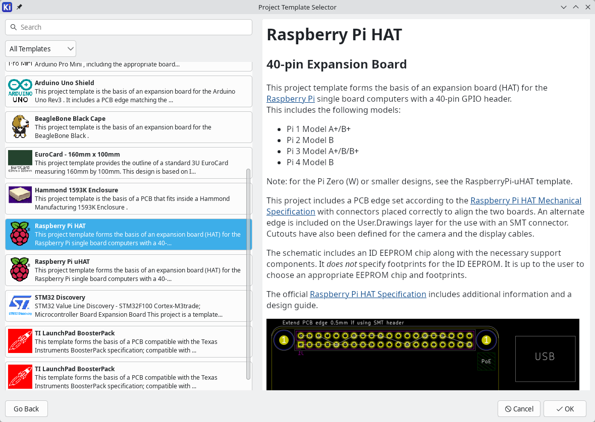

A further click on the **OK** button creates a new project based on the selected template.
You can pick the name of the new project and where to create it.
The template files will be copied to the new project location and renamed to reflect the new project's name.

[[template-locations]]
=== Template locations

When you create a new project, the Project Template Selector dialog shows templates from two locations:

- System Templates are templates in the path defined by the `KICAD10_TEMPLATE_DIR` path variable.
  These templates are installed with KiCad's default libraries and generally should not be modified by users.
- User templates are templates in the path defined by the `KICAD_USER_TEMPLATE_DIR` path variable.
  When you create your own project templates, store them in this location so you can use them when you create a new project.

To change the location of the user template folder, edit the `KICAD_USER_TEMPLATE_DIR` path variable in your <<path-variables,paths configuration>>.

[[template-contents]]
=== Template contents

A KiCad template is a directory containing the template project files,
as well as some required metadata for the template in a subdirectory named `meta`.
The name of the directory containing the template files determines the name of the template.
This means that a KiCad template folder is simply a KiCad project folder with an additional `meta` subdirectory.

When you create a project from a template,
KiCad copies the template files to the new project directory,
renaming them to match the new project name as described below.
All files in the template are copied, with two exceptions:

* Files with names beginning with the `.` character (dotfiles) are not copied.
  There is a special case for files named `.gitignore` or `.gitattributes`,
  which are copied if they exist.
* The `meta` directory is not copied.

NOTE: Other than the two exceptions above, all files in the template are copied, even if they are not KiCad design files.
      This means you can use templates to create projects that are already set up with non-KiCad files you need to include, such as documentation templates, license files, logos, `.gitignore` files, etc.

[[template-metadata]]
==== Template metadata

A template's `meta` directory must contain an HTML file named `info.html`, which is
displayed in the KiCad template browser and should contain basic information
describing the template. Basic HTML features are supported, including images.
Any images referenced by `info.html` should also be stored in the `meta`
directory.

The `<title>` tag determines the name of the template that is displayed during
template selection. Note that the project template name will be cut off if it's
too long. This display name does not need to be the same as the template
directory name.

Here is a sample `info.html` file:

[source,html]
----------------------------------------------------------------
<!DOCTYPE HTML PUBLIC "-//W3C//DTD HTML 4.0 Transitional//EN">
<HTML>
<HEAD>
<META HTTP-EQUIV="CONTENT-TYPE" CONTENT="text/html;
charset=windows-1252">
<TITLE>Raspberry Pi - Expansion Board</TITLE>
</HEAD>
<BODY LANG="fr-FR" DIR="LTR">

This project template is the basis of an expansion board for the
<A HREF="http://www.raspberrypi.org/" TARGET="blank">Raspberry Pi $25
ARM board.</A>   This base project includes a PCB edge defined
as the same size as the Raspberry-Pi PCB with the connectors placed
correctly to align the two boards. All IO present on the Raspberry-Pi
board is connected to the project through the 0.1&quot; expansion
headers.   The board outline looks like the following:

    

(c)2012 Brian Sidebotham (c)2012 KiCad Developers

</BODY>
</HTML>
----------------------------------------------------------------

Finally, `meta` can optionally contain an image named `icon.png`, which will be
used as the template's icon in the template selection dialog. The icon should be
a 64 x 64 pixel PNG image.

==== Template file renaming

All files and directories in a template are copied to the new project
path when a project is created using a template, except `meta` and dotfiles.
Files and directories containing the template directory name will be renamed
with the new project file name.
Files and directories that don't contain the template name keep their original name.

For example, using a template named `example` (left) to create a project named
`newproject` (right), with renamed files shown in *bold*:

[width="100%",cols="50%,50%",options="header"]
|=======================================================================
|Files in template `example` directory
|Files created in project `newproject` directory
|
`example.kicad_pro` +
`example.kicad_sch` +
`example.kicad_pcb` +
`example-first.kicad_sch` +
`second-example.kicad_sch` +
`third.kicad_sch` +
`third.kicad_pcb`
|
`*newproject.kicad_pro*` +
`*newproject.kicad_sch*` +
`*newproject.kicad_pcb*` +
`*newproject-first.kicad_sch*` +
`*second-newproject.kicad_sch*` +
`third.kicad_sch` +
`third.kicad_pcb`
|=======================================================================

A template does not need to contain a complete project. If a required
project file is missing, KiCad will create the file using the default create
project behavior:

[width="100%",cols="50%,50%",options="header"]
|=======================================================================
|Files in template `example` directory
|Files created in `newproject` directory
|
`example.kicad_sch` +
`first-example.kicad_sch` +
`first-example.kicad_pcb` +
`second-example.kicad_sch` +
`second-example.kicad_pcb`
|
`*newproject.kicad_sch*` +
`*first-newproject.kicad_sch*` +
`*first-newproject.kicad_pcb*` +
`*second-newproject.kicad_sch*` +
`*second-newproject.kicad_pcb*` +
`*newproject.kicad_pro*` (default) +
`*newproject.kicad_pcb*` (default)
|=======================================================================

As an exception to the template name renaming rule, if the template contains
one project file (`.kicad_pro`) and its name doesn't match the template name,
KiCad will do the renaming based on that project file name instead:

[width="100%",cols="50%,50%",options="header"]
|=======================================================================
|Files in template `example` directory
|Files created in `newproject` directory
|
`example.kicad_sch` +
`example.kicad_pcb` +
`*first-example.kicad_pro*` +
`first-example.kicad_sch` +
`first-example.kicad_pcb` +
`second-example.kicad_sch` +
`second-example.kicad_pcb`
|
`example.kicad_sch` +
`example.kicad_pcb` +
`*newproject.kicad_pro*` +
`*newproject.kicad_sch*` +
`*newproject.kicad_pcb*` +
`second-example.kicad_sch` +
`second-example.kicad_pcb`
|=======================================================================

WARNING: It is not recommended to create a template with multiple project files.

=== Creating new templates

Because a KiCad template is just a Kicad project with an additional metadata folder,
the easiest way to create a new template is to start from a project.
If you save a project in your <<template-locations,user template folder>> and add a `meta` folder to it,
you can use it as a template.

TIP: To find out where your user template folder is, check the value of the `KICAD_USER_TEMPLATE_DIR` path variable in the Configure Paths dialog (**Preferences** -> **Configure Paths...**).

If you are creating a template from scratch, you can create a new project in the user template folder,
then edit the project until you have created your desired template.
This new project will be your template, so when you create it you should choose the name based on what you want the template to be called.

If you have an existing project that you want to turn into a template,
you can save a copy of that project into your user template folder
(**File** -> **Save As...** from the Project Manager).
The name you choose for the re-saved project will be the template name.
After saving in the template folder, you can edit the template project so that it exactly matches your desired template.

In either case, templates are required to have a <<template-metadata,metadata directory>>,
so you must add a `meta` folder inside the template folder.
The metadata folder must also contain an `info.html` file, which is intended to contain a description of the template.
You can copy the <<template-metadata,sample `info.html` above>> as a starting point.

In general, you will also want to remove any files and folders that you don't want to include each time you use the template.
Some examples of things to remove include the `*-backups` folder, the `.history` snapshot folder, any unneeded version control files (`.git`, etc.), and anything else you don't want to include in new projects.

[[plugin-content-manager]]
== Plugin and Content Manager

KiCad has a Plugin and Content Manager that lets you browse, install, and
manage packages submitted by other users and organizations. Packages can be
plugins offering specialized functionality, tools for ordering PCBs from
specific manufacturers, libraries of symbols and footprints, or new editor
color schemes. You can access the PCM by launching it from the main KiCad
Project Manager window.

The PCM downloads packages from repositories on the internet. Each repository is
a collection of packages that is managed by an individual or an organization. By
default, the PCM uses a single repository managed by the KiCad organization.
Users and organizations are free to create their own repositories, which other
users can can then add as additional repositories in their own KiCad
installation. Third-party repositories can be public or private.

NOTE: Packages may install code that runs on your computer. Packages are not
      developed by the KiCad developers. The KiCad organization does not make
      any guarantees about the quality or safety of packages installed through
      the PCM. Make sure you only install packages that you trust.

NOTE: If you have feedback regarding a package, please submit it to the
      package's developer, not the KiCad team. Contact information for each
      package is shown in the package's description.

To share a package that you have developed, you can submit it to the KiCad
official repository. If it is accepted, it will then be available to other users
browsing the KiCad repository. You can also create your own repository or submit
your package to a repository managed by another person or group, but in that
case users will not see your package unless they have configured that repository
in their own installation. More information about creating your own packages and
repositories is available <<pcm-creating-packages,below>>.

=== Browsing packages

All of the packages in a repository are shown in the PCM's **Repository** tab.
You can choose which repository to browse by selecting the repository in the
dropdown at the top of the tab. By default, only the KiCad official repository
is enabled.

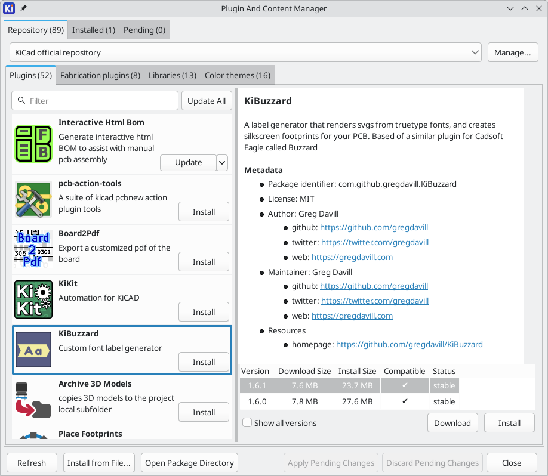

Packages are grouped into four categories, each with its own tab within the
**Repository** tab:

- **Plugins** are additional tools that can be launched from the PCB Editor.
  Plugins can have many purposes, for example modifying a board design or
  generating specific outputs. Footprint wizards can also be distributed as
  plugins.
- **Fabrication plugins** are a sub-category of plugins for ordering your PCBs
  from specific fabricators. These plugins may be a convenient way to order from
  a manufacturer, but they are typically not required; you can usually provide
  manufacturers with normal fabrication outputs instead. Consult with your
  manufacturer to find out the best way to order from them.
- **Libraries** contain symbols, footprints, and/or 3D models. By default,
  libraries installed by a library package are automatically added to the
  appropriate symbol and/or footprint library tables when the package is
  installed, and removed from the table when the package is uninstalled.
  Libraries installed by a package have configurable library name prefix (`PCM_`
  by default). These settings are configurable in the **Packages and Updates**
  section of Preferences.
- **Color themes** are color themes for the Schematic, Symbol, Board, and
  Footprint editors. You can select an installed theme in the **Colors** section
  of the Preferences for each editor.

The list on the left of the window shows the packages within each category. You
can filter the list of packages by typing in the filter box at the top of the
package list. Press the **Refresh** button to reload the list of packages from
the online repository.

When you select a package in the list, information about the package is shown on
the right. This includes a description of the package, the package's license,
and contact information for the package's developer, including a place to report
bugs and other feedback for the package.

The package information also includes a table of the versions of the package
that are currently available. For each version, the table displays the package size, its status, and whether it is compatible with your version of KiCad.

A package's status can be one of the following, as indicated by the package's
developer:

- Stable: the package version is suitable for general use.
- Testing: the package version is in a testing phase; users should be cautious
  and report any issues they encounter to the package's developers.
- Development: the package version is in a development phase; users should not
  expect it to work fully.
- Deprecated: the package is no longer maintained.

By default, the version table only shows versions of the package that are
compatible with your version of KiCad. You can show all versions of the package,
even those that will not work with your KiCad version, by checking the
**Show all versions** box. If multiple versions of a package are available, you
can choose which to install.

=== Installing packages

When you decide to to install a package, click the package's **Install** button
in the package's description page. If there are multiple versions of the package
available, select the desired version in the version table before installing.
You can also install the latest version by clicking the **Install** button in
the list of packages. This does not immediately install the package; the package
is instead queued for later installation and is shown in the **Pending** tab.
The package will not be installed until you click the **Apply Pending Changes**
button, which installs all pending packages at once.

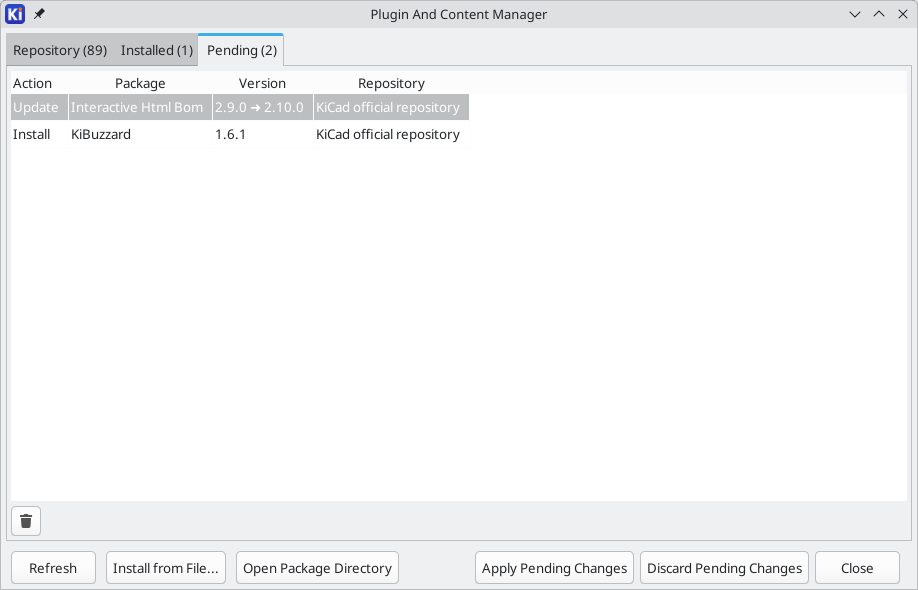

To remove a single package from the pending installation list, select it in the
**Pending** tab and press the  button. To
cancel the installation of all pending packages, click the **Discard Pending
Changes** button.

Once a package is installed, it is listed in the **Installed** tab. In this tab
you can see the list of installed packages and update or uninstall any of them.

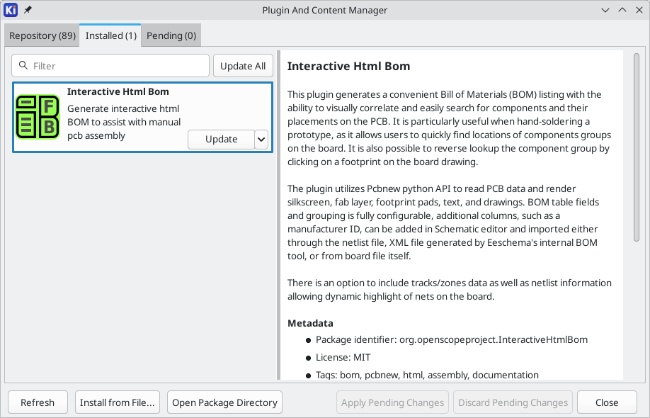

If any packages have new versions available, the PCM icon in the Project Manager displays an indicator showing the number of available updates.

To update to a different version of a package, select the new version in its
version table and click the **Update** button. You can also update a package to
the newest version by clicking **Update** in the dropdown menu next to its
**Uninstall** button in the list of installed packages. To update all installed
packages, click the **Update All** button at the top of the installed package
list. A package will not be updated if **Pin Package** is selected in its
dropdown menu.

To uninstall a package, click its **Uninstall** button in the list of installed
packages or in the package's description page.

As with installation, packages are not updated or uninstalled immediately when
you click the **Update** or **Uninstall** button. Instead, the operation is
queued in the **Pending** tab until you apply each change individually or click
the **Apply Pending Changes** button.

Finally, you can download a package without installing it by clicking the
**Download** button at the bottom of the package's description and selecting a
location to save the package. This lets you inspect the files in the package
before installing it. To install a package that has been downloaded but not yet
installed, click the **Install from file...** button and select the package. The
**Open Package Directory** button opens a file browser in the folder where KiCad
installs packages.

=== Managing repositories

By default, only the KiCad official repository is used by the PCM. You can add
a third party repository, or remove existing repositories, by clicking the
**Manage...** button at the top of the **Repository** tab. 

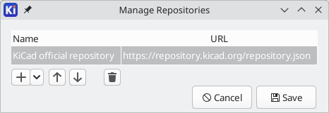

To add a repository, click the  button and
specify the full URL to the repository. To remove a repository, select it and
press the  button. Use the
 and 
buttons to reorder repositories in the list.

If you remove the default KiCad official repository, you can easily re-add it by
clicking **Add Default Repository** in the dropdown menu next to the
 button.

[[pcm-creating-packages]]
=== Creating packages and repositories

To create a package for the PCM, follow the instructions at
https://dev-docs.kicad.org/en/addons/index.html. These instructions explain how
to create PCM packages for any repository, including but not limited to the
KiCad official repository. They also explain the rules for packages included in
the KiCad repository and how to submit packages to this repository.
Third-party repositories use the same package format but may have different
rules and procedures for submitting packages.

To create your own repository, publish a repository JSON file following the
schema published at https://go.kicad.org/pcm/schemas/v1.

[[kicad-manager-configuration]]
== KiCad preferences

The KiCad preferences can always be accessed from the **Preferences** menu, or by using the hotkey
(default kbd:[Ctrl+,]). The Preferences dialog is shared between the running KiCad tools.  Some
preferences apply to all tools, and some are specific to a certain tool (such as the schematic or
board editor).

=== Common preferences

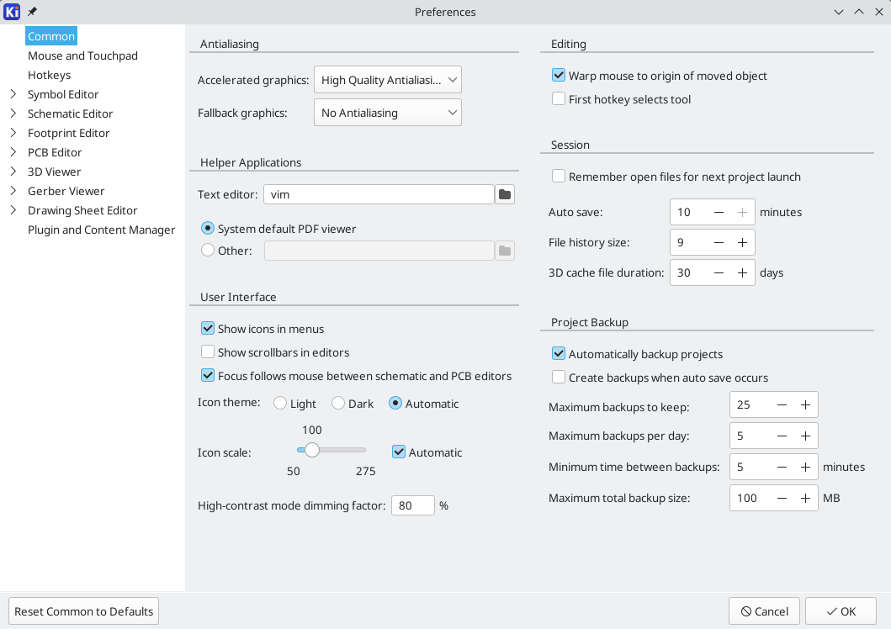

**Accelerated graphics antialising:** KiCad can use different methods to prevent aliasing
(jagged lines) when rendering using a graphics card.  Different methods may look better on
different hardware, so you may want to experiment to find the one that looks best to you.

**Fallback graphics antialiasing:** KiCad can also apply antialiasing when using the fallback
graphics mode.  Enabling this feature may result in poor performance on some hardware.

**Text editor:** Choose a text editor to use when opening text files from the project tree view.

**PDF viewer:** Choose a program to use when opening PDF files.

**Show icons in menus:** Enables icons in drop-down menus throughout the KiCad user interface.

NOTE: Icons in menus are not displayed on some operating systems.

**Show scrollbars in editors:** When enabled, scrollbars are displayed next to the editing
canvases in each tool. When disabled, scrollbars are not shown.

**Focus follows mouse between schematic and PCB editors:** When enabled, the window under the
mouse cursor will automatically become focused.

**Icon scale:** Sets the size of the icons used in menus and buttons throughout KiCad.  Choose
_Automatic_ to pick an appropriate icon scale automatically based on your operating system
settings.

**Icon theme:** Sets whether to use the icon theme designed for light window backgrounds or dark
window backgrounds.  The default setting of Automatic will choose the theme based on the lightness
of the operating system window theme.

**High-contrast mode dimming factor:** Sets how much non-focused items are
dimmed in high-contrast display mode.

**Warp mouse to origin of moved object:** When enabled, the mouse cursor will be repositioned
(warped) to the origin of an object when you start a move command on that object.

**First hotkey selects tool:** When disabled, pressing the hotkey for a command such as _Add Wire_
will immediately start the command at the current cursor location.  When enabled, pressing the
hotkey the first time will just select the _Add Wire_ tool but will not immediately begin a wire.

**Remember open files for next project launch:** When enabled, KiCad will automatically re-open any
files that were previously open when a project is re-opened.

**Auto save:** When editing schematics and board files, KiCad can automatically save your work
periodically.  Set to `0` to disable this feature.

**File history size:** Configure the number of entries in the list of recently-opened files

**3D cache file duration:** KiCad creates a cache of 3D models in order to speed up the 3D viewer.
You can configure how long to keep this cache before deleting old files.

**Automatically backup projects:** When enabled, KiCad projects will be archived to ZIP files
automatically according to the settings below.  The archives will be stored in a subfolder of the
project folder.  Backups are created when saving files in the project.

**Create backups when auto save occurs:** When enabled, a backup will be created every time an
automatic file save occurs (if the backup is permitted by the settings below).  This setting has
no effect if the auto save interval is set to `0` (disabled).

**Maximum backups to keep:** When creating a new backup, the oldest backup file will be deleted to
keep the total number of backup files below this limit.

**Maximum backups per day:** When creating a new backup, the oldest backup file created on the
current day will be deleted to stay below this limit.

**Minimum time between backups:** If backup is triggered (for example, by saving a board file),
the backup will not be created if an existing backup file is newer than this limit.

**Maximum total backup size:** When creating a new backup file, the oldest backup files will be
deleted to keep the total size of the backup files directory below this limit.

=== Mouse and touchpad preferences

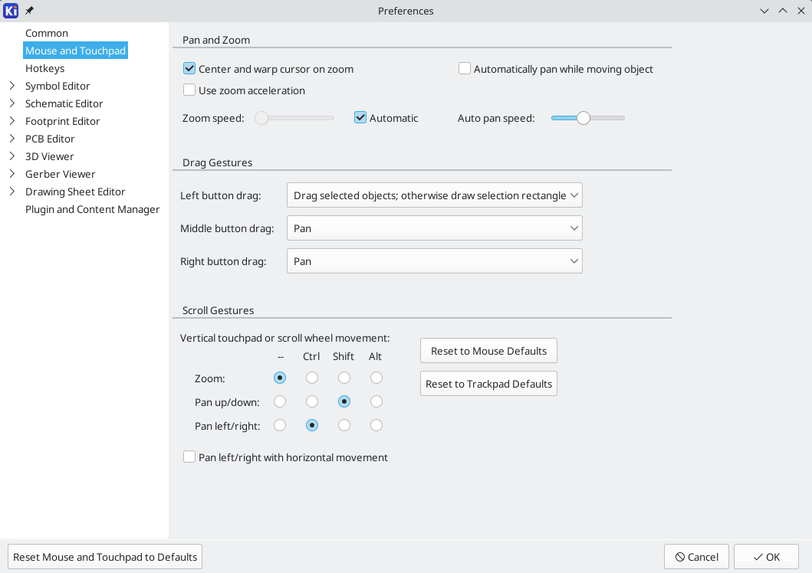

**Center and warp cursor on zoom:** When enabled, zooming using the hotkeys or mouse wheel will
cause the view to be centered on the cursor location.

**Use zoom acceleration:** When enabled, scrolling the mouse wheel or touchpad faster will cause
the zoom to change faster.

**Zoom speed:** Controls how much the zoom changes for a given amount of scrolling the mouse wheel
or touchpad.  Use _Automatic_ to set a default value depending on your operating system.

**Automatically pan while moving object:** When enabled, the view can be panned while moving an
object by moving close to the edge of the canvas.

**Auto pan speed:** Controls how fast the canvas pans while moving an object.

**Mouse buttons:** You can set the behavior of dragging the middle and right mouse buttons to zoom
the view, pan the view, or have no effect.  You can also set the behavior of dragging the left
mouse button depending on whether or not any objects are already selected in the editing canvas.

NOTE: The left mouse button is always used for selecting and manipulating objects.

**Mouse wheel and touchpad scrolling:** You can set the behavior of scrolling the mouse wheel or
vertical motion of the touchpad while pressing certain modifier keys.

**Pan left/right with horizontal movement:** When enabled, you can pan the view using the touchpad
or horizontal scroll wheel (if present on your mouse).

=== Hotkey preferences

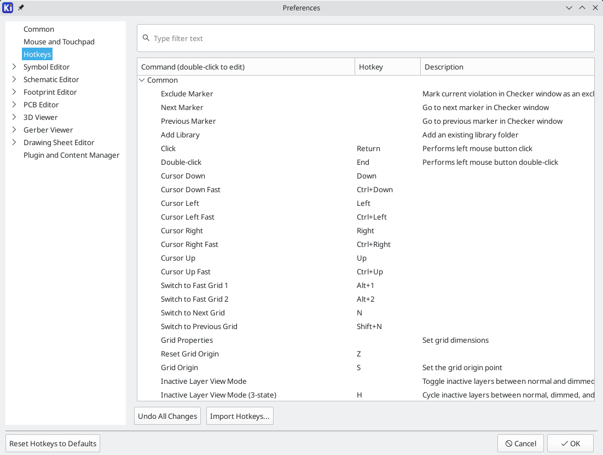

You can use this dialog to customize the hotkeys used to control KiCad.  The hotkeys in the
_Common_ section are shared between every KiCad program. Hotkeys for each specific KiCad program
are shown when that program is running.  You can assign the same hotkey to a different action in
different KiCad programs (for example, the schematic editor and the board editor), but you cannot
assign a hotkey to more than one action in the same program.

There are many available commands, and so not all of them have a hotkey assigned by default.  You
can add a hotkey to any command by double-clicking on the command in the list.  If you choose a
hotkey that is already assigned to a different command, you can choose to use that hotkey on your
chosen command, which will remove the hotkey assignment from the conflicting command.

Changes that you have made to hotkey assignments are shown with a `*` character at the end of the
command name.  You can undo changes to a specific command by right-clicking that command and
selecting **Undo Changes**, or you can undo all changes with the button below the command list.

==== Importing hotkeys

Hotkey preferences are stored in `.hotkeys` files in the KiCad settings directory (see the
<<settings,Settings>> section for information about where the settings directory is on your
operating system).  If you have configured KiCad hotkeys the way you like on one computer, you can
transfer that configuration to another computer by importing the appropriate `.hotkeys` file(s).

// actions reference (section header in included file)
include::kicad_projmgr_actions_reference.adoc[po4a]
