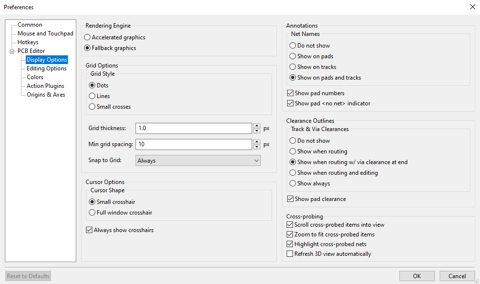
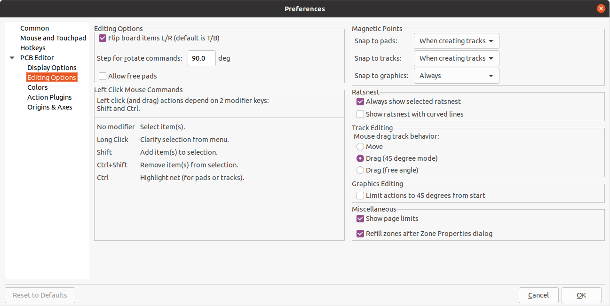
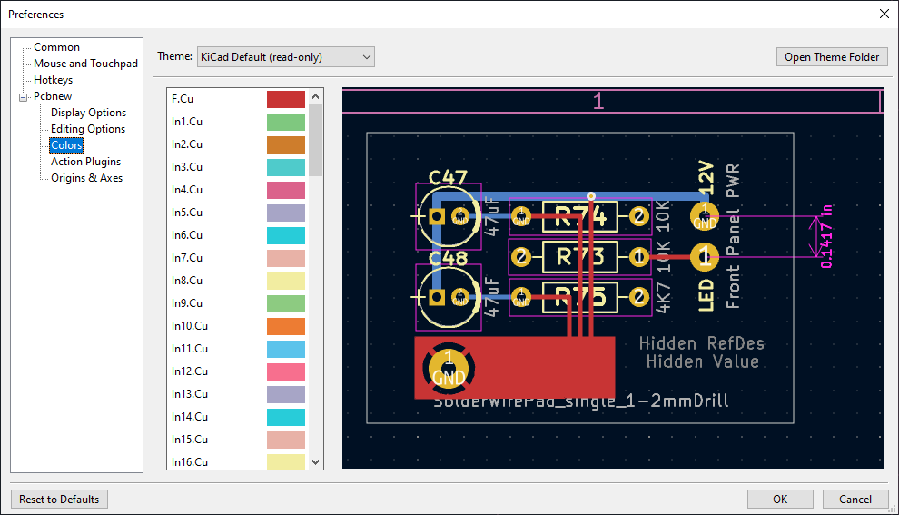
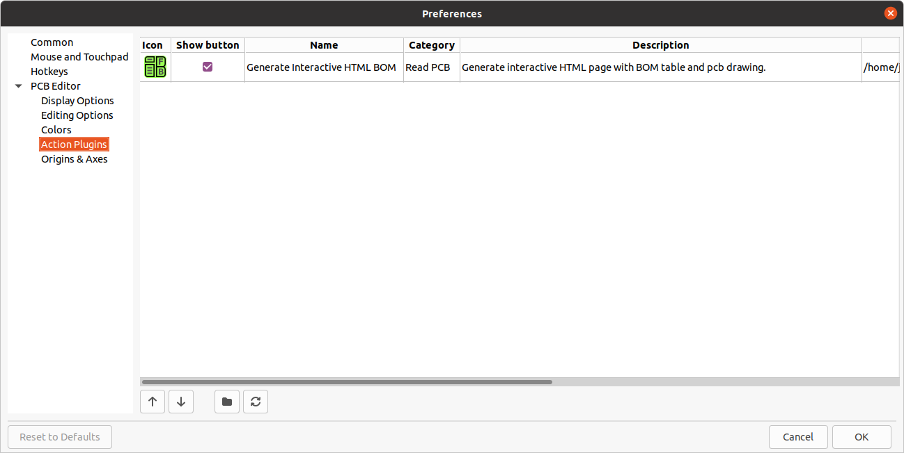
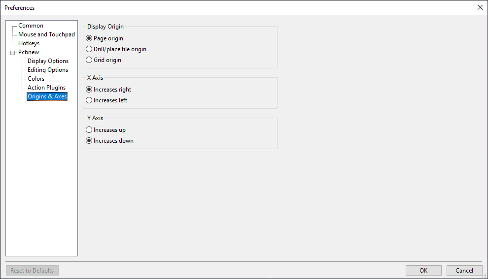
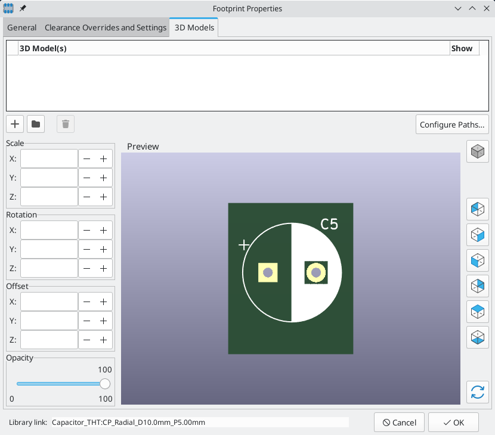
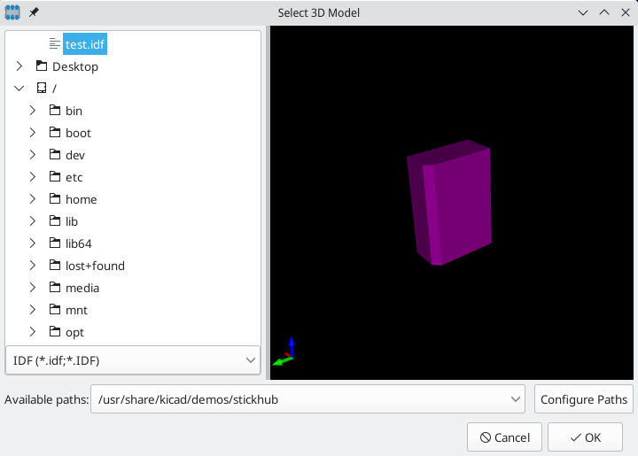
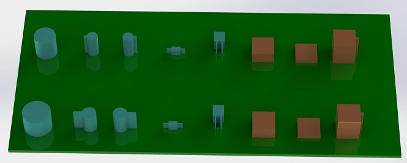

:experimental:

== Advanced topics

[[configuration-and-customization]]
=== Configuration and Customization

The KiCad PCB Editor has a variety of preferences that can be configured through the Preferences dialog. Like
all parts of KiCad, the preferences for the PCB Editor are stored in the user configuration directory and
are independent between KiCad minor versions to allow multiple versions to run side-by-side with
independent preferences.

The first sections of the Preferences dialog (Common, Mouse and Touchpad, and Hotkeys) are shared
between all KiCad programs. These sections are described in detail in the KiCad manual under the
"Common preferences" section.

==== Display options

**Rendering Engine:** Controls if Accelerated graphics or Fallback graphics are used.

**Grid style:** Controls how the alignment grid is drawn.

**Grid thickness:** Controls how thick grid lines or dots are drawn.

**Min grid spacing:** Controls the minimum distance, in pixels, between two grid lines. Grid lines
  that violate this minimum spacing will not be drawn, regardless of the current grid setting.

**Snap to grid:** Controls when drawing and editing operations will be snapped to coordinates on
  the active grid.  "Always" will enable snapping even when the grid is hidden; "When grid shown"
  will enable snapping only when the grid is visible.

NOTE: Grid snapping can be temporarily disabled by holding down kbd:[Ctrl].

**Cursor shape:** Controls whether the editing cursor is drawn as a small crosshair or a
  full-screen crosshair (a set of lines covering the entire drawing canvas).  The editing cursor
  shows where the next drawing or editing action will occur and will be snapped to a grid location
  if snapping is enabled.

**Always show crosshairs:** Controls whether the editing cursor is shown all the time or only
  when an editing or drawing tool is active.

**Net names:** Controls whether or not net name labels are drawn on copper objects. These labels
  are guides for editing only and do not appear in fabrication outputs.

**Show pad numbers:** Controls whether or not pad number labels are drawn on footprint pads.

**Show pad <no net> indicator:** Controls whether or not pads with no net are indicated with a
  special marker.

**Track clearance:** Controls whether or not clearance outlines around tracks and vias are shown.
  Clearance outlines are shown as thin shapes around objects that indicate the minimum clearance to
  other objects, as defined by constraints and design rules.

**Show pad clearance:** Controls whether or not clearance outlines around pads are shown.

**Center view on cross-probed items:** When the Schematic and PCB Editors are
  both running, controls whether clicking a component or pin in Eeschema will
  center the PCB Editor view on the corresponding footprint or pad.

**Zoom to fit cross-probed items:** Controls whether the view will be zoomed to show a
  cross-probed footprint or pad.

**Highlight cross-probed nets:** Controls whether or not nets highlighted in Eeschema will be
  highlighted in the PCB Editor when the highlight tool is activated in both tools.

==== Editing options

**Flip board items L/R:** Controls the direction board items will be flipped when moving them
  between the top and bottom layers.  When checked, items are flipped Left-to-Right (about the
  Vertical axis); when unchecked, items are flipped Top-to-Bottom (about the Horizontal axis).

**Step for rotate commands:** Controls how far the selected object(s) will be rotated each time the
  Rotate command is used.

**Allow free pads:** Controls whether or not the pads of footprints can be unlocked and edited or
  moved separately from the footprint.

**Magnetic points:** This section controls object snapping, also called magnetic points.  Object
  snapping takes precedence over grid snapping when it is enabled.  Object snapping only works to
  objects on the active layer. Hold kbd:[Shift] to temporarily disable object snapping.

**Snap to pads:** Controls when the editing cursor will snap to pad origins.

**Snap to tracks:** Controls when the editing cursor will snap to track segment endpoints.

**Snap to graphics:** Controls when the editing cursor will snap to graphic shape points.

**Always show selected ratsnest:** When enabled, the ratsnest for a selected footprint will always
  be shown even if the global ratsnest is hidden.

**Show ratsnest with curved lines:** Controls whether ratsnest lines are drawn straight or curved.

**Mouse drag track behavior:** Controls the action that will occur when you drag a track segment
  with the mouse: "Move" will move the track segment independent of any others.  "Drag (45 degree
  mode)" will invoke the push-and-shove router to drag the track, respecting design rules and keeping
  other track segments attached.  "Drag (free angle)" will move the nearest corner of the track
  segment, highlighting collisions with other objects but not moving them out of the way.

**Limit actions to 45 degrees from start** Controls whether lines drawn with the graphic
  drawing tools can take on any angle. Note that this only affects drawing new lines: lines can be
  edited to take on any angle.

**Show page limits:** Controls whether or not the page boundary is drawn as a rectangle.

**Refill zones after Zone Properties dialog:** Controls whether or not zones are automatically
  refilled after editing the properties of any zone.  This may be disabled on complicated designs or
  slower computers to improve responsiveness.

==== Colors

KiCad supports switching between different color themes to match your preferences. Kicad 10.0
comes with two built-in color themes: "KiCad Default" is a new theme designed to have good
contrast and balance for most cases and is the default for new installations. "KiCad Classic" is
the default theme from KiCad 5.1 and earlier versions. Neither of these built-in themes can be
modified, but you can create new themes to customize the look of KiCad as well as install themes
made by other users.

Color themes are stored in JSON files located in the `colors` subdirectory of the KiCad
configuration directory.  The "Open Theme Folder" button will open this location in your system
file manager, making it easy to manage your installed themes. To install a new theme, place it in
this folder and restart KiCad. The new theme will be available from the drop-down list of color
themes if the file is a valid color theme file.

To create a new color theme, choose New Theme... from the drop-down list of color themes.  Enter a
name for your theme and then begin editing colors.  The colors in the new theme will be copied
from whatever theme was selected before you created the new theme.

To change a color, double-click or middle-click the color swatch in the list.  The "Reset to
Default" button will reset that color to its corresponding entry in the "KiCad Default" color
theme.

Color themes are saved automatically; all changes are reflected immediately when you close the
Preferences dialog.  The window on the right side of the dialog shows a preview of how the
selected theme will look.

==== Action plugins

The KiCad PCB editor supports plugins written in Python that can perform actions on the board being
edited.  These plugins can be installed using the built-in Plugin and Content Manager (see the
KiCad chapter for details) or by placing the plugin files inside the user plugins directory.  See
the Scripting section below for details.

Each plugin that is detected will be shown in a row on this preferences page.  Plugins may show a
button on the top toolbar of the PCB editor.  If the "Show button" control is unchecked for a
plugin, it may still be accessed from the Tools > External Plugins menu.

The arrow controls at the bottom of the list allow changing the order that the plugins appear in
the toolbar and menu.  The folder button will launch a file explorer to the plugin folder, to make
installing new plugins easier.  The refresh button will scan the plugin folder for any new or
removed plugins and update the list.

==== Origin & axes

**Display origin:** Determines which coordinate origin is used for coordinate display in the
  editing canvas. The page origin is fixed at the corner of the page. The drill/place file origin and
  the grid origin can be moved by the user.

**X axis:** Controls whether X-coordinates increase to the right or to the left.

**Y axis:** Controls whether Y-coordinates increase upwards or downwards.

[[text-variables]]
=== Text variables

KiCad supports text variables, which allow you to reference predefined variables by name in many kinds of text.
KiCad will substitute the variable name with the text string assigned to the variable.
Text variables can be used in schematic and PCB graphic text, symbol and footprint text, symbol and footprint fields, drawing sheet fields, custom DRC rules, and other text contexts.
This substitution happens anywhere the variable name is used inside the variable replacement syntax of `${VARIABLENAME}`.

For example, you could create a variable named `VERSION` and set the text substitution to `1.0`.
Now, in any text object on the PCB, you can enter `${VERSION}` and KiCad will display this as `1.0`.
If you change the value to `2.0`, every text object that includes `${VERSION}` will be updated automatically.
You can also mix regular text and variables:
a text object with the text `Version: ${VERSION}` will be displayed as `Version: 1.0`.

You can define text variables in the
xref:../eeschema/eeschema.adoc#schematic-setup-text-variables[schematic] or
<<board-setup-text-variables,board setup>> dialogs.
These are referred to as project text variables because they are defined for the whole project,
so a project text variable defined in the Schematic Editor can also be used in the Board Editor, and vice versa.

The PCB Editor also has a number of built-in system text variables, which are listed in the table below.
System text variables may be available in some contexts and not others.
There is an equivalent list of variables for the xref:../eeschema/eeschema.adoc#text-variables[Schematic Editor].

[options="header",cols="20%,80%"]
|====
| Variable name | Description
| `ADDR`
  | Column (letter) and row (zero-indexed number) address of current table cell.
    This variable is only available in <<tables,table>> cells.
| `CELL(<row>, <col>)`
  | Contents of the table cell indexed by `<row>` and `<col>` (zero-indexed).
    This variable is only available in <<tables,table>> cells.
| `COL`
  | Column number (zero-indexed) of current table cell.
    This variable is only available in <<tables,table>> cells.
| `COMMENT1` - `COMMENT9`
  | Contents of drawing sheet's `Comment<n>` field.
| `COMPANY`
  | Contents of drawing sheet's `Company` field.
| `CURRENT_DATE`
  | Today's date, in ISO format.
| `FILENAME`
  | Filename of the board, with a file extension.
| `FILEPATH`
  | Full file path of the board, with a file extension.
| `ISSUE_DATE`
  | Contents of drawing sheet's `Issue Date` field.
| `KICAD_VERSION`
  | Current version of KiCad. This variable is only available in drawing sheet fields.
| `LAYER`
  | Layer of the object. In footprint fields and text objects in footprints, this is
    the layer of the field/text object, not the layer of the parent footprint. In
    drawing sheet fields, this resolves to the plotted layer, for example `F.Fab` in
    a plot of the `F.Fab` layer and `F.Cu` in a plot of the `F.Cu` layer.
    This variable is only available in objects that have a layer, like footprint fields and PCB text.
    It is not available if there is no applicable layer, such as in DRC rules.
| `PAPER`
  | Current sheet's paper size. This variable is only available in drawing sheet fields.
| `PROJECTNAME`
  | Project name, without a file extension.
| `REVISION`
  | Contents of drawing sheet's `Revision` field.
| `ROW`
  | Row number (zero-indexed) of current table cell.
    This variable is only available in <<tables,table>> cells.
| `TITLE`
  | Contents of drawing sheet's `Title` field.
| `VARIANT`
  | Name of the currently selected variant.
| `VARIANT_DESC`
  | Description of the currently selected variant.
| `VCSHASH`
  | Full hash of the project's current Git commit.
    If the project is not part of a Git repository, resolves to "no hash".
| `VCSSHORTHASH`
  | Short (8 character) hash of the project's current Git commit.
    If the project is not part of a Git repository, resolves to "no hash".
| `<variablename>`
  | Contents of <<board-setup-text-variables,project text variable>>
  `<variablename>`.
| `<fieldname>`
  | Contents of footprint field `<fieldname>`. Fields can only be
    accessed from within their parent object, so footprint fields can be
    accessed from other fields or text within the footprint.

    Both built-in footprint fields and user-defined fields from the
    corresponding symbol are available. Built-in footprint fields use all
    uppercase letters: for example, to access a footprint's value, use
    `${VALUE}`.

    Built-in footprint fields are
    `FOOTPRINT_LIBRARY`,
    `FOOTPRINT_NAME`,
    `LAYER`,
    `NET_CLASS(<pad_number>)`,
    `NET_NAME(<pad_number>)`,
    `PIN_NAME(<pad_number>)`,
    `REFERENCE`,
    `SHORT_NET_NAME(<pad_number>)`,
    and
    `VALUE`.

| `<refdes>:<fieldname>`
  | Contents of field `<fieldname>` in footprint `<refdes>`.

    Both built-in footprint fields and user-defined fields from the
    corresponding symbol are available. Built-in footprint fields use all
    uppercase letters: for example, to access the value of `U1`, use
    `${U1:VALUE}`.

    Built-in footprint fields are
    `FOOTPRINT_LIBRARY`,
    `FOOTPRINT_NAME`,
    `LAYER`,
    `NET_CLASS(<pad_number>)`,
    `NET_NAME(<pad_number>)`,
    `PIN_NAME(<pad_number>)`,
    `REFERENCE`,
    `SHORT_NET_NAME(<pad_number>)`,
    and
    `VALUE`.

    **Note:** If the footprint referenced by `<refdes>` is reannotated, i.e. receives a new reference designator,
    `<refdes>` in the text variable will be automatically updated to the new reference designator so that the text variable continues to reference the same footprint.
| `DRC_ERROR <errorname>`
  | Generates a <<text-var-drc,DRC error>> named `<errorname>`. Everything
    inside the braces resolves to an empty string, while everything after the
    braces is included in the descriptive text for the DRC violation. The text
    variable must be at the beginning of the text item.

    For example, a text item containing `${DRC_ERROR TODO}Length match tracks`
    will display as the text "Length match tracks" and generate a DRC error
    named "TODO" with the description "Length match tracks".
| `DRC_WARNING <warningname>`
  | Generates a DRC warning named `<warningname>`. This behaves the same as
    `DRC_ERROR`, except a warning is generated rather than an error.

|====

[[text-expressions]]
=== Text expressions

KiCad has a system for evaluating text expressions,
which allows you to manipulate text, evaluate mathematical expressions in strings, and dynamically create strings based on other information.
Text expressions can be used in schematic and PCB graphic text, symbol and footprint text, symbol and footprint fields, drawing sheet fields, and other text contexts.

Text expressions are evaluated when the `@{expression}` syntax is used.
Everything inside the braces is evaluated, and the entire expression, including the surrounding `@{}`, is replaced by the evaluated results.
If the expression cannot be evaluated, the expression is not replaced and the original text is retained.

As a basic example, a text object containing `1 plus 1 is @{1 + 1}` will read `1 plus 1 is 2`.

Many expression functions are provided to perform more complex operations.
The available expression functions are detailed in the tables below.
For example, the absolute value of a number can be calculated using the `abs` function:
`@{abs(-1)}` evaluates to `1`.

A single text item can contain multiple text evaluations, and evaluations can be nested.
You can also combine text evaluations with <<text-variables,text variables>>.
For example, `@{max(1, 2, 3)}, @{max(4, 5, 6)}` evaluates to `3, 6`.
If the text variable `var` is defined as `-10`, a text item containing
`@{max(abs(${var}), 5)}` evaluates to `10`.

Numbers can be written in scientific notation, so `@{2e3 + 1}` evaluates to `2001`.

Text expressions support units.
Results are always printed in SI units, and the unit is not printed.
For example, `@{1mm + 1in}` evaluates to `26.4`.

In addition to numbers, some expression functions operate on strings.
A string is text that is enclosed with single or double quotes, like `'string 1'` or `"string 2"`.
An example of an expression function that operates on strings is `upper`, which converts a string to uppercase.
`@{upper("string")}` evaluates to `STRING`.

You can concatenate multiple strings or strings and numbers using the `concat` expression function or using the `+` operator:
`@{concat("hello ", "world")}` and `@{"hello " + "world"}` both evaluate to `hello world`.
`@{concat("revision ", 1)}` and `@{"revision " + 1}` both evaluate to `revision 1`.

==== Mathematical and logical expressions

The following arithmetic operations are available for operations between two numbers.
The operators are all infix operators and obey order of operations.
Parentheses can be used for grouping.
For example, `@{3 + 4 * 3}` evaluates to `15`, and `@{(3 + 4) * 3}` evaluates to `21`.

[options="header",cols="10%,50%,40%"]
|====
| Arithmetic operator | Description | Example
| `+`
  | Addition

    **Note:** `+` can also be used to concatenate two strings, or to concatenate a string and a number.
  | `@{1 + 1}` = `2`
| `-` | Subtraction | `@{1 - 1}` = `0`
| `*` | Multiplication | `@{2 * 2}` = `4`
| `/`
  | Division (the expression is not evaluated if the divisor is `0`)
  | `@{3 / 2}` = `1.5`

    `@{1 / 0}` = `@{1 / 0}`
| `%`
  | Modulo (the expression is not evaluated if the divisor is `0`)
  | `@{3 % 2}` = `1`

    `@{3 % -2}` = `1`

    `@{1 % 0}` = `@{1 % 0}`
| `^`
  | Exponentiation (right-associative)
  | `@{2 ^ 3}` = `8`

    `@{2 ^ 3 ^ 2}` = `512`
|====

The following expression functions are available for performing mathematical functions.
For example, `@{abs(-1)}` evaluates to `1`.

[options="header",cols="20%,50%,30%"]
|====
| Expression function | Description | Example
| `abs(x)`
  | Evaluates to the absolute value of `x`.
  | `@{abs(-1)}` = `1`
| `sqrt(x)`
  | Evaluates to the square root of `x`.
    The expression is not evaluated if `x` is negative.
  | `@{sqrt(4)}` = `2`

    `@{sqrt(-1)}` = `@{sqrt(-1)}`
| `pow(x, y)` | Evaluates to `x` to the power of `y`. | `@{pow(2, 3)}` = `8`
| `floor(x)`
  | Evaluates to the greatest integer less than or equal to `x`.
  | `@{floor(3.7)}` = `3`
| `ceil(x)`
  | Evaluates to the smallest integer greater than or equal to `x`.
  | `@{ceil(3.2)}` = `4`
| `round(x, [precision])`
  | Evaluates to `x` rounded to the number of decimal places given by `precision`.
    `precision` is optional; if it is not given, `x` is rounded to the nearest integer.
  | `@{round(3.7)}` = `4`

    `@{round(3.2)}` = `3`

    `@{round(3.14159, 2)}` = `3.14`
| `min(...)`
  | Evaluates to the minimum of the given comma-separated values.
  | `@{min(5, 3, 8, 1)}` = `1`
| `max(...)`
  | Evaluates to the maximum of the given comma-separated values.
  | `@{max(5, 3, 8, 1)}` = `8`
| `sum(...)`
  | Evaluates to the sum of the given comma-separated values.
  | `@{sum(1, 2, 3, 4)}` = `10`
| `avg(...)`
  | Evaluates to the average of the given comma-separated values.
  | `@{avg(2, 4, 6)}` = `4`
| `random()`
  | Evaluates to a random number between `0` (inclusive) and `1` (exclusive).
  | `0` &le; `@{random()}` &lt; `1`
| `shunt(r1, r2)`
  | Evaluates to the equivalent resistance of the two parallel resistances `r1` and `r2`: `(r1*r2) / (r1+r2)`.
  | `@{shunt(10k, 10k)}` = `5000`
| `db(ratio)`
  | Converts the power ratio `ratio` to decibels: `10*log10(ratio)`.
  | `@{db(2)}` &#x2248; `3`
| `dbv(ratio)`
  | Converts the voltage or current ratio `ratio` to decibels: `20*log10(ratio)`.
  | `@{dbv(2)}` &#x2248; `6`
| `fromdb(db)`
  | Converts the quantity `db`, in decibels, to a power ratio: `10^(db/10)`.
  | `@{fromdb(3)}` &#x2248; `2`
| `fromdbv(db)`
  | Converts the quantity `db`, in decibels, to a voltage or current ratio: `10^(db/20)`.
  | `@{fromdbv(6)}` &#x2248; `2`
| `enearest(value, [series])`
  | Evaluates to the closest E-series standard value to `value` from the specified `series`.
    Valid values for `series` are `"E3"`, `"E6"`, `"E12"`, `"E24"`, `"E48"`, `"E96"`, and `"E192"`.
    `series` is optional; if it is not given, `"E24"` is used.
  | `@{enearest(5)}` = `5.1`
| `eup(value, [series])`
  | Evaluates to the closest E-series standard value greater than `value` from the specified `series`.
    Valid values for `series` are `"E3"`, `"E6"`, `"E12"`, `"E24"`, `"E48"`, `"E96"`, and `"E192"`.
    `series` is optional; if it is not given, `"E24"` is used.
  | `@{eup(5)}` = `5.1`
| `edown(value, [series])`
  | Evaluates to the closest E-series standard value less than `value` from the specified `series`.
    Valid values for `series` are `"E3"`, `"E6"`, `"E12"`, `"E24"`, `"E48"`, `"E96"`, and `"E192"`.
    `series` is optional; if it is not given, `"E24"` is used.
  | `@{edown(5)}` = `4.7`
|====

==== Boolean expressions

The following boolean operations are available.
These operations evaluate to `1` if the expression is true or `0` if it is false.

[options="header",cols="10%,50%,40%"]
|====
| Arithmetic operator | Description | Example
| `<` | Less than | `@{1 < 2}` = `1`
| `\<=` | Less than or equal to | `@{1 \<= 2}` = `1`
| `>` | Greater than | `@{1 > 2}` = `0`
| `>=` | Greater than or equal to | `@{1 >= 2}` = `0`
| `==` | Equal to | `@{1 == 2}` = `0`
| `!=` | Not equal to | `@{1 != 2}` = `1`
|====

The following expression functions are available for operating on the result of a boolean or mathematical expression.

[options="header",cols="20%,50%,30%"]
|====
| Expression function | Description | Example
| `if(condition, true_value, false_value)`
  | Evaluates to `true_value` if `condition` evaluates to a true (non-zero) value.
    Otherwise, evaluates to `false_value`.
  | `@{if(0, "true", "false")}` = `false`

    `@{if(1 < 2, 5, 10)}` = `5`
|====

==== String manipulation

The following expression functions are available for manipulating strings.

NOTE: Strings are text that is surrounded by single or double quotes.
      For example, `"this is a string"` and `'this is also a string'`.

[options="header",cols="20%,40%,40%"]
|====
| Expression function | Description | Example
| `upper(str)`
  | Evaluates to `str` converted to uppercase.
  | `@{upper("hello world")}` = `HELLO WORLD`
| `lower(str)`
  | Evaluates to `str` converted to lowercase.
  | `@{lower("HELLO WORLD")}` = `hello world`
| `concat(...)`
  | Evaluates to the given comma-separated strings or numbers concatenated together.

    *Note:* strings and numbers can also be concatenated using the `+` operator.
  | `@{concat("Hello", " ", "World")}` = `Hello World`

    `@{concat("Count: ", 42, " items")}` = `Count: 42 items`

    `@{"Count: " + 42 + " items"}` = `Count: 42 items`
| `beforefirst(str, c)`
  | Evaluates to the portion of `str` before the first occurrence of the character `c` in `str`.
  | `@{beforefirst("hello.world.txt", ".")}` = `hello`
| `beforelast(str, c)`
  | Evaluates to the portion of `str` before the last occurrence of the character `c` in `str`.
  | `@{beforelast("hello.world.txt", ".")}` = `hello.world`
| `afterfirst(str, c)`
  | Evaluates to the portion of `str` after the first occurrence of the character `c` in `str`.
  | `@{afterfirst("hello.world.txt", ".")}` = `world.txt`
| `afterlast(str, c)`
  | Evaluates to the portion of `str` after the last occurrence of the character `c` in `str`.
  | `@{afterlast("hello.world.txt", ".")}` = `txt`
| `format(num, [precision])`
  | Formats `num` as a string containing `num` rounded to `precision` decimal places.
    `precision` is optional; if it is not given, `num` is rounded to 2 decimal places.

    **Note:** `format()` behaves exactly the same as `fixed()`.
  | `@{format(3.14159)}` = `3.14`

    `@{format(3.14159, 3)}` = `3.142`

    `@{format(1234.5)}` = `1234.50`
| `fixed(num, [precision])`
  | Formats `num` as a string containing `num` rounded to `precision` decimal places.
    `precision` is optional; if it is not given, `num` is rounded to 2 decimal places.

    **Note:** `fixed()` behaves exactly the same as `format()`.
  | `@{fixed(3.14159)}` = `3.14`

    `@{fixed(3.14159, 3)}` = `3.142`

    `@{fixed(1234.5)}` = `1234.50`
| `currency(amount, [symbol])`
  | Formats `amount` as a string containing the currency symbol specified by `symbol` and a value with two decimal places.
    `symbol` is optional; if it is not given, `"$"` is used.
  | `@{currency(1234.56)}` = `$1234.56`

    `@{currency(999.99, "€")}` = `€999.99`
|====

==== Date and time formatting

The following expression functions are available for manipulating dates and times.

[options="header",cols="20%,40%,40%"]
|====
| Expression function | Description | Example
| `today()`
  | Evaluates to the current date, represented as the number of days since the Unix epoch (00:00:00 UTC on 1970-01-01).

  **Note:** this value can be formatted in various ways using the `dateformat()` function. You can add or subtract numbers to this value to get dates relative to the current date.
  |
| `now()`
  | Evaluates to the current timestamp, represented as the number of seconds since the Unix epoch (00:00:00 UTC on 1970-01-01).

  **Note:** you can add or subtract numbers to this value to get timestamps relative to the current timestamp.
  |
| `dateformat(days, [format])`
  | Formats `days` as a string depending on the specified date `format`.
    `days` is a number representing the number of days since the Unix epoch (00:00:00 UTC on 1970-01-01).
    Valid values for `format` are `"ISO"`, `"US"`, `"EU"`, `"Chinese"`, `"Japanese"`, `"long"`, and `"short"`.
    `format` is optional; if it is not given, `"ISO"` is used.
  | `@{dateformat(0)}` = `1970-01-01`

    `@{dateformat(0, "ISO")}` = `1970-01-01`

    `@{dateformat(0, "short")}` = `Jan 1, 1970`
| `weekdayname(days)`
  | Evaluates to the day of the week of the date represented by `days`.
    `days` is a number representing the number of days since the Unix epoch (00:00:00 UTC on 1970-01-01).
  | `@{weekdayname(0)}` = `Thursday`
|====

==== Version control expressions

The following expression functions are available for extracting version control system information about the project.
If the project is not under version control, each expression function evaluates to `<unknown>`.

Git is the only supported version control system for these expression functions.

[options="header",cols="20%,80%"]
|====
| Expression function | Description
| `vcsidentifier([length])`
  | Evaluates to the current HEAD commit identifier, truncated to `length` characters.
    `length` is optional; if it is not given, the commit identifier is truncated to 40 characters.
    The minimum `length` is 4 characters.
| `vcsbranch()`
  | Evaluates to the current branch name.
| `vcsauthor()`
  | Evaluates to the current HEAD commit's author's name.
| `vcsauthoremail()`
  | Evaluates to the current HEAD commit's author's email address.
| `vcscommitter()`
  | Evaluates to the current HEAD commit's committer's name.
| `vcscommitteremail()`
  | Evaluates to the current HEAD commit's committer's email address.
| `vcscommitdate([format])`
  | Evaluates to the current HEAD commit's commit date.
    Valid values for `format` are `"ISO"`, `"US"`, `"EU"`, `"Chinese"`, `"Japanese"`, `"long"`, and `"short"`.
    `format` is optional; if it is not given, `"ISO"` is used.
| `vcsnearestlabel([match], [anyTags])`
  | Evaluates to the name of the matching tag closest to the HEAD commit.
    `match` is an optional pattern (glob-style) to match tag names against;
    if it is given, only tag names that match the pattern will be considered.
    If it is not given, this is equivalent to the pattern `*`.
    If `anyTags` is `0` or not given, only annotated tags will be considered.
    If `anyTags` is `1`, all tags will be considered.
| `vcslabeldistance([match], [anyTags])`
  | Evaluates to the number of commits between HEAD and the matching tag closest to the HEAD commit.
    `match` is an optional pattern (glob-style) to match tag names against;
    if it is given, only tag names that match the pattern will be considered.
    If it is not given, this is equivalent to the pattern `*`.
    If `anyTags` is `0` or not given, only annotated tags will be considered.
    If `anyTags` is `1`, all tags will be considered.
| `vcsdirty([includeUntracked])`
  | Evaluates to `1` if the repository is dirty, or `0` if it is not.
    If `includeUntracked` is `0` or not given, untracked files will not contribute to the repository's dirty status.
    If `includeUntracked` is 1, untracked files will contribute.
| `vcsdirtysuffix([suffix], [includeUntracked])`
  | Evaluates to the given `suffix` if the repository is dirty or an empty string if it is not.
    `suffix` is optional; if it is not given, `-dirty` is used.
    If `includeUntracked` is `0` or not given, untracked files will not contribute to the repository's dirty status.
    If `includeUntracked` is 1, untracked files will contribute.
| `vcsfileidentifier(file, [length])`
  | Evaluates to the commit identifier of the last commit that modified the specified `file`,
    truncated to `length` characters.
    `length` is optional; if it is not given, the commit identifier is truncated to 40 characters.
    The minimum `length` is 4 characters.
| `vcsfileauthor(file)`
  | Evaluates to the name of the author of the last commit that modified the specified `file`.
| `vcsfileauthoremail(file)`
  | Evaluates to the email address of the author of the last commit that modified the specified `file`.
| `vcsfilecommitter(file)`
  | Evaluates to the name of the committer of the last commit that modified the specified `file`.
| `vcsfilecommitteremail(file)`
  | Evaluates to the email address of the committer of the last commit that modified the specified `file`.
| `vcsfilecommitdate(file, [format])`
  | Evaluates to the commit date of the last commit that modified the specified `file`.
    Valid values for `format` are `"ISO"`, `"US"`, `"EU"`, `"Chinese"`, `"Japanese"`, `"long"`, and `"short"`.
    `format` is optional; if it is not given, `"ISO"` is used.
|====

// anchor with underscores is needed for linking from Board Editor syntax help dialog
[[custom-design-rules]]
=== [[custom_design_rules]]Custom design rules

KiCad's custom design rule system allows creating design rules that are more specific than the
generic rules available in the Constraints page of the Board Setup dialog.  Custom design rules have
many applications, but in general they are used to apply certain rules to a portion of the board,
such as a specific net or net class, a specific area, or a specific footprint.

Custom design rules are stored in a separate file with the extension `kicad_dru`.  This file is
created automatically when you start adding custom rules to a project.  If you are using custom
rules in your project, make sure to save the `kicad_dru` file along with the `kicad_pcb` and
`kicad_pro` files when making backups or committing to a version control system.

NOTE: The `kicad_dru` file is managed automatically by KiCad and should not be edited with an
      external text editor.  Always use the Custom Rules page of the Board Setup dialog to edit
      custom design rules.

==== The Custom Rules editor

The custom rules editor is located in the Board Setup dialog and provides a text editor for
entering custom rules, a syntax checker that will test your custom rules and note any errors, and
a syntax help dialog that contains a quick reference to the custom rules language and some
example rules.

The custom rules editor also provides context-sensitive autocomplete to suggest valid keywords and
properties. The autocomplete suggestion menu appears automatically, but it can also be opened
manually by pressing kbd:[Ctrl+Space].

It is a good idea to use the **Check rule syntax** button after editing custom rules to make sure
there are no syntax errors.  Any errors in the custom rules will prevent the design rule checker
from running.

==== Custom rule syntax

The custom design rule language is based on s-expressions and allows you to create design
constraints that are not possible with the built-in constraints.  Each design rule generally
contains a **condition** defining what objects to match and a **constraint** defining the rule to
be applied to the matched objects.

The language uses parentheses (`(` and `)`) to define clauses of related keywords and values.
Parentheses must always be matched: for every `(` there must be a matching `)`.  Inside a clause,
keywords and values are separated by whitespace (spaces, tabs, and newlines).  By convention, a single space is used, but any
number of whitespace characters between keywords and values is acceptable.  In places where text strings are
valid, strings without any whitespace may be quoted with `"` or `'`, or unquoted.  Strings that
contain whitespace must always be quoted.  Newlines cannot be used within a quoted string.  Where nested quotes are required, a single level of
nesting is possible by using `"` for the outer quote character and `'` for the inner (or vice
versa).  Newlines between clauses are not required, but are typically used in examples for clarity.

In the syntax descriptions below, items in `<angle brackets>` represent keywords or values that must be present
and items in `[square brackets]` represent keywords or values that are optional or only sometimes required.

The Custom Rules file must start with a version header defining the version of the rules language.
As of KiCad 10.0, the version is `1`.  The syntax of the version header is `(version <number>)`. So
in KiCad 10.0 the header should read:

    (version 1)

After the version header, you can enter any number of rules.  Rules are evaluated in reverse order,
meaning the last rule in the file is checked first.  Once a matching rule is found for a given set
objects being tested, no further rules will be checked. In practice, this means that more specific
rules should be later in the file, so that they are evaluated before more general rules.

For example, if you create one rule that limits the minimum clearance between tracks in the net
`HV` and tracks in any other net and a second rule that limits the minimum clearance for all
objects inside a certain rule area, make sure the first rule appears later in the custom rules file
than the second rule.  Otherwise tracks in the `HV` net could have the wrong clearance if they fall
inside the rule area.

Each rule must have a name and one or more `constraint` clauses.  The name can be any string and is
used to refer to the rule in DRC reports.  The `constraint` defines the behavior of the rule.
Rules may also have a `condition` clause that determines which objects should have the
rule applied, an optional `layer` clause which specifies which board layers the rule applies to,
and an optional `severity` clause which specifies the severity of the resulting DRC violation.

    (rule <name>
        [(severity <severity>)]
        [(layer <layer_name>)]
        [(condition <expression>)]
        (constraint <constraint_type> [constraint_arguments]))

The custom rules file may also include comments to describe rules.  Comments are denoted by any
line that begins with the `#` character (not including whitespace). You can press kbd:[Ctrl+/]
to comment or uncomment lines automatically.

   # Clearance for 400V nets to anything else
   (rule HV
       (condition "A.hasNetclass('HV')")
       (constraint clearance (min 1.5mm)))

Custom rules can reference <<text-variables,text variables>>.
These are not technically part of the custom rules syntax, but are resolved in a preprocessing step before evaluating the rules file.
Because text variables are resolved as a simple text replacement, they can be used anywhere in the DRC rules,
as long as all rules are syntactically valid after the variables have been resolved.

Text variables could be used, for example, to define a project-wide value that is used in one or more constraints,
like `(constraint clearance (min ${hv_clearance}))`,
where `${hv_clearance}` is a text variable defined in the project as `${3 mm}`.

Not all text variables can be resolved in custom rules.
Some text variables resolve to different values depending on the object they are a part of, such as `${LAYER}` or `${<fieldname>}`.
Because text variables in custom rules are resolved before evaluating any rules or applying rules to specific objects in the board, such text variables cannot be resolved in custom rules.
Any text variables that cannot be resolved will remain in their unresolved state and cause a syntax error when the rules file is evaluated.

===== Layer Clause

The `layer` clause determines which layers the rule will work on.  While the layer of objects can
be tested in the `condition` clause as described below, using the `layer` clause is more efficient.

The value in the `layer` clause can be any board layer name, or the shortcut keywords `outer` to match the
front and back copper layers (`F.Cu` and `B.Cu`) and `inner` to match any internal copper layers.

If the `layer` clause is omitted, the rule will apply to all layers.

Some examples:

----
# Do not allow footprints on back layer (no condition clause means this rule always applies)
(rule "Top side footprints only"
    (layer B.Cu)
    (constraint disallow footprint))

# This rule does the same thing, but is less efficient
(rule "Top side footprints only"
    (condition "A.Layer == 'B.Cu'")
    (constraint disallow footprint))

# Larger clearance on outer layers (inner layer clearance set by board minimum clearance)
(rule "clearance_outer"
    (layer outer)
    (constraint clearance (min 0.25mm)))
----

===== Severity Clause

The `severity` clause sets the DRC violation severity whenever the rule is violated.

Possible values are `error`, `warning`, `ignore`, and `exclusion`. Ignored rules are not observed by
the interactive router and violations are not shown in the DRC dialog. However, ignored rules are
evaluated for matching and therefore can still override earlier rules. Errors, warnings, and excluded
rules are all observed by the interactive router, and violations are displayed in the DRC dialog when
the appropriate filters are selected.

WARNING: Setting a rule's severity to `ignore` does not disable the rule; only the effects of the rule
are disabled. The rule is still evaluated and can still override previous rules.

===== Condition Clauses

The `condition` clause determines which objects which objects the rule applies to. If a rule has a
condition clause, the rule will apply to any objects that match the condition. If a rule
does not have any condition clauses, it will apply unconditionally.

The rule **condition** is an expression contained inside a text string (and therefore usually
surrounded by quotes in order to allow whitespace for clarity).  The expression is evaluated
against each pair of objects that is being tested by the design rule checker.  For example,
when checking for clearance between copper objects, each copper object (track segment, pad, via,
etc.) on each net is checked against other copper objects on other nets.  If a custom rule exists
where the expression matches the two given copper objects and the constraint defines a copper
clearance, this custom rule could be used to determine the required clearance between the two
objects.

The objects being tested are referred to as `A` and `B` in the expression language.  The order of
the two objects is not important because the design rule checker will test both possible orderings.
For example, you can write a rule that assumes that `A` is a track and `B` is a via.  There are
some expression functions that test both objects together; these use `AB` as the object name.

The expression in a condition must resolve to a boolean value (true or false).  If the
expression resolves to true, the rule is applied to the given objects.

Each object being tested has **properties** that can be compared, as well as **functions** that
can be used to perform certain tests.  The syntax for using properties and functions is
`<object>.<property>` and `<object>.<function>([arguments])` respectively.

NOTE: When you type `<object>.` in the text editor (`A.`, `B.`, or `AB.`), an autocomplete list
      will open that contains all the object properties that can be used.

The object properties and functions are compared using **boolean** and **relational operators**
to result in a boolean expression.  The following operators are supported:

[cols="25%,75%"]
|====
| `==`      | Equal to
| `!=`      | Not equal to
| `>`, `>=` | Greater than, greater than or equal to
| `<`, `\<=` | Less than, less than or equal to
| `&&`      | And
| `\|\|`      | Or
| `!`       | Not (unary)
|====

For example, `A.NetName == 'VDD'` will apply to any objects that are part of the "VDD" net and
`A.NetName != B.NetName` will apply to any objects that have different net names. Parentheses
can be used to clarify the order of operations in complex expressions but they are not required.
All the boolean operators have the same precedence and are evaluated in order from left to right.

To test a boolean property, evaluate the property itself, without comparing it to a boolean
literal like `true` or `false` (which don't exist in the DRC rules language). For example, to test
if a footprint's boolean `Do_not_populate` property is set, the boolean expression `A.Do_not_populate`
by itself is sufficient. It will resolve to a true value if the footprint's DNP attribute is set, and
a false value otherwise. To check if a boolean is false, use the `!` operator (unary not):
`!A.Do_not_populate` will resolve to a true value if the DNP attribute is unset, and a false value
otherwise.

Some properties represent a physical measurement, such as a size, angle, length, position, etc.
On these properties, **unit suffixes** can be used in the custom rules language to specify what
units are being used.  If no unit suffix is used, the internal representation of the property will
be used instead (nanometers for distances and degrees for most angles).  The following suffixes
are supported:

[cols="25%,75%"]
|====
| `mm`       | Millimeters
| `mil`, `th` | Thousandths of an inch (mils)
| `in`, `"`  | Inches
| `deg`      | Degrees
| `rad`      | Radians
|====

NOTE: The units used in custom design rules are independent of the display units in the PCB editor.

Numeric conditions can use simple math expressions, for example
`(condition "A.Hole_Size_X == 1.0mm + 0.1mm")`.

===== Constraint Clauses

The `constraint` clause of the rule defines the behavior of the rule on the objects that are
matched by the condition.  Each constraint clause has a **constraint type** and one or more
arguments that set the behavior of the constraint.  A single rule may have multiple constraint
clauses, in order to set multiple constraints (for example, `clearance` and `track_width`) for
objects that match the same rule conditions.

Many constraints take arguments that specify a physical measurement or quantity.  These constraints
support minimum, optimal, and maximum value specification (abbreviated "min/opt/max").  The
**minimum** and **maximum** values are used for design rule checking: if the actual value is less
than the minimum or is greater than the maximum value in the constraint, a DRC error is created.
The **optimal** value is only used for some constraints, and informs KiCad of a "best" value to use
by default.  For example, the optimal `diff_pair_gap` is used by the router when placing new
differential pairs.  No errors will be created if the differential pair is later modified such that
the gap between the pair is different from the optimal value, as long as the gap is between the
minimum and maximum values (if these are specified).  In all cases where a min/opt/max value is
accepted, any or all of the minimum, optimal, and maximum value can be specified.

Min/opt/max values are specified as `(min <value>)`, `(opt <value>)`, and `(max <value>)`. For
example, a track width constraint may be written as
`(constraint track_width (min 0.5mm) (opt 0.5mm) (max 1.0mm))` or simply
`(constraint track_width (min 0.5mm))` if only the minimum width is to be constrained.

Numeric constraint values can use simple math expressions, for example
`(constraint clearance (min 0.5mm + 0.1mm))`.

[options="header",cols="20%,20%,60%"]
|====
| Constraint type | Argument type | Description
| `annular_width` | min/max   | Checks the width of annular rings on vias and pads.
| `assertion` | boolean expression
  | Checks that the boolean expression is true. If the expression is false, a DRC error will be
    created. The expression can use any of the properties listed in the Object Properties section.
| `bridged_mask` |
  | Checks for solder mask bridges between copper items.
    This constraint does not take a min/opt/max value.
    In combination with a severity clause,
    this constraint can be used to allow or disallow solder mask bridging in various conditions.
| `clearance` | min
  | Specifies the *electrical* clearance between copper objects of different nets.  (See
    `physical_clearance` if you wish to specify clearance between objects regardless of net.)

    To allow copper objects to overlap (collide), create a `clearance` constraint with the `min`
    value less than zero (for example, `-1`).
| `connection_width` | min
  | Checks the width of connections between pads and zones. An error will be generated for each pad
    connection that is narrower than the `min` value.
| `courtyard_clearance` | min
  | Checks the clearance between footprint courtyards and generates an error if any two courtyards
    are closer than the `min` distance.  If a footprint does not have a courtyard shape, no errors
    will be generated from this constraint.

    To allow courtyard objects to overlap (collide), create a `courtyard_clearance` constraint with
    the `min` value less than zero (for example, `-1`).
| `creepage` | min
  | Specifies the creepage between copper objects of different nets.
| `diff_pair_gap` | min/opt/max
  | Checks the gap between parallel tracks in a differential pair.  The `opt` setting is used by the
    interactive router for placing new differential pairs. An error will be generated if the
    spacing between tracks in a differential pair is outside of the `min` and `max` settings.
    Differential pair gap is not tested on non-parallel portions of a differential pair (for example,
    the fanout from a component).
| `diff_pair_uncoupled` | max
  | Checks the distance that a differential pair track is routed uncoupled from the other polarity
    track in the pair (for example, where the pair fans out from a component, or becomes uncoupled
    to pass around another object such as a via). An error will be generated for each differential
    pair with an uncoupled distance that is greater than the `max` value. Differential pair tracks
    are considered uncoupled if they are not parallel or if they are outside the range set by a
    `diff_pair_gap` constraint.
| `disallow`
  | `track +
     via +
     micro_via +
     buried_via +
     pad +
     zone +
     text +
     graphic +
     hole +
     footprint`
  | Specify one or more object types to disallow, separated by spaces.  For example,
    `(constraint disallow track)` or `(constraint disallow track via pad)`.  If an object of this
    type matches the rule condition, a DRC error will be created.  This constraint is essentially
    the same as a keepout rule area, but can be used to create more specific keepout restrictions.
| `edge_clearance` | min
  | Checks the clearance between objects and the board edge.

    This can also be thought of as the "milling tolerance" as the board edge will include all
    graphical items on the `Edge.Cuts` layer as well as any *oval* pad holes.  (See
    `physical_hole_clearance` for the drilling tolerance.)

    To allow objects to overlap (collide) with the board edge, create an `edge_clearance`
    constraint with the `min` value less than zero (for example, `-1`).
| `hole_clearance` | min
  | Checks the clearance between a drilled hole in a pad or via and copper objects on a different
    net.  The clearance is measured from the diameter of the hole, not its center.
| `hole_size` | min/opt/max
  | Checks the size (diameter) of a drilled hole in a pad or via.  For oval holes, the smaller
    (minor) diameter will be tested against the `min` value (if specified) and the larger (major)
    diameter will be tested against the `max` value (if specified).
    The `opt` value is used by the interactive router as the default via hole size for nets that match the rule condition.
| `hole_to_hole` | min
  | Checks the clearance between mechanically-drilled holes in pads and vias.  The clearance is
    measured between the diameters of the holes, not between their centers.

    This constraint is solely for the protection of drill bits.  The clearance between
    *laser-drilled* (microvias) and other non-mechanically-drilled holes is not checked, nor is
    the clearance between *milled* (oval-shaped) and other non-mechanically-drilled holes.
| `length` | min/opt/max
  | Checks the total routed length for the nets that match the rule condition and generates an
    error for each net that is below the `min` value (if specified) or above the `max` value (if
    specified) of the constraint.
    The `opt` value sets a target length that is used by the
    <<length-tuning,length tuning tool>> for any nets that match the rule condition.
| `min_resolved_spokes`
  | `0 +
     1 +
     2 +
     3 +
     4`
  | Checks the total number of connections (spokes) to a pad. An error will be raised for each
    pad that has fewer than the specified number of spokes.
| `physical_clearance` | min
  | Checks the clearance between two objects, regardless of their nets. This includes objects
    with the same net and objects on non-copper layers. Only objects on physical layers and
    courtyard layers are checked: this means copper, adhesive, paste, silkscreen, mask,
    courtyard, and edge cut layers. Physical clearance is only checked between objects on the
    same layer, except for objects on `Edge.Cuts`, which are treated as if they are on all layers.
    In other words, physical clearance can be checked between objects on `Edge.Cuts` and objects
    on any of the other physical layers.

    While this can perform more general-purpose checks than `clearance`, it is much slower.  Use
    `clearance` where possible.
| `physical_hole_clearance` | min
  | Checks the clearance between a drilled hole in a pad or via and another object, regardless of
    net. The clearance is measured from the diameter of the hole, not its center.

    This can also be thought of as the "drilling tolerance" as it only includes *round* holes
    (see `edge_clearance` for the milling tolerance).
| `silk_clearance` | min
  | Checks the clearance between objects on silkscreen layers and other objects.

    To allow silkscreen objects to overlap (collide) with other objects, create a `silk_clearance`
    constraint with the `min` value less than zero (for example, `-1`).
| `skew` | min/opt/max/within_diff_pairs
  | Checks the total skew for the nets that match the rule condition, that is, the difference
    between the length of each net and the longest net that is matched
    by the rule.  If the difference between the longest net and the length of any one net is above
    the constraint `max` value, an error will be generated.
    This constraint also sets a target skew that is used by the <<length-tuning,skew tuning tool>>
    for any nets that match the rule condition. The target skew is the `opt` value, if specified,
    or the `min` value if not. If neither `min` nor `opt` is specified, the target skew is `0`.
    If the option `within_diff_pairs` is specified, the skew will be tested separately for every
    valid differential pair in the nets matching the rule. If `within_diff_pairs` is not specified,
    the skew will  be tested across all matching nets (e.g. for skew tuning a bus).
| `solder_mask_expansion` | opt | Specifies the solder mask expansion for pads, shapes and tracks.
| `solder_paste_abs_margin` | opt
  | Specifies the absolute solder paste clearance for pads. Usually negative to inset the paste.
    The final solder paste clearance will be the absolute clearance plus the relative clearance.
| `solder_paste_rel_margin` | opt
  | Specifies the relative solder paste clearance for pads.  Usually negative to inset the paste.
    The final solder paste clearance will be the absolute clearance plus the relative clearance.
| `text_height` | min/max
  | Checks the height of text, including text boxes. An error will be generated for each text item
    that has a height below the `min` value (if specified) or above the `max` value (if specified).
| `text_thickness` | min/max
  | Checks the thickness of text, including text boxes. An error will be generated for each text
    item that has a thickness below the `min` value (if specified) or above the `max` value (if
    specified).
| `thermal_relief_gap` | min
  | Specifies the width of the gap between a pad and a zone with a thermal-relief connection.
| `thermal_spoke_width` | opt
  | Specifies the width of the spokes connecting a pad to a zone with a thermal-relief connection.
| `track_angle` | min/max
  | Checks the angle between two connected track segments. An error will be generated for each
    connected pair with an angle below the min value (if specified) or above the max value
    (if specified).
| `track_segment_length` | min/max
  | Checks the length of track and arc segments. An error will be generated for each segment that
    has a length below the min value (if specified) or above the max value (if specified).
| `track_width` | min/opt/max
  | Checks the width of track and arc segments.  An error will be generated for each segment that
    has a width below the `min` value (if specified) or above the `max` value (if specified).
    The `opt` value is used by the interactive router as the default track width for nets that match the rule condition.
| `via_count` | min/max
  | Counts the number of vias on every net matched by the rule condition.  An error will be generated
    for each net that has fewer vias than the `min` value (if specified) or more than the `max` value
    (if specified).
| `via_dangling` |
  | Checks for vias that are unconnected or connected on only one layer. This constraint does not take
    a min/opt/max value. In combination with a `severity` clause, this constraint can be used to allow
    or disallow dangling vias in various conditions.
| `via_diameter` | min/opt/max
  | Checks the diameter of vias. An error will be generated for each via that has a diameter below
    the `min` value (if specified) or above the `max` value (if specified).
    The `opt` value is used by the interactive router as the default via diameter for nets that match the rule condition.
| `zone_connection`
  | `solid +
    thermal_reliefs +
    none`
  | Specifies the connection to be made between a zone and a pad.
|====

==== Object property and function reference

The following properties can be tested in custom rule expressions:

===== Common Properties

These properties apply to all PCB objects.

[options="header",cols="15%,15%,70%"]
|====
| Property    | Data type | Description
| `Layer`       | string
  | The board layer on which the object exists.  For objects that exist on more than one layer,
    this property will return the first layer (for example, `F.Cu` for most through-hole
    pads/vias).
| `Locked` | boolean | True if the object is locked.
| `Parent` | string | Returns the unique identifier of the parent object of this object.
| `Position_X` | dimension
  | The position of the object's origin in the X-axis. Note that the origin of an object is not
    always the same as the center of the object's bounding box.  For example, the origin of a
    footprint is the location of the (0, 0) coordinate of that footprint in the footprint editor,
    but the footprint may have been designed such that this location is not in the center of the
    courtyard shape.
| `Position_Y` | dimension
  | The position of the object's origin in the Y-axis.  Note that KiCad always uses Y-coordinates
    that increase from the top to bottom of the screen internally, even if you have configured your
    settings to show the Y-coordinates increasing from bottom to top.
| `Type` | string
  | One of "Bitmap", "Dimension", "Footprint", "Graphic", "Group", "Leader", "Pad",
    "Target", "Text", "Text Box", "Track", "Via", or "Zone".
|====

===== Connected Object Properties

These properties apply to copper objects that can have a net assigned (pads, vias, zones, tracks).

[options="header",cols="15%,15%,70%"]
|====
| Property    | Data type | Description
| `Net` | integer
  | The net code of the copper object.

    Note that net codes should not be relied upon to remain
    constant: if you need to refer to a specific net in a rule, use `NetName` instead.  `Net` can
    be used to compare the nets of two objects with better performance, for example
    `A.Net == B.Net` is faster than `A.NetName == B.NetName`.
| `NetClass` | string
a| The list of all net classes for the copper object. This is a priority
ordered, comma delimited list where a net has multiple net classes assigned.

Note that this list may include the `Default` net class, even if other net
classes have been explicitly assigned to the net, because the `Default` net
class provides fallback properties and design rules for any properties not
defined by explicit net classes. See the
<<board-setup-net-classes,net class documentation>> for more details.

In an expression, an object's `NetClass` property and a net class string are
equal to each other if the string matches any of the net classes in the list, or
if the string matches the full ordered list. For example, if an object belongs
to the `HV` and `Default` net classes, all of the following expressions are
true:

* `A.NetClass == 'HV'`
* `A.NetClass == 'Default'`
* `A.NetClass == 'HV,Default'`

The following expressions are false, however:

* `A.NetClass == 'LV'`
* `A.NetClass == 'LV,Default'`
* `A.NetClass == 'Default,HV'`

You can also check if a copper object is a member of a particular net class,
regardless of any other net classes it may be a part of, using
`hasNetclass(<netclass>)`. You can check if a copper object's net classes exactly
match a given list of net classes using `hasExactNetclass(<netclass list>)`.

| `NetName` | string
  | The name of the net for the copper object.

    Note that `Net` can be used instead in some situations for better
    performance; see the notes under `Net`.
| `Curved_Edges`      | boolean | True if curved edges are enabled for teardrops connected to the object.
| `Enable_Teardrops`  | boolean | True if teardrops are enabled for the object.
| `Prefer_Zone_Connections` | boolean | True if the "Prefer zone connections" property is set for the object.
| `Allow_Teardrops_To_Span_Two_Tracks`  | boolean | True if the "Allow teardrops to span two tracks" property is set for the object.
| `Best_Length_Ratio` | double | Best ratio of teardrop length to object size for teardrops connected to the object.
| `Best_Width_Ratio`  | double | Best ratio of teardrop width to object size for teardrops connected to the object.
| `Max_Length`  | dimension | Maximum length dimension for teardrops connected to the object.
| `Max_Width`   | dimension | Maximum width dimension for teardrops connected to the object.
| `Max_Width_Ratio`  | double | Maximum allowable ratio of object size to track width for teardrops connected to the object.
|====

===== Footprint Properties

These properties apply to footprints.

[options="header",cols="15%,15%,70%"]
|====
| Property    | Data type | Description
| `Clearance_Override` | dimension | The copper clearance override set for the footprint.
| `Component_Class` | string
a| The name of the component class set for the footprint. This is an alphabetically ordered,
comma delimited list where a footprint has multiple component classes assigned.

In an expression, a footprint's `Component_Class` property and a component class string are
equal to each other if the string matches any of the component classes in the list, or
if the string matches the full ordered list. For example, if a footprint belongs to the
`Connector` and `HV` component classes in that order, all of the following expressions are true:

* `A.Component_Class == 'Connector'`
* `A.Component_Class == 'HV'`
* `A.Component_Class == 'Connector,HV'`

The following expressions are false, however:

* `A.Component_Class == 'LV'`
* `A.Component_Class == 'Connector,LV'`
* `A.Component_Class == 'HV,Connector'`

Note that while `Component_Class` is a footprint property, footprint children, such as pads
or graphics, are considered to be members of any component class that their parent footprint
is a member of. For example, if a footprint is has the component class `HV`, the condition
`A.Component_Class == 'HV'` is true both for the footprint as well as for its pads and other
children.

You can also check if an object is part of a footprint with a specific component class using
the `memberOfFootprint('${Class:x}')` function.
| `Do_not_Populate` | boolean | True if the footprint's "Do not populate" attribute is set.
| `Exclude_From_Position_Files` | boolean
  | True if the footprint's "Exclude from position files" attribute is set.
| `Exclude_From_Bill_of_Materials` | boolean
  | True if the footprint's "Exclude from bill of materials" attribute is set.
| `Exempt_From_Courtyard_Requirement` | boolean
  | True if the footprint's "Exempt from courtyard requirement" attribute is set.
| `Keywords` | string | The "Keywords" from the library footprint.
| `Library_Description` | string
  | The footprint's description in the footprint library. This is the footprint's
    description property, not the contents of the footprint field named `Description`.
| `Library_Link` | string
  | The link to the library footprint in `library_name:footprint_name` format.
| `Not_in_Schematic` | boolean
  | True if the footprint's "Not in schematic" attribute is set.
| `Orientation` | double | The orientation (rotation) of the footprint in degrees.
| `Reference` | string
  | The reference designator of the footprint.

    Note that while footprints have a `Reference` property, footprint child
    objects (such as pads) do not. To check if an object belongs to a footprint
    with a specific reference, use the `memberOfFootprint('x')` function.
| `Solderpaste_Margin_Override` | dimension
  | The solder paste margin override set for the footprint.
| `Solderpaste_Margin_Ratio_Override` | dimension
  | The solder paste margin ratio override set for the footprint.
| `Thermal_Relief_Gap` | dimension | The thermal relief gap set for the footprint.
| `Thermal_Relief_Width` | dimension | The thermal relief connection width set for the footprint.
| `Value` | string | The contents of the "Value" field of the footprint.
| `Zone_Connection_Style` | string | One of "Inherited", "None", "Thermal reliefs" or "Solid".
|====

===== Pad Properties

These properties apply to footprint pads.

[options="header",cols="15%,15%,70%"]
|====
| Property    | Data type | Description
| `Clearance_Override` | dimension | The copper clearance override set for the pad.
| `Fabrication_Property` | string
  | One of "None", "BGA pad", "Fiducial, global to board", "Fiducial, local to footprint",
    "Test point pad", "Heatsink pad", "Castellated pad".
| `Hole_Size_X` | dimension | The size of the pad's drilled hole/slot in the X axis.
| `Hole_Size_Y` | dimension | The size of the pad's drilled hole/slot in the Y axis.
| `Orientation` | double | The orientation (rotation) of the pad in degrees.
| `Pad_Number` | string | The "number" of a pad, which can be a string (for example "A1" in a BGA).
| `Pad_Shape` | string
  | One of "Circle", "Rectangle", "Oval", "Trapezoid", "Rounded rectangle", "Chamfered rectangle",
    or "Custom".
| `Pad_To_Die_Length` | dimension
  | The value of the "pad to die length" property of a pad, which is additional length added to
    the pad's net when calculating net length.
| `Pad_Type` | string | One of "Through-hole", "SMD", "Edge connector", or "NPTH, mechanical".
| `Pin_Name` | string
  | The name of the pad (usually the name of the corresponding pin in the schematic).
| `Pin_Type` | string
  | The electrical type of the pad (usually taken from the corresponding pin in the schematic).
    One of "Input", "Output", "Bidirectional", "Tri-state", "Passive", "Free", "Unspecified",
    "Power input", "Power output", "Open collector", "Open emitter", or "Unconnected".

    Pins with a no-connection flag on them will have a "+no_connect" suffix added to the pin type
    string. For example, "passive+no_connect" will match a passive pin with a no-connection flag.
    To match a pin type whether or not the pin has a no-connection flag, use a wildcard: "passive*"
    will match passive pins with or without a no-connection flag.
| `Corner_Radius_Ratio` | double
  | For rounded rectangle pads, the ratio of radius to rectangle size.
| `Size_X` | dimension | The size of the pad in the X-axis.
| `Size_Y` | dimension | The size of the pad in the Y-axis.
| `Soldermask_Margin_Override` | dimension | The solder mask margin override set for the pad.
| `Solderpaste_Margin_Override` | dimension | The solder paste margin override set for the pad.
| `Solderpaste_Margin_Ratio_Override` | dimension
  | The solder paste margin ratio override set for the pad.
| `Thermal_Relief_Gap` | dimension | The thermal relief gap set for the pad.
| `Thermal_Relief_Spoke_Angle` | dimension | The thermal relief connection angle set for the pad.
| `Thermal_Relief_Spoke_Width` | dimension | The thermal relief connection width set for the pad.
| `Zone_Connection_Style` | string | One of "Inherited", "None", "Thermal reliefs" or "Solid".
|====

===== Track and Arc Properties

These properties apply to tracks and arc tracks.

[options="header",cols="15%,15%,70%"]
|====
| Property    | Data type | Description
| `Origin_X`  | dimension | The x-coordinate of the start point.
| `Origin_Y`  | dimension | The y-coordinate of the start point.
| `End_X`     | dimension | The x-coordinate of the end point.
| `End_Y`     | dimension | The y-coordinate of the end point.
| `Width`     | dimension | The width of the track or arc.
|====

===== Via Properties

These properties apply to vias.

[options="header",cols="15%,15%,70%"]
|====
| Property    | Data type | Description
| `Diameter`  | dimension | The diameter of the via's pad.
| `Hole`      | dimension | The diameter of the via's finished hole.
| `Layer_Bottom` | string | The last layer in the via stackup.
| `Layer_Top`    | string | The first layer in the via stackup.
| `Via_Type` | string | One of "Through", "Blind/buried",  or "Micro".
|====

===== Tuning Pattern Properties

These properties apply to tuning patterns.

[options="header",cols="15%,15%,70%"]
|====
| Property    | Data type | Description
| `End_X`     | dimension | The x-coordinate of the end point.
| `End_Y`     | dimension | The y-coordinate of the end point.
| `Min_Amplitude`   | dimension | The minimum amplitude of the tuning pattern.
| `Max_Amplitude`   | dimension | The maximum amplitude of the tuning pattern.
| `Tuning_Mode`     | string | One of "Single track", "Differential pair", or "Diff pair skew".
| `Initial_Side`    | string | One of "Left", "Right", or "Default".
| `Min_Spacing`     | dimension | The minimum spacing of the tuning pattern..
| `Corner_Radius_%` | integer | The corner radius percentage of the tuning pattern.
| `Target_Length`   | dimension | The target length for the tuning pattern.
| `Target_Skew`     | dimension | The target skew for the tuning pattern.
| `Override_Custom_Rules` | boolean | True if the tuning pattern overrides custom DRC rules.
| `Single-sided`    | boolean | True if the tuning pattern is single-sided.
| `Rounded`   | boolean | True if the tuning pattern uses rounded meanders.
|====

===== Zone and Rule Area Properties

These properties apply to copper and non-copper zones, and rule areas (formerly called keepouts).

[options="header",cols="15%,15%,70%"]
|====
| Property    | Data type | Description
| `Clearance_Override` | dimension | The copper clearance override set for the zone.
| `Hatch_Gap` | dimension | The distance between hatched lines in the zone.
| `Hatch_Minimum_Hole_Ratio` | float
  | The minimum allowed hatching hole size, expressed as a fraction of the
    nominal hatching hole size.
| `Hatch_Orientation` | integer | The angle (in degrees) of the hatched lines in the zone.
| `Hatch_Width` | dimension | The width of hatched lines in the zone.
| `Min_Width` | dimension | The minimum allowed width of filled areas in the zone.
| `Name` | string | The user-specified name (blank by default).
| `Pad_Connections` | string
  | One of "Inherited", "None", "Thermal reliefs", "Solid", or "Thermal Reliefs for PTH".
| `Priority` | integer | The priority level of the zone.
| `Thermal_Relief_Gap` | dimension | The thermal relief gap set for the zone.
| `Thermal_Relief_Width` | dimension | The thermal relief connection width set for the zone.
|====

===== Graphic Shape Properties

These properties apply to graphic lines, arcs, circles, rectangles, and polygons.

[options="header",cols="15%,15%,70%"]
|====
| Property     | Data type | Description
| `Angle`      | dimension | The angle of an arc.
| `End_X`      | dimension | The x-coordinate of the end point.
| `End_Y`      | dimension | The y-coordinate of the end point.
| `Filled`     | boolean   | True if the shape is filled.
| `Line_Width` | dimension | Thickness of the strokes of the shape.
| `Line_Style` | string
  | One of "Solid", "Dashed", "Dotted", "Dash-Dot", "Dash-Dot-Dot".
| `Shape`      | string
  | One of "Segment", "Rectangle", "Arc", "Circle", "Polygon", or "Bezier".
| `Start_X`    | dimension | The x-coordinate of the start point.
| `Start_Y`    | dimension | The y-coordinate of the start point.
|====

===== Text Properties

These properties apply to text objects (footprint fields, free text labels, etc).

[options="header",cols="15%,15%,70%"]
|====
| Property    | Data type | Description
| `Bold`      | boolean   | True if the text is bold.
| `Height`    | dimension | Height of a character in the font.
| `Horizontal_Justification` | string
  | Horizontal text justification (alignment): one of "Left", "Center", or "Right".
| `Italic` | boolean | True if the text is italic.
| `Knockout` | boolean | True if the text has the knockout property set.
| `Mirrored` | boolean | True if the text is mirrored.
| `Name` | string
  | The name of a footprint field. For text objects that are not
    footprint fields, this is an empty string.
| `Text` | string | The contents of the text object.
| `Thickness` | dimension | Thickness of the stroke of the font.
| `Width` | dimension | Width of a character in the font.
| `Vertical_Justification` | string
  | Vertical text alignment: one of "Top", "Center", or "Bottom".
| `Visible` | boolean | True if the text object is visible (displayed).
|====

===== Expression functions

The following functions can be called on objects in custom rule expressions:

[options="header",cols="20%,10%,70%"]
|====
| Function | Objects | Description
| `enclosedByArea('x')` | `A` or `B`
    | Returns true if all of the object is inside the named rule area or zone.  Note that
      `enclosedByArea()` is slower than `intersectsArea()`. Use `intersectsArea()` where possible.
| `existsOnLayer('layer_id')` | `A` or `B`
    | Returns true if the object exists on the given board layer.  `layer_id` is a string
      containing the name of a board layer.
| `fromTo('x', 'y')` | `A` or `B`
    | Returns true if the object exists on the copper path between the given pads.  `x` and `y` are
      pad identifiers in the format `'RefDes-PadNumber'` (for example, `'U1-A5'`), or a reference
      designator alone (for example, `'U1'`) to match all pads of a footprint.  Wildcards `\*` and
      `?` are supported in both `x` and `y`.  See <<from-to-signal-path-matching>> for details.
| `getField('x')` | `A` or `B`
    | Returns the value of field `x` in the object. Note that only footprints have fields, so no field will
      be returned unless the object is is a footprint.
| `hasComponentClass('x')` | `A` or `B`
    | Returns true if the set of component classes assigned to the object contains the named component class `x`.
      Note that only footprints have component classes, so this function will only return true if the object is
      a footprint. In most cases, you will want to check if an object is part of a footprint that has a specific
      component class. For this query, see the `memberOfFootprint()` expression function.
| `hasExactNetclass('x')` | `A` or `B`
    | Returns true if the set of net classes assigned to the object exactly matches the named set of net
      classes `x`.
| `hasNetclass('x')` | `A` or `B`
    | Returns true if the set of net classes assigned to the object contains the named net class `x`.
| `inDiffPair('x')` | `A` or `B`
    | Returns true if the object is part of a differential pair and the base name of the pair
      matches the given argument `x`.  For example, `inDiffPair('/USB_')` or `inDiffPair('/USB')` both return
      `true` for objects in the nets `/USB_P` and `/USB_N`.  `\*` and `?` can be used as wildcards, so
      `inDiffPair('/USB*')` matches `/USB1_P` and `/USB1_N` as well as `/USB2_P` and `/USB2_N`.  Note this
      will always return false if the given net is not a diff pair, meaning that there isn't a matching net of
      the opposite polarity.  So, on a board with a net named `/USB_P` but no net named `/USB_N`, this function
      returns false.
| `insideArea('x')` | `A` or `B`
    | Returns true if any part of the object is inside the named rule area or zone.  Rule area and zone
      names can be set in their respective properties dialogs.  If the given area is a filled copper zone, the
      function tests if the given object is inside any of the filled copper regions of the zone,
      not if the object is inside the zone's outline.

    **Deprecated**; use `intersectsArea()` instead.
| `insideCourtyard('x')`

  `insideFrontCourtyard('x')`

  `insideBackCourtyard('x')`
  | `A` or `B`
  a| Returns true if the any part of the object is inside the courtyard of the given footprint.  The
    first variant checks both the front or back courtyard and returns true if the object is inside
    either one; the second and third variants check a courtyard on a specific layer.
    The named footprint `x` can be one of the following:

    * A reference designator, possibly containing wildcards `\*` and `?`. `insideCourtyard('R?')`
      will check all footprints with references that contain `R` followed by a single character, while
      `insideCourtyard('R*')` will check all footprints with reference designators starting with `R`.
    * A footprint library identifier in `<footprint_library>:<footprint_name>` format, possibly
      containing wildcards `\*` and `?`. `insideCourtyard('Resistor_SMD:*')` will check all footprints
      in the `Resistor_SMD` library.
    * A component class, in the form `${Class:ClassName}`. The `Class` keyword is not case-sensitive,
      but component class names are case-sensitive. The function will return true if the object is
      inside the courtyard of a footprint with the named component class.

**Deprecated**; use `intersectsCourtyard()`, `intersectsFrontCourtyard()`, and `intersectsBackCourtyard()` instead.
| `intersectsArea('x')` | `A` or `B`
    | Returns true if any part of the object is inside the named rule area or zone.  Rule area and zone
      names can be set in their respective properties dialogs.  If the given area is a filled copper zone, the
      function tests if the given object is inside any of the filled copper regions of the zone,
      not if the object is inside the zone's outline.
| `intersectsCourtyard('x')`

  `intersectsFrontCourtyard('x')`

  `intersectsBackCourtyard('x')`
  | `A` or `B`
  a| Returns true if any part of the object is inside the courtyard of the given footprint.  The
    first variant checks both the front or back courtyard and returns true if the object is inside
    either one; the second and third variants check a courtyard on a specific layer.
    The named footprint `x` can be one of the following:

    * A reference designator, possibly containing wildcards `\*` and `?`. `intersectsCourtyard('R?')`
      will check all footprints with references that contain `R` followed by a single character, while
      `intersectsCourtyard('R*')` will check all footprints with reference designators starting with `R`.
    * A footprint library identifier in `<footprint_library>:<footprint_name>` format, possibly
      containing wildcards `\*` and `?`. `intersectsCourtyard('Resistor_SMD:*')` will check all footprints
      in the `Resistor_SMD` library.
    * A component class, in the form `${Class:ClassName}`. The `Class` keyword is not case-sensitive,
      but component class names are case-sensitive. The function will return true if the object intersects
      the courtyard of a footprint with the named component class.
| `isBlindBuriedVia()` | `A` or `B` | Returns true if the object is a blind/buried via.
| `isCoupledDiffPair()` | `AB`
  | Returns true if the two objects being tested are part of the same differential pair but are
    opposite polarities.  For example, returns true if `A` is in net `/USB+` and `B` is in net
    `/USB-`.
| `isMicroVia()` | `A` or `B` | Returns true if the object is a microvia.
| `isPlated()` | `A` or `B` | Returns true if the object is a plated hole (in a pad or via).
| `memberOf('x')` | `A` or `B` | Returns true if the object is a member of the named group `x`.

  **Deprecated**; use `memberOfGroup()` instead.
| `memberOfGroup('x')` | `A` or `B` | Returns true if the object is a member of a group named `x`.
| `memberOfFootprint('x')` | `A` or `B`
  a| Returns true if the object is a member of the given footprint.
    The named footprint `x` can be one of the following:

    * A reference designator, possibly containing wildcards `\*` and `?`. `memberOfFootprint('R?')`
      will match all footprints with references that contain `R` followed by a single character, while
      `memberOfFootprint('R*')` will match all footprints with reference designators starting with `R`.
    * A footprint library identifier in `<footprint_library>:<footprint_name>` format, possibly
      containing wildcards `\*` and `?`. `memberOfFootprint('Resistor_SMD:*')` will match all footprints
      in the `Resistor_SMD` library.
    * A component class, in the form `${Class:ClassName}`. The `Class` keyword is not case-sensitive,
      but component class names are case-sensitive. The function will return true if the object is a
      member of a footprint with the named component class.
| `memberOfSheet('x')` |  `A` or `B`
  | Returns true if the object is a member of a schematic sheet named `x`. The sheet path can contain
    wildcards `\*` and `?`. This does not check subsheets: objects in child hierarchical sheets of `x`
    are not considered members of `x`. To check if an object is in a sheet or any of that sheet's child
    sheets, use `memberOfSheetOrChildren()`.
| `memberOfSheetOrChildren('x')` |  `A` or `B`
  | Returns true if the object is a member of a schematic sheet named `x` or any of its child hierarchical
    sheets. The sheet path can contain wildcards `\*` and `?`.
|====

[[from-to-signal-path-matching]]
==== From-To signal path matching

In high-speed PCB design, constraining an entire net is often too coarse.  A single net may connect
many pads, but only a specific segment of that net -- the path between two particular pads -- carries
the timing-critical signal.  For example, a DDR data net may run from a memory controller pad to a
DRAM pad, but the same net also fans out to termination resistors or test points.  Applying a length
constraint to the whole net would include copper that is irrelevant to the high-speed signaling path.

From-To paths solve this problem.  A From-To path is a designer-defined signal path between two
specific pads on a board.  By identifying the copper objects (tracks, vias, and pads) that form the
unique electrical path between a source pad and a destination pad, From-To paths allow custom DRC
rules to target exactly the portion of a net that matters for signal integrity.

This concept is analogous to Altium Designer's xSignals feature, where designers define specific
signal paths to scope length-matching and other high-speed design rules to individual point-to-point
connections rather than entire nets.

===== How From-To paths work

When a custom DRC rule uses the `fromTo()` function, KiCad evaluates From-To paths for the
board.  The process works as follows:

1. **Endpoint discovery**: KiCad scans every footprint on the board and builds a list of pad
   endpoints.  Each endpoint is identified by a name in the format `RefDes-PadNumber` (for example,
   `U1-A5` or `R3-1`).  Each pad is also identified by just the parent footprint's reference
   designator (for example, `U1`), allowing rules to match all pads of a footprint.

2. **Pad matching**: The `from` and `to` arguments are matched against endpoint names using
   wildcard comparison.  The wildcards `\*` (match any sequence of characters) and `?` (match a
   single character) are supported.  Matching is case-insensitive.

3. **Path tracing**: For each pair of matching endpoints that share the same net, KiCad traces the
   copper connectivity to find the path between them.  The path includes all tracks, vias, and pads
   that lie on the electrical route between the two endpoints.

4. **Uniqueness check**: KiCad determines whether the path between the two pads is _unique_ --
   that is, whether there is exactly one route between the pads.  If there are multiple paths (for
   example, because of a ground plane or copper pour connecting the pads through more than one
   route), the path is still found but is marked as non-unique.

NOTE: If the `from` pattern matches a pad that has more than one connected pad matching the `to`
      pattern _on the same net_, the path cannot be unambiguously determined and will not be
      created.  Make your `from` and `to` patterns specific enough to identify exactly one pad at
      each end.

===== Pad name format

Pad endpoints used in `fromTo()` follow a specific naming convention:

[options="header",cols="30%,70%"]
|====
| Format | Description
| `RefDes-PadNumber` | Matches a specific pad on a specific footprint. For example, `'U1-A5'`
    matches pad A5 on U1.
| `RefDes` | Matches _all_ pads on the given footprint.  For example, `'U1'` matches every pad
    on U1.  This is useful when combined with a specific pad at the other end.
| Wildcards | Both `\*` and `?` wildcards are supported.  For example, `'U1-A\*'` matches all
    pads on U1 whose pad number starts with `A`, and `'R?-1'` matches pad 1 on all single-character
    reference designators starting with `R` (such as R1, R2, etc.).
|====

===== Using `fromTo()` in custom DRC rules

The `fromTo()` function is used in the `condition` clause of a custom DRC rule.  It takes two
string arguments: the `from` pad identifier and the `to` pad identifier.  The function returns
true if the object being tested (either `A` or `B`) lies on the copper path between the specified
pads.

The basic syntax is:

----
(rule <name>
    (condition "A.fromTo('<from_pad>', '<to_pad>')")
    (constraint <constraint_type> <arguments>))
----

The `fromTo()` function is most commonly combined with the following constraint types:

[options="header",cols="30%,70%"]
|====
| Constraint | Use with `fromTo()`
| `length` | Constrain the total routed length of a specific signal path, rather than the
    entire net.
| `skew` | Match lengths across a group of signal paths (for example, a DDR data bus) by
    constraining the skew between paths.
| `track_width` | Enforce specific trace widths on high-speed signal paths.
| `clearance` | Apply tighter or looser clearance rules to specific signal paths.
| `diff_pair_gap` | Control differential pair spacing on specific segments.
|====

===== From-To path examples

====== Length-constrain a specific signal path

To constrain the routed length of a specific signal path between a memory controller and a
DRAM chip, rather than constraining the entire net:

----
# Constrain the DDR clock path from the controller to the DRAM
(rule "DDR_CLK length"
    (condition "A.fromTo('U1-C5', 'U2-D3')")
    (constraint length (min 20mm) (max 25mm)))
----

====== Match lengths across a DDR data bus

When designing a DDR interface, all data signals must be length-matched to each other.  Using
`fromTo()`, you can target only the relevant path segments and combine them with a `skew`
constraint:

----
# Match data signal lengths from memory controller to DRAM
# Each data line has its own fromTo path; the skew constraint
# checks that all matching paths are within tolerance
(rule "DDR_DQ0 length"
    (condition "A.fromTo('U1-A1', 'U2-B1')")
    (constraint length (max 50mm)))

(rule "DDR_DQ1 length"
    (condition "A.fromTo('U1-A2', 'U2-B2')")
    (constraint length (max 50mm)))

(rule "DDR_DQ2 length"
    (condition "A.fromTo('U1-A3', 'U2-B3')")
    (constraint length (max 50mm)))

(rule "DDR_DQ3 length"
    (condition "A.fromTo('U1-A4', 'U2-B4')")
    (constraint length (max 50mm)))

# Constrain skew across all DQ paths
(rule "DDR_DQ skew"
    (condition "A.fromTo('U1-A*', 'U2-B*')")
    (constraint skew (max 0.2mm)))
----

====== USB signal path constraints

For a USB interface, you might constrain the differential pair paths from a connector to a
controller, including both length and track width:

----
# USB data path track width
(rule "USB track width"
    (condition "A.fromTo('J1-D*', 'U1-H*')")
    (constraint track_width (min 0.09mm) (opt 0.09mm) (max 0.09mm)))

# USB data path length constraint
(rule "USB path length"
    (condition "A.fromTo('J1-D*', 'U1-H*')")
    (constraint length (max 80mm)))
----

====== PCIe lane length matching

For PCIe, each transmit and receive lane must be length-matched.  Using wildcards in `fromTo()`,
you can write rules that cover multiple lanes:

----
# PCIe TX lane length matching from connector to controller
(rule "PCIe TX length"
    (condition "A.fromTo('J1-TX*', 'U1-TX*')")
    (constraint length (min 40mm) (max 60mm)))

# PCIe RX lane length matching from connector to controller
(rule "PCIe RX length"
    (condition "A.fromTo('J1-RX*', 'U1-RX*')")
    (constraint length (min 40mm) (max 60mm)))
----

====== Series termination resistor paths

A common high-speed topology places a series termination resistor between a driver and a receiver.
In this case, you need separate `fromTo()` rules for each segment of the path:

----
# Segment from driver to series resistor (keep short)
(rule "CLK driver to resistor"
    (condition "A.fromTo('U1-C5', 'R1-1')")
    (constraint length (max 10mm)))

# Segment from series resistor to receiver (length-controlled)
(rule "CLK resistor to receiver"
    (condition "A.fromTo('R1-2', 'U2-D3')")
    (constraint length (min 20mm) (max 30mm)))
----

TIP: When a net passes through a series component such as a termination resistor, the net changes
     at the component pads.  Define separate `fromTo()` paths for each segment (driver to resistor
     and resistor to receiver) to control each portion independently.

====== Clearance between high-speed paths and other nets

You can combine `fromTo()` with clearance constraints to create isolation rules for sensitive
signal paths:

----
# Extra clearance around high-speed clock path
(rule "CLK clearance"
    (condition "A.fromTo('U1-C5', 'U2-D3')")
    (constraint clearance (min 0.3mm)))
----

==== Custom design rule examples

===== Basic examples
----

(rule RF_width
    (layer outer)
    (condition "A.hasNetclass('RF')")
    (constraint track_width (min 0.35mm) (max 0.35mm)))

(rule "BGA neckdown"
    (constraint track_width (min 0.2mm) (opt 0.25mm))
    (constraint clearance (min 0.05mm) (opt 0.08mm))
    (condition "A.intersectsCourtyard('U3')"))

# Specify an optimal gap for a particular differential pair
(rule "Clock gap"
    (condition "A.inDiffPair('/CLK')")
    (constraint diff_pair_gap (opt 0.8mm)))

# Specify a larger clearance between differential pairs and anything else
(rule "Differential pair clearance"
    (condition "A.inDiffPair('*') && !AB.isCoupledDiffPair()")
    (constraint clearance (min 1.5mm)))

(rule "copper keepout"
    (constraint disallow track via zone)
    (condition "A.intersectsArea('zone3')"))

(rule "minimum creepage distance for high voltage nets"
    (condition "A.hasNetclass('HV')")
    (constraint creepage (min 5mm)))

----

===== Various clearances
----

(rule "Clearance between Pads of Different Nets"
    (constraint clearance (min 3.0mm))
    (condition "A.Type == 'Pad' && B.Type == 'Pad' && A.Net != B.Net"))

(rule "Pad to Track Clearance"
    (constraint clearance (min 0.2mm))
    (condition "A.Type == 'Pad' && B.Type == 'Track'"))

# Enforce a clearance around pads (and other copper objects) in a specific footprint
(rule "Pad clearance in R1"
    (constraint clearance (min 1mm))
    (condition "A.memberOfFootprint('TP1')"))

# Enforce a mechanical clearance between components and board edge
(rule front_mechanical_board_edge_clearance
    (layer "F.Courtyard")
    (constraint physical_clearance (min 3mm))
    (condition "B.Layer == 'Edge.Cuts'"))

# Prevent copper pours under capacitors
(rule "No copper pours under capacitors"
    (constraint physical_clearance (min 0.1mm))
    (condition "A.Type == 'Zone' && B.Reference == 'C*'")
)

# This assumes that there is a cutout with 1mm thick lines
(rule "Clearance to cutout"
    (constraint edge_clearance (min 0.8mm))
    (condition "A.Layer=='Edge.Cuts' && A.Line_Width == 1.0mm"))

# prevent silk over tented vias
(rule silk_over_via
    (constraint silk_clearance (min 0.2mm))
    (condition "A.Type == '*Text' && B.Type == 'Via'"))

(rule "Allow connector silk to intersect board edge"
    (constraint silk_clearance)
    (severity ignore)
    (condition "A.memberOfFootprint('J*') && B.Layer=='Edge.Cuts'"))

(rule "Distance between Vias of Different Nets"
    (constraint hole_to_hole (min 0.254mm))
    (condition "A.Type == 'Via' && B.Type == 'Via' && A.Net != B.Net"))

(rule "Via Hole to Track Clearance"
    (constraint hole_clearance (min 0.254mm))
    (condition "A.Type == 'Via' && B.Type == 'Track'"))

(rule "Distance between test points"
    (constraint courtyard_clearance (min 1.5mm))
    (condition "A.Reference =='TP*' && B.Reference == 'TP*"))

----

===== High-current design rules
----

# Check current-carrying capacity
(rule high-current
    (constraint track_width (min 1.0mm))
    (constraint connection_width (min 0.8mm))
    (condition "A.hasNetclass('Power')"))

# Don't use thermal reliefs on heatsink pads
(rule heat_sink_pad
    (constraint zone_connection solid)
    (condition "A.Fabrication_Property == 'Heatsink pad'"))

# Require all four thermal relief spokes to connect to parent zone
(rule fully_spoked_pads
    (constraint min_resolved_spokes 4))

# Set thermal relief gap & spoke width for all zones
(rule defined_relief
    (constraint thermal_relief_gap (min 10mil))
    (constraint thermal_spoke_width (min 12mil)))

# Override thermal relief gap & spoke width for GND and PWR zones
(rule defined_relief_pwr
    (constraint thermal_relief_gap (min 10mil))
    (constraint thermal_spoke_width (min 12mil))
    (condition "A.Name == 'zone_GND' || A.Name == 'zone_PWR'"))

# Prevent solder wicking from SMD pads
(rule holes_in_pads
    (constraint physical_hole_clearance (min 0.2mm))
    (condition "B.Pad_Type == 'SMD'"))

# Disallow solder mask margin overrides
(rule "disallow solder mask margin overrides"
    (constraint assertion "A.Soldermask_Margin_Override == 0mm")
    (condition "A.Type == 'Pad'"))

----

===== Hole sizes
----

(rule "Max Drill Hole Size Mechanical"
    (constraint hole_size (max 6.3mm))
    (condition "A.Pad_Type == 'NPTH, mechanical'"))

(rule "Max Drill Hole Size PTH"
    (constraint hole_size (max 6.35mm))
    (condition "A.Pad_Type == 'Through-hole'"))

# Separate drill bit and milling cutter size constraints
(rule "Plated through-hole size"
    (constraint hole_size (min 0.2mm) (max 6.35mm))
    (condition "A.isPlated() && A.Hole_Size_X == A.Hole_Size_Y"))

(rule "Plated slot size"
    (constraint hole_size (min 0.5mm))
    (condition "A.isPlated() && A.Hole_Size_X != A.Hole_Size_Y"))

----

===== Solder mask and solder paste
----
# No solder mask expansion for vias
(rule "no mask expansion on vias"
    (constraint solder_mask_expansion (opt 0mm))
    (condition "A.type == via"))

# Remove solder paste from DNP footprints
(rule remove_solder_paste_from_DNP
    (constraint solder_paste_abs_margin (opt -50mm))
    (condition "A.Do_not_Populate"))

# Allow solder mask bridging under guard ring mask apertures
(rule guard_ring_bridging
    (constraint bridged_mask)
    (condition "A.intersectsArea('guard_ring')")
    (severity ignore))

----

===== Dangling vias
----
# allow dangling vias within a specific rule area named 'dangling vias allowed'
(rule ignore_left
    (constraint via_dangling)
    (condition "A.enclosedByArea('dangling vias allowed')")
    (severity ignore))

----

=== Scripting

Scripting allows you to automate tasks within KiCad using the https://www.python.org/[Python]
language. KiCad provides an API for editing PCBs that can be used interactively or in standalone
scripts. Board Editor scripts can be organized as "action plugins", which are displayed as icons
in the top toolbar of the Board Editor. There is also a separate Footprint Wizard API that can
be used to create footprint creation plugins for the Footprint Editor.

This manual covers general scripting concepts for the Board Editor's `pcbnew` API as well as for
the footprint wizard API. Users wishing to write or modify scripts should also
use the Doxygen documentation for these APIs located at
https://docs.kicad.org/doxygen-python-nightly/namespaces.html[https://docs.kicad.org/doxygen-python-nightly/namespaces.html].

KiCad 6 or newer requires Python 3 for scripting support. Python 2 is no longer supported.

==== Using the scripting console

The PCB Editor comes with a built-in Python console that can be used to inspect and interact with the
board.  To launch the console, use the 
button in the top toolbar. The PCB Editor Python API is not automatically loaded, so to load it,
type `import pcbnew` into the console. The command `pcbnew.GetBoard()` will then return a
reference to the board currently loaded in the PCB Editor, which can be inspected and modified
through the console.

==== Python script locations

Plugin scripts (PCB action plugins and footprint wizards) can be installed automatically using
the Plugin and Content Manager (PCM), or manually by copying the plugin to a folder.  Manually
installed plugins should each be in their own folder within the `plugins` folder.  The location
of the `plugins` folder is by default:

[options="header",cols="20%,80%"]
|====
| Platform | Path
| Linx     | `~/.local/share/kicad/10.0/scripting/plugins`
| macOS    | `~/Documents/KiCad/10.0/scripting/plugins`
| Windows  | `%HOME%\Documents\KiCad\10.0\scripting\plugins`
|====

NOTE: The type of plugin is determined by the Python class it inherits from. Inheriting from
      `FootprintWizardBase.FootprintWizard` will create a footprint wizard plugin, and inheriting from
      `pcbnew.ActionPlugin` will create an action plugin. Creating action plugins and footprint wizards
      is described in more detail below.

==== `pcbnew` API overview

The scripting API reflects the internal object structure inside KiCad's Board Editor. It is provided
by the `pcbnew` module in Python.

NOTE: Because the API is tightly coupled to KiCad's internals, the API will change over time and is not
      considered stable. Consult the
      https://docs.kicad.org/doxygen-python-nightly/namespaces.html[doxygen documentation]
      for the most up-to-date API reference, and be sure to use the documentation for the appropriate
      version of KiCad.

Scripts, action plugins, and interactive scripting sessions often start with a call to `GetBoard()`,
which returns a `BOARD` object representing the currently open board and its contents.

`BOARD` has a set of properties and a set for each type of object in the board: footprints, zones, tracks,
vias, text, etc. Each type of object has its own properties and holds its own objects: a footprint will likely
have at least one pad, for example.

The objects in the `BOARD` can be accessed using methods that each return an iterable list of the
corresponding object type. A selection of these methods are listed below. Other methods are listed in
the doxygen documentation.

- `board.GetFootprints()`: returns a list of all of the footprints in the board.
- `board.GetDrawings()`: returns a list of miscellaneous board objects in the board.
- `board.GetTracks()`: returns a list of all of the tracks and vias in the board.
- `board.GetZones()`: returns a list of all of the zones in the board.
- `board.GetNetClasses():` returns a list of all net classes in the board's design rules.

Boards can be loaded and saved from disk using the following functions:

- `LoadBoard(filename)`:
           loads a board from file, returning a `BOARD` object, using the file format that matches
           the filename extension.
- `SaveBoard(filename, board)`:
           saves a `BOARD` object to file, using the file format that matches the filename extension.
- `board.Save(filename)`:
           the same as `SaveBoard()`, but a method of the `BOARD` object.

===== Examples

.Load a board, hide all values, and show all references.
[source,python]
----------
#!/usr/bin/env python3
import sys
from pcbnew import LoadBoard

filename = sys.argv[1]

pcb = LoadBoard(filename)
for fp in pcb.GetFootprints():
    print(f"* Footprint: {fp.GetReference()}")
    fp.Value().SetVisible(False)      # set Value as Hidden
    fp.Reference().SetVisible(True)   # set Reference as Visible

pcb.Save("mod_" + filename)
----------

.Change the paste mask margin for pins 1-14 of a footprint.
[source,python]
----------
#!/usr/bin/env python3
import sys
from pcbnew import *

filename=sys.argv[1]
pcb = LoadBoard(filename)

# Find module U304
u304 = pcb.FindFootprintByReference('U304')
pads = u304.Pads()

#  Iterate over pads, printing solder paste margin
for p in pads:
    print(p.GetPadName(), ToMM(p.GetLocalSolderPasteMargin()))
    id = int(p.GetPadName())
    # Set margin to 0 for all but pad (pin) 15
    if id<15: p.SetLocalSolderPasteMargin(0)

pcb.Save("mod_"+filename)
----------

.Load a footprint library, list footprints in the library, and list pads in each footprint.
[source,python]
----------
#!/usr/bin/env python3
from pcbnew import *

libpath = "/usr/share/kicad/footprints/Connector_PinSocket_2.54mm.pretty"
print(f">> enumerate footprints, pads of {libpath}")

# Load the suitable plugin to read/write the .pretty library
src_type = PCB_IO_MGR.GuessPluginTypeFromLibPath( libpath );
# We can force the plugin type by using IO_MGR.PluginFind( IO_MGR.KICAD )
plugin = PCB_IO_MGR.PluginFind( src_type )

# Print plugin type name: (Expecting "KiCad" for a .pretty library)
print(f"Selected plugin type: {PCB_IO_MGR.ShowType(src_type)}")

list_of_footprints = plugin.FootprintEnumerate(libpath)

for name in list_of_footprints:
    fp = plugin.FootprintLoad(libpath,name)
    # print the short name of the footprint
    print(name)
    # followed by ref field, value field, and decription string:
    # Remember ref and value texts are dummy text, replaced by the schematic values
    # when reading a netlist.
    print(f"  -> {fp.GetReference()} {fp.GetValue()} {fp.GetLibDescription()}")
    for pad in fp.Pads():
        print(
            f"    pad [{pad.GetPadName()}] at "
            f"pos ({ToMM(pad.GetPosition().x)}, {ToMM(pad.GetPosition().y)}) mm,",
            f"shape offset ({ToMM(pad.GetOffset().x)}, {ToMM(pad.GetOffset().y)}) mm"
        )
    print()
----------

.Load a board and print information about each item in the board.
[source,python]
----------
#!/usr/bin/env python
import sys
from pcbnew import *

filename=sys.argv[1]
pcb = LoadBoard(filename)

print("Listing Tracks and Vias:")
for item in pcb.GetTracks():
    if type(item) is PCB_VIA:
        pos = item.GetPosition()
        drill = item.GetDrillValue()
        width = item.GetWidth()
        print(f" * Via:   {ToMM(pos)} - {ToMM(drill)}/{ToMM(width)}")
    elif type(item) is PCB_TRACK:
        start = item.GetStart()
        end = item.GetEnd()
        width = item.GetWidth()
        print(f" * Track: {ToMM(start)} to {ToMM(end)}, width {ToMM(width)}")
    else:
        print(f"Unknown type    {type(item)}")

print()
print("Listing Text and Shapes:")
for item in pcb.GetDrawings():
    if type(item) is PCB_TEXT:
        print(f"* Text:    '{item.GetText()}' at {ToMM(item.GetPosition())}")
    elif type(item) is PCB_SHAPE:
        print(f"* Drawing: {item.GetShapeStr()}")
    else:
        print(f"Unknown type    {type(item)}")

print()
print("Listing Footprints")
for fp in pcb.GetFootprints():
    print(f"* Footprint: {fp.GetReference()} at {ToMM(fp.GetPosition())}")

print()
print(f"Ratsnest count: {pcb.GetNetCount()}")
print(f"Track width count: {len(pcb.GetTrackWidthList())}")
print(f"Via size count: {len(pcb.GetViasDimensionsList())}")

print()
print(f"Listing Zones: {pcb.GetAreaCount()}")
for idx in range(0, pcb.GetAreaCount()):
    zone = pcb.GetArea(idx)
    print(f"zone: {idx} priority: {zone.GetAssignedPriority()} netname: {zone.GetNetname()}")

print()
print(f"Netclasses: {len(pcb.GetAllNetClasses())}")

----------

==== Action plugins

Action plugin associate a script with a button in the PCB Editor GUI. Clicking the button
runs the script. Action plugins are shown in the **Tools** -> **External plugins** menu, and
can also be shown in the toolbar if enabled in the **Action Plugins** page of the
**Preferences** dialog.

The example below is an action plugin that uses KiCad's `pcbnew` API to replace the string
`$date$` with the current date in any text item.

[source,python]
----------
import pcbnew
import re
import datetime

class text_by_date(pcbnew.ActionPlugin):
    """
    test_by_date: A sample plugin as an example of ActionPlugin
    Add the date to any text field of the board containing '$date$'
    How to use:
    - Add a text on your board with the content '$date$'
    - Call the plugin
    - The text will automatically be updated with the date (format YYYY-MM-DD)
    """

    def defaults(self):
        """
        Method defaults must be redefined
        self.name should be the menu label to use
        self.category should be the category (not yet used)
        self.description should be a comprehensive description
          of the plugin
        """
        self.name = "Add date on PCB"
        self.category = "Modify PCB"
        self.description = "Automatically add date on an existing PCB"

    def Run(self):
        pcb = pcbnew.GetBoard()
        for item in pcb.GetDrawings():
            if item.GetClass() == "PCB_TEXT":
                txt = re.sub("\$date\$ [0-9]{4}-[0-9]{2}-[0-9]{2}",
                                 "$date$", item.GetText())
                if txt == "$date$":
                    item.SetText("$date$ %s" % datetime.date.today())

text_by_date().register()

----------

[[creating-footprint-wizards]]
==== Footprint wizards

Footprint wizards are Python scripts that can be accessed from the Footprint Editor. Each footprint wizard
presents a selection of parameters defined in the Python script, and creates a footprint based on the
parameter values.

There are 3 minimum steps required to create a footprint wizard, which are described below. For examples
of how to create footprint wizards, see the footprint wizards included with KiCad.

1. Instantiate a Python class, inheriting from `FootprintWizardBase.FootprintWizard`.
2. Define the 6 required functions: `GetName()`, `GetDescription()`, `GetValue()`, `GenerateParameterList()`,
   `CheckParameters()`, and `BuildThisFootprint()`.
3. Register the class by calling `{your_class_name}().register()`.

The `GetName()`, `GetDescription()`, and `GetValue()` functions are there to provide strings to the UI.
The only functionality needed is to return an appropriate string.

The `GenerateParameterList()` function defines the parameters needed for the footprint.  Parameters are
grouped into a `page` + `name` format.  For example, calling `self.AddParam("demo", "radius", self.uMM, 5)`
would add a parameter named radius into the page named demo.  Retrieving that parameter data would be done
with a call such as `self.footprint_radius = self.parameters["demo"]["radius"]`.

The `CheckParameters()` function is available to perform any data validation on the parameters defined in
`GenerateParameterList()`.  This function is also where the
`self.footprint_radius = self.parameters["demo"]["radius"]` calls reside.

The `BuildThisFootprint()` function is where the footprint building steps are called.  This function is where
one creates the footprint.

The required `{your_class_name}().register()` call can either be at the end of the Python file, or
in an `\\__init__.py` file.  Both styles are supported by KiCad.

NOTE: KiCad will not reload a plugin after it has raised an error (for example, the `NotImplementedError`).
      One will need completely close out KiCad and restart it.  However, this doesn't apply to changes
      which do not raise an error.

[[idf-component-outlines]]
=== IDF component outlines

KiCad can <<idf-exporter,export an IDF representation of the board>> for use in
mechanical CAD software. Below is some guidance on attaching IDF component
outlines to footprints, creating new IDF component outlines, and a description
of the IDF utilities included with KiCad.

==== Specifying component models for use by the exporter

IDF component models are attached to footprints using the
<<fp-3d-models,footprint's 3D model properties>>. The IDF exporter uses
different filetypes than the 3D viewer and other 3D model exporters, so adding
3D models for the IDF exporter does not conflict with 3D models added to a
footprint for other purposes.

To add an IDF model to a footprint in the footprint or PCB editors, edit the
footprint's properties and click on the 3D Models tab.

Click the  button and select
the **IDF (\*.idf;*.IDF)** filetype filter. Browse to the desired outline file.

Once the desired component outline file is selected, enter any necessary values
for the offset and rotation. The offsets must be specified using the IDF board
output units (mm or mils) and in the IDF coordinate system, which is a
right-hand coordinate system with +Z pointing towards the viewer, +X to the
viewer's right, and +Y towards the upper edge of the screen. The rotation must
be in degrees; positive rotation is a counter-clockwise rotation as described in
the IDFv3 specification.

Multiple outlines may be combined with appropriate offsets to represent simple
assemblies such as a DIP package in a socket.

NOTE: Only the offset values and the Z rotation value are used by the IDF
exporter; all other values are ignored.

==== Creating a component outline file

The component outline file (`*.idf`) consists of a single `.ELECTRICAL` or
`.MECHANICAL` section as described in the specification document. The section
may be preceded by any number of comment lines; the comment lines are copied by
the exporter into the library file and can be used to track metadata such as
references to the documents used to determine the component's outline and
dimensions.

The component outline section contains fields which are strings,
integers, or floating point numbers. A string is a combination of
characters which may include spaces; if a string contains spaces then it
must be quoted. Quotation marks must not appear within a string.
Floating point numbers may be represented using decimal or exponential
notations but decimal notation is preferred for human readability. The
decimal point must be a dot and not a comma. The IDF file must consist
only of 7-bit ASCII characters; use of 8-bit characters will result in
undefined behavior.

An IDF file consists of SECTIONS which consist of RECORDS which consist of
FIELDS. For the IDF outline files only one type of section may exist and must be
one of `.ELECTRICAL` or `.MECHANICAL`. A record is a single line of text and may
contain one or more fields. Fields are sequences of characters separated by one
or more spaces which do not appear between quotation marks. All fields of a
record must appear on a single line; records may not span lines.

The section heading (`.ELECTRICAL` or `.MECHANICAL`) is considered the first
record (Record 1) of the section. Record 1 must be followed by Record 2
which has four fields:

1.  Geometry Name: a string which in combination with the Part Number
    must form a unique identifier for the component outline. For
    standardized packages, the package name is a good value for the
    geometry name, for example "SOT-23". For unique packages the
    manufacturer's part number is a good choice for the geometry name.

2.  Part Number: although obviously intended for the part number, for
    example BS107, it is better to use this string to help describe the
    package. For example if the geometry name is "TO-92", the part number
    entry may be used to describe the layout of the pads or the
    orientation of this particular TO-92 outline file.

3.  IDF Unit: this must be one of `MM` or `THOU` and it applies only to the
    units describing this single component outline.

4.  Height: this is a floating point number representing the nominal
    height of the component using units specified in Field 3.

Record 2 must be followed by a number of Record 3 entries which specify
the outline of the component. Record 3 consists of four fields:

1.  Loop Index: `0` (outline points are specified in counter-clockwise
    order) or `1` (outline points are specified in clockwise order)

2.  X coordinate: a floating point number

3.  Y coordinate: a floating point number

4.  Included Angle: a floating point number. If the value is `0` then a
    straight line segment is drawn from the previous point to this point.
    If the value is `360` then the previous point specifies the center of a
    circle and this point specifies a point on the circle; never specify
    a circle using a value of `-360` as at least one major mechanical CAD
    package does not behave well in that situation. If the value is
    negative then a clockwise arc is drawn from the previous point to
    this point and if the value is positive then a counter-clockwise
    arc is drawn.

Only one closed loop is permitted and it is not possible to specify a
cutout. The last point specified must be the same as the first point
unless the outline is a circle.

Example IDF File 1:

--------------------------------------------------------------------
# a simple cylinder - this could represent an electrolytic capacitor
.ELECTRICAL
    "cylinder" "5mm OD, 5mm height" MM 5
    0 0 0 0
    0 2.5 0 360
.END_ELECTRICAL
--------------------------------------------------------------------

Example IDF File 2:

-------------------------------------------------
# an upside-down T
# a comment added for the sake of adding comments
.ELECTRICAL
    "Capital T" "5x8x10mm, upside down" MM 10
    0 -0.5 8 0
    0 -0.5 0.5 0
    0 -2.5 0.5 0
    0 -2.5 -0.5 180
    0 2.5 -0.5 0
    0 2.5 0.5 180
    0 0.5 0.5 0
    0 0.5 8 0
    0 -0.5 8 180
.END_ELECTRICAL
-------------------------------------------------

==== Guidelines for creating outlines

When creating outlines, and especially when sharing the work with
others, consistency in the design and naming of files helps people
locate files quicker and place the components with minimal hassles.

===== Package naming

Try to make some information about the outline available in the filename
to give the user a general idea of what the outline is. For example
axial leaded cylindrical packages may represent some types of capacitors
as well as some types of resistors, so it makes sense to identify an
outline as a horizontal or vertical axial leaded device and to add some
extra information on the relevant dimensions: diameter, length, and
pitch are the most important. If a device has a unique outline, the
manufacturer's part number and a prefix to indicate the class of device
are adequate.

===== Comments

Use comments in the IDF file to give users more information about the
outline, for example a reference to the source used for dimensional
information.

===== Geometry and Part Number entries

Think carefully about the values to give to the Geometry and Part Number
entries. Taken together, these strings act as a unique identifier for
the MCAD system. The values of the strings will ideally have some
meaning to a user, but this is not necessary: the values are primarily
intended for the MCAD system to use as a unique ID. Ideally the values
chosen will be unique within any large collection of outlines; choosing
values well will result in fewer clashes especially in complex boards.

===== Pin orientation and positioning

Component outlines should be created to match the orientation and position of
the corresponding footprints. This avoids the need to specify a non-zero
rotation for the IDF component outline. Since the IDF exporter ignores the (X,
Y) offset values, it is vital that you use the correct origin in the IDF
component outline.

The image above shows sample outlines generated by the programs `idfcyl` and
`idfrect` and rendered in a mechanical CAD program. From left to right are (a)
vertical radial leaded cylinder, (b) vertical axial leaded cylinder with wire on
left, (c) vertical axial leaded cylinder with wire on right, (d) horizontal
axial leaded cylinder, (e) horizontal radial leaded cylinder, (f) square
outline, plain, (g) square outline with chamfer, (h) square outline with axial
lead on right. The top outlines were specified in units of millimeters while the
bottom outlines were specified in units of inches.

===== Tips on dimensions

The purpose served by the extruded outlines is to give the mechanical
designer some idea of the location and physical space occupied by each
component. In a typical scenario the mechanical designer will replace
some of the crude outlines with more detailed mechanical models, for
example when checking to ensure that a right-angle mounted LED will fit
into a hole on a panel. In most situations the accuracy of an outline
doesn't matter, but it is good practice to create outlines which convey
the best mechanical information possible. In a few instances a user may
wish to fit the component into a case with very little excess space, for
example in a portable music player. In such a situation, if most
extruded outlines are a good enough representation of components then
the mechanical designer may only have to replace very few models while
designing the case. If the outlines are not a reliable reflection of
reality then the mechanical designer will waste a lot of time replacing
models to ensure a good fit. After all, if you put garbage in you can
expect garbage to come out. If you put in good information, you can be
confident of good results.

==== IDF Component Outline Tools

A number of command-line tools are available to help generate IDF
component outlines. The tools are:

1.  `idfcyl:` creates an outline of a cylinder in vertical or horizontal
    orientation and with axial or radial leads

2.  `idfrect:` creates an outline of a rectangle which may have either
    an axial lead or a chamfer in the top left corner

3.  `dxf2idf:` converts a drawing in DXF format into an IDF component
    outline

===== idfcyl

`idfcyl` generates outlines for cylindrical components.

When `idfcyl` is invoked with no arguments it prints out a usage note
and a summary of its inputs:

------------------------------------
idfcyl: This program generates an outline for a cylindrical component.
    The cylinder may be horizontal or vertical.
    A horizontal cylinder may have wires at one or both ends.
    A vertical cylinder may have at most one wire which may be
    placed on the left or right side.

Input:
    Unit: mm, in (millimeters or inches)
    Orientation: V (vertical)
    Lead type: X, R (axial, radial)
    Diameter of body
    Length of body
    Board offset
    *   Wire diameter
    *   Pitch
    **  Wire side: L, R (left, right)
    *** Lead length
    File name (must end in *.idf)

    NOTES:
        *   only required for horizontal orientation or
            vertical orientation with axial leads

        **  only required for vertical orientation with axial leads

        *** only required for horizontal orientation with radial leads
------------------------------------

The notes can be suppressed by entering any arbitrary argument on the
command line. A user can manually enter information at the command line
or create scripts to generate outlines. The following script creates a
single cylinder axial leaded outline with the lead on the right hand side:

[source,bash]
----------------------------------------------------------------
#!/bin/bash
# Generate a cylindrical IDF outline for test purposes
# vertical 5mm cylinder,  nominal length 8mm + 3mm board offset,
# axial wire on right,  0.8mm wire dia., 3.5mm pitch
idfcyl - 1 > /dev/null <<  _EOF
mm
v
x
5
8
3
0.8
3.5
r
cylvmm_1R_D5_L8_Z3_WD0.8_P3.5.idf
_EOF
----------------------------------------------------------------

===== idfrect

`idfrect` generates outlines for rectangular components.

When `idfrect` is invoked with no arguments it prints out a usage note
and a summary of its inputs:

-----------------------------------------------------------------------
idfrect: This program generates an outline for a rectangular component.
    The component may have a single lead (axial) or a chamfer on the
    upper left corner.
Input:
    Unit: mm, in (millimeters or inches)
    Width:
    Length:
    Height:
    Chamfer: length of the 45 deg. chamfer
    *  Leaded: Y,N (lead is always to the right)
    ** Wire diameter
    ** Pitch
    File name (must end in *.idf)

    NOTES:
        *   only required if chamfer = 0

        **  only required for leaded components
-----------------------------------------------------------------------

The notes can be suppressed by entering any arbitrary argument on the
command line. A user can manually enter information at the command line
or create scripts to generate outlines. The following script creates a
chamfered rectangle and an axial leaded outline:

[source,bash]
-------------------------------------------------------------
#!/bin/bash
# Generate various rectangular IDF outlines for test purposes
# 10x10, 1mm chamfer, 2mm height
idfrect - 1 > /dev/null <<  _EOF
mm
10
10
2
1
rectMM_10x10x2_C0.5.idf
_EOF
# 10x10x12,  0.8mm lead on 6mm pitch
idfrect - 1 > /dev/null <<  _EOF
mm
10
10
12
0
Y
0.8
6
rectLMM_10x10x12_D0.8_P6.0.idf
_EOF
-------------------------------------------------------------

===== dxf2idf

`dxf2idf` creates an IDF component file from a DXF outline.

The DXF file used to specify the component outline can be prepared with
the free software http://librecad.org/[LibreCAD] for best compatibility.

When `dxf2idf` is invoked with no arguments it prints out a usage note
and a summary of its inputs:

------------------------------------------------------------------
dxf2idf: this program takes line, arc, and circle segments
    from a DXF file and creates an IDF component outline file.

Input:
    DXF filename: the input file, must end in '.dxf'
    Units: mm, in (millimeters or inches)
    Geometry Name: string, as per IDF version 3.0 specification
    Part Name: as per IDF version 3.0 specification of Part Number
    Height: extruded height of the outline
    Comments: all non-empty lines are comments to be added to
        the IDF file. An empty line signifies the end of
        the comment block.
    File name: output filename, must end in '.idf'
------------------------------------------------------------------

The notes can be suppressed by entering any arbitrary argument on the
command line. A user can manually enter information at the command line
or create scripts to generate outlines. The following script creates a
5mm high outline from a DXF file `test.dxf`:

[source,bash]
---------------------------------------------------------------
#!/bin/bash
# Generate an IDF outlines from a DXF file
dxf2idf - 1 > /dev/null << _EOF
test.dxf
mm
DXF TEST GEOMETRY
DXF TEST PART
5
This is an IDF test file produced from the outline 'test.dxf'
This is a second IDF comment to demonstrate multiple comments

test_dxf2idf.idf
_EOF
---------------------------------------------------------------

[[idf2vrml]]
===== idf2vrml

The `idf2vrml` tool reads a set of one IDF Board (`.emn`) and one IDF
Component file (`.emp`) and produces a VRML file which can be viewed
with a VRML viewer. This feature is useful for visualization of the
board assembly in cases where the user does not have access to MCAD
software. Invoking `idf2vrml` without any arguments will result in the
display of a usage message:

----------------------------------------------------------------------------------
>./idf2vrml
Usage: idf2vrml -f input_file.emn -s scale_factor {-k} {-d} {-z} {-m}
flags:
   -k: produce KiCad-friendly VRML output; default is compact VRML
   -d: suppress substitution of default outlines
   -z: suppress rendering of zero-height outlines
   -m: print object mapping to stdout for debugging purposes
example to produce a model for use by KiCad: idf2vrml -f input.emn -s 0.3937008 -k
----------------------------------------------------------------------------------

NOTE: The `idf2vrml` tool does not correctly render `OTHER_OUTLINE` entities in
an `emn` file if that entity is specified on the back layer of the PCB; however
you will not noticeable using files exported by KiCad because there is no
mechanism to specify such an entity. This is only an issue if you render a third
party emn file which does employ an entity on the back side of a board.
