:experimental:

== Creating a PCB

=== Basic PCB concepts

A printed circuit board in KiCad is generally made up of *footprints* representing electronic
components and their pads, *nets* defining how those pads connect to each other, *tracks*, *vias*,
and *filled zones* that form the copper connections between pads in each net, and various graphic
shapes defining the board edge, silkscreen markings, and any other desired information.

KiCad normally keeps the information about nets on a PCB synchronized with an associated
schematic, but nets can also be created and edited directly within the PCB editor.

=== Capabilities

KiCad is capable of creating printed circuit boards with up to 32 copper layers, 14 technical
layers (silkscreen, solder mask, component adhesive, solder paste, etc), and 13 general-purpose
drawing layers.

The internal measurement resolution of all objects in KiCad is 1 nanometer, and measurements are
stored as 32-bit integers.  This means it is possible to create boards up to approximately
4 meters by 4 meters.

KiCad currently supports one board file per project / schematic.

=== Starting from a schematic

Creating a board from a schematic is the recommended workflow for KiCad.  When you create a new
project, KiCad will generate an empty board file with the same name as the project.  To start
designing the board after you have created a schematic, simply open the board file.  You can do
this either from the KiCad project manager, or by clicking the "Open PCB in board editor" button in
the schematic editor.  To import the schematic design information into the board editor, including
footprints and net connections, use the **Tools** -> **Update PCB from Schematic...** action
(kbd:[F8]). You can also use the

icon in the top toolbar.

NOTE: Update PCB from Schematic is the preferred way to transfer design
information from the schematic to the PCB. In older versions of KiCad, the
equivalent process was to export a netlist from the Schematic Editor and import
it into the Board Editor. It is no longer necessary to use a netlist file.

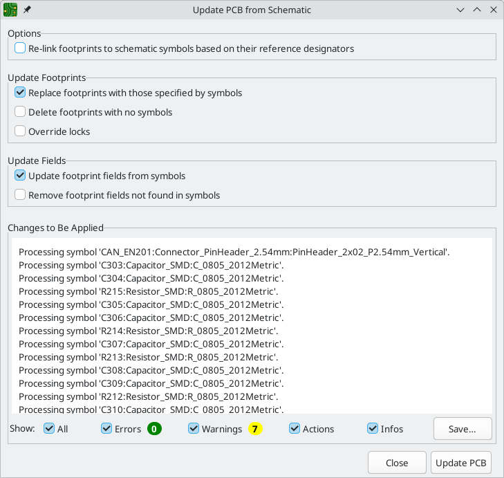

For more information about the Update Schematic from PCB tool, see the
<<forward-and-back-annotation,forward annotation section of the manual>>.

[[starting-from-scratch]]
=== Starting from scratch

It is also possible to create a board with no matching schematic, although this workflow has some
limitations and is not recommended for most users.  To do this, you must start the PCB editor
standalone (not from the KiCad project manager).  Before beginning your design, it is a good idea
to save the board file, which will also create a project file to store board settings.  Use "Save
As..." from the File menu to choose where to save your board file.  A project file with the same
name will be created in the same location you choose to save the board file in.

== Board setup

Before beginning your board design, use the Board Setup dialog to configure the basic parameters of
the board.  To open Board Setup, click the  icon in the top
toolbar or choose "Board Setup..." from the File menu.

[[board-setup-stackup]]
=== Configuring board stackup and physical parameters

The Board Stackup section of Board Setup is used to configure the stackup and layers of the board.

==== Board editor layers

The Board Editor Layers page lets you
rename layers,
disable non-copper layers that will not be used in the design,
and add additional user-defined layers for documentation or other purposes.
For example, if you will not use a back silkscreen on
the design, uncheck the box next to the `B.Silkscreen` layer.
Some layers, like copper layers, courtyard layers, and `Edge.Cuts`, are required layers and therefore cannot be disabled.

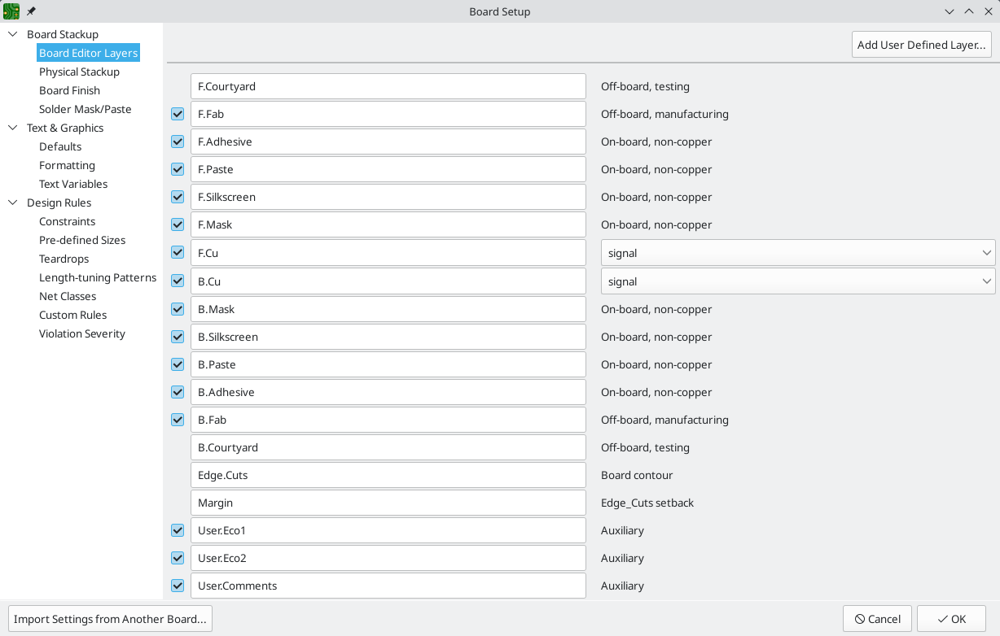

NOTE: Copper layers can be designated as signal, power plane, mixed, or jumper in the Board Editor
      Layers section.  This designation is intended as a guide for the user only.  Tracks and zones
      can be routed on any copper layer, no matter what the type is configured to in this dialog.

You can add additional user-defined layers (`User.1`, `User.2`, etc.) by clicking the
**Add User Defined Layer...** button in the top right. User-defined layers can't be used for routing,
but they can contain arbitrary graphics or other information. By default, user layers are **auxiliary**
layers, meaning that whatever information they contain does not correspond to either the front or back
of the board. User layers can instead be set to **Off-board, front** or **Off-board, back**, in which
case they correspond to the selected side of the board. Items on such layers can be flipped from front
to back in the same way as objects on physical front/back layers. Adjacent front/back layers are treated
as paired: if `User.2` is defined as a front layer and `User.3` is defined as a back layer, flipping an
object on `User.2` will move it to `User.3`, and vice versa.

==== Physical stackup

The Physical Stackup page controls the board layers that are part of the PCB layer stackup:
copper layers, dielectric layers, solder mask, and silkscreen.

NOTE: Use the **Board Editor Layers** page to add non-physical layers, configure names for all layers, and enable or disable optional layers.

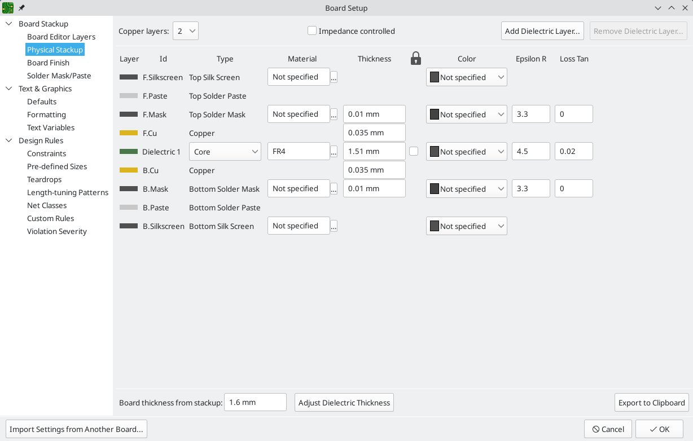

Set the number of copper layers in the upper left corner and then enter the physical parameters of the stackup if desired.
These parameters may be left at their default values,
but note that the board thickness value will be used when exporting a 3D model of the board,
and layer thicknesses will be included in net length calculations for any nets that include vias.
If you plan to use these features, it is a good idea to ensure that the stackup thickness is correct.
Dielectric, soldermask, and silkscreen layers can have colors assigned to them, which affects the board's appearance in the 3D viewer and in 3D model exports.

NOTE: KiCad currently only supports stackups with an even number of copper layers.  To create
      designs with an odd number of layers (for example, flexible printed circuits or metal-core
      printed circuits), simply choose the next highest even number and ignore the extra layer.

The **Board thickness from stackup** value at the bottom of the page is automatically calculated based on the stackup parameters in the table.
You can automatically adjust the thickness of dielectric layers by pressing the **Adjust Dielectric Thickness** button and entering an overall thickness for the PCB.
The thickness of the dielectric layers will be adjusted to meet the overall PCB thickness.
Any dielectric layers that are locked (the  column is checked) will not be adjusted.

==== Board finish

The Board Finish section has settings for defining the copper finish and special features such as castellations or edge plating.
Note that these settings only impact the board attributes output as part of Gerber job files at this time.

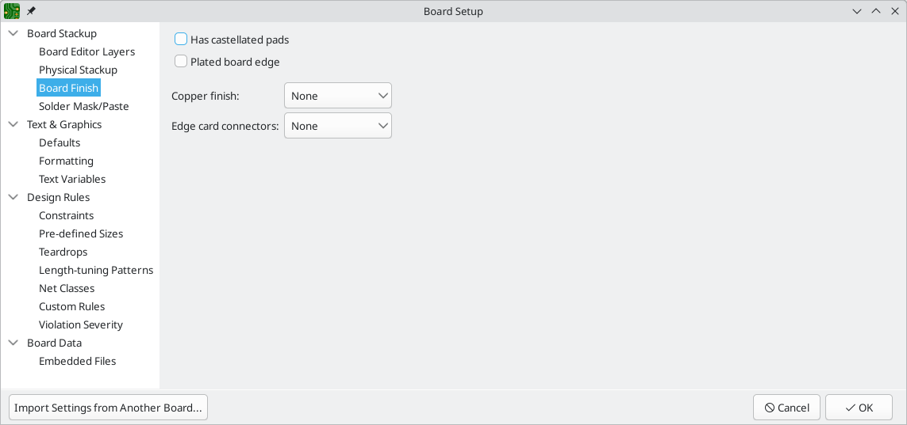

==== Solder mask/paste

The Solder Mask/Paste section allows global adjustment of the clearance (positive or negative) between solder mask / solder paste shapes and the copper shapes of the parent pads.
These values are global settings, but they will be superseded by any clearance overrides set on individual footprints or pads.
Positive clearance values will result in the shape of the solder mask or paste opening being _larger_ than the copper
shape.
Negative clearance values will result in the opening being _smaller_ than the copper shape.

WARNING: Most commercial PCB fabricators expect these values to be zero and make their own
         adjustments to solder mask and paste openings as part of their CAM process.  It is usually
         best to leave these values at their default of zero unless you are making the PCB yourself
         or have specific advice from your fabricator to use different values.

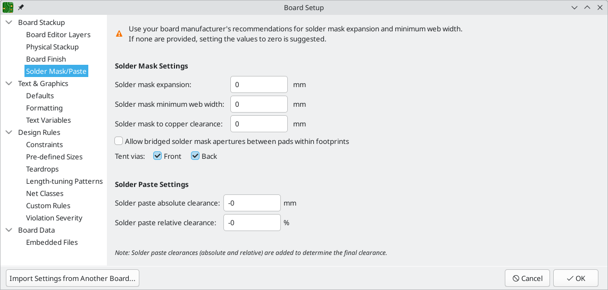

- **Solder mask expansion** is a global setting to specify the size of a solder mask opening relative to the parent pad size.
  If it is `0`, solder mask openings will be the same size as the pad.
  Positive values mean solder mask openings will be larger than pads.
  Negative values mean solder mask openings will be smaller than pads.
  This global value is overridden by expansion settings in individual footprints or pads.

- **Solder mask minimum web width** is the minimum width of webs between solder mask openings,
  or in other words, the minimum distance between solder mask openings.
  Any solder mask openings that are closer than this minimum distance will be plotted as a single merged opening.

- **Solder mask to copper clearance** is the minimum distance between a solder mask opening and copper with a different net than the opening's parent copper.
  Distances smaller than this minimum will result in a DRC error.

- **Allow bridged solder mask apertures between pads within footprints** controls whether a DRC violation occurs when multiple pads in the same footprint share a single solder mask opening.
  This situation can occur when multiple solder mask openings are merged due to the minimum solder mask web width setting.

- **Tent vias** controls whether vias are tented (covered with solder mask) on the top and bottom layers of the board.

- **Solder paste clearance** is a global setting to specify the solder paste shape relative to the parent pad size
  (the size difference between the pad shape and the aperture shape on the F.Paste and B.Paste layers).
  This can be specified as an absolute offset from the pad edge (e.g. `-0.1mm`),
  a value relative to the pad dimension (e.g. `-5%`),
  or both (e.g. `-0.1mm - 5%`).
  If it is `0` or blank, the solder paste aperture will be the same size as the pad.
  Positive values mean solder paste aperture larger than the pad.
  Negative values mean solder paste aperture smaller than the pad.
  This global value is overridden by paste clearance settings in individual footprints or pads.

==== Zone hatch offsets

The Zone Hatch Offsets page lets you configure per-layer offsets for zone hatch patterns.
Hatched zones on each layer will have their hatch patterns offset in X and Y relative to the patterns on other layers based on the settings on this page.

image::images/board_setup_zone_hatch_offsets.png[scaledwidth="70%"]

=== Configuring text and graphics

The Text & Graphics section contains formatting settings for text objects, graphic shapes, and dimension objects.
It also allows configuring project text variables. 

[[board-setup-defaults]]
==== Defaults

The Defaults section of the Board Setup dialog is used to configure the
properties that will be used for new text and graphic shapes that are placed on the board.

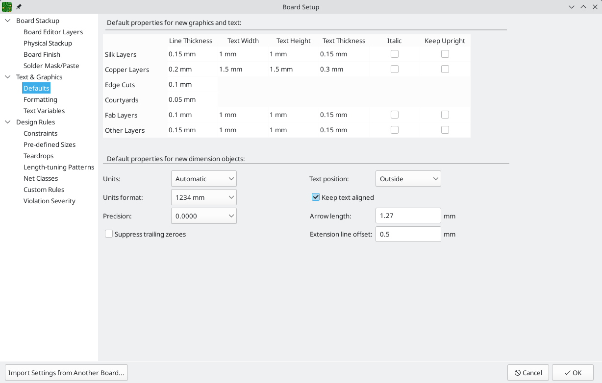

Line thickness, text size, and text appearance can be configured for the six different categories of layers shown in the dialog.
These default settings are automatically applied to new text and graphic objects based on the new object's layer.
These settings can be overridden on a per-object basis in that object's properties, however.

Additionally, the default properties for dimension objects can be configured for all layers.
For more details about dimension properties, see the <<dimensions,dimensions section>>.

The **Defaults** page also contains default settings for new <<working-with-zones,zones>>.
The settings configured here are applied to newly-created zones, but can be overridden on a per-zone basis in the zone's properties.

==== Formatting

The Formatting section contains controls for how to format certain board items.

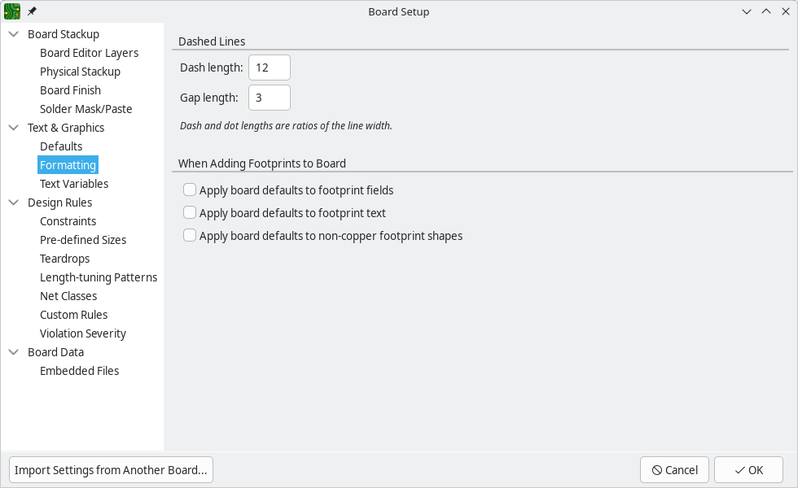

The Dashed Line section controls the appearance of dashed lines.
*Dash length* controls the length of dashes,
while *Gap length* controls the spacing between dashes and dots.
The dash and gap lengths are relative to the line width:
a gap length of `2` means twice the width of the line.

The checkboxes at the bottom of the page control how the settings from the <<board-setup-defaults,**Defaults** page>> are automatically applied to footprints that are added to the board.

- **Apply board defaults to footprint fields**:
  if checked, default settings will be applied to footprint fields.
- **Apply board defaults to footprint text**:
  if checked, default settings will be applied to footprint text objects.
- **Apply board defaults to non-copper footprint shapes**:
  if checked, default settings will be applied to graphic shapes on non-copper layers in footprints.
  Graphic shapes on copper layers will not be modified.
- **Apply board defaults to footprint dimensions**:
  if checked, default settings will be applied to footprint <<dimensions,dimensions>>.
- **Apply board defaults to footprint barcodes**:
  if checked, default settings will be applied to footprint <<barcodes,barcodes>>.

[[board-setup-text-variables]]
==== Text variables

Project text variables can be created in the Text Variables section.
KiCad will substitute the variable name with the text string assigned to the variable.
This substitution happens anywhere the variable name is used inside the variable replacement syntax of `${VARIABLENAME}`.

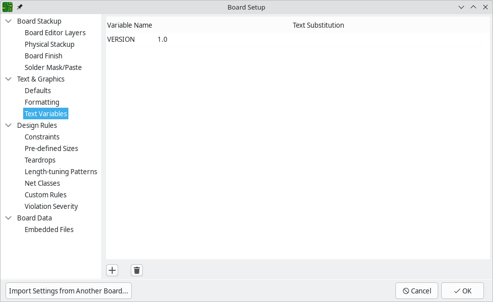

For example, you could create a variable named `VERSION` and set the text substitution to `1.0`.
Now, in any text object on the PCB, you can enter `${VERSION}` and KiCad will display this as `1.0`.
If you change the value to `2.0`, every text object that includes `${VERSION}` will be updated automatically.
You can also mix regular text and variables.
For example, you can create a text object with the text `Version: ${VERSION}` which will be displayed as `Version: 1.0`.

Text variables can also be created in
xref:../eeschema/eeschema.adoc#schematic-setup[Schematic Setup].
Text variables are project-wide; variables created in the schematic editor are
also available in the board editor, and vice versa.

There are also a number of
<<text-variables,built-in system text variables>>.

=== Configuring design rules

Design rules control the behavior of the interactive router, the filling of copper zones, and the
<<design-rule-checking,design rule checker>>.  Design rules can be modified at any time, but we recommend that you establish
all known design rules at the beginning of the board design process.

[[board-setup-constraints]]
==== Constraints

Basic design rules are configured in the Constraints section of the Board Setup dialog.  Constraints
in this section apply to the entire board and should be set to the values recommended by your board
manufacturer.  Any minimum value set here is an _absolute_ minimum and cannot be overridden with a
more specific design rule.  For example, if you need the copper clearance on part of a board to be
0.2mm and in the rest 0.3mm, you must enter 0.2mm for the minimum copper clearance in the
Constraints section and use a net class or custom rule to set the larger 0.3mm clearance.

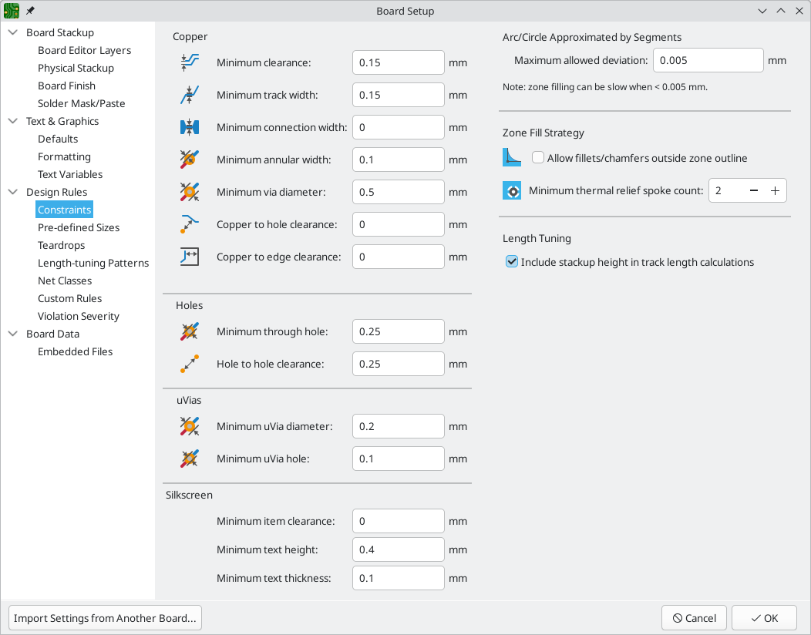

In addition to setting minimum clearances, a number of features can be configured here:

[options="header",cols="25%,75%"]
|====
| Setting | Description
| Arc/circle approximated by segments
  | In some situations, KiCad must use a series of straight line segments to approximate round
    shapes such as those of arcs and circles.  This setting controls the maximum error allowed by
    this approximation: in other words, the maximum distance between a point on one of these line
    segments and the true shape of the arc or circle.  Setting this to a lower number than the
    default value of 0.005mm will result in smoother shapes, but can be very slow on larger boards.
    The default value typically results in arc approximation error that is not detectable in the
    manufactured board due to manufacturing tolerances.
| Allow fillets outside zone outline
  | Zones can have fillets (rounded corners) added in the Zone Properties dialog.  By default, no
    zone copper, including fillets, is allowed outside the zone outline.  This effectively means
    that inside corners of the zone outline will not be filleted even when a fillet is configured.
    By enabling this setting, inside corners of the zone outline will be filleted even though this
    results in copper from the zone extending outside the zone outline.
| Minimum thermal relief spoke count
  | This sets the minimum acceptable number of thermal relief spokes connecting a pad to a
    zone. A DRC violation will be generated if this constraint is violated.
| Include stackup height in track length calculations
  | By default, the length tuner uses the height of the stackup to calculate the additional length
    of a track that travels through vias from one layer to another.  This calculation relies on the
    board stackup height being correctly configured.  In some situations, it is preferable to ignore
    the height of vias and just calculate the track length assuming that vias add no length.  Disabling
    this setting will exclude via length from length tuner track length calculations.
|====

[[board-setup-pre-defined-sizes]]
==== Pre-defined sizes

The Pre-defined Sizes section allows you to define the track and via dimensions you want to have
available while routing tracks.  Net classes can be used to define the default dimensions for tracks
and vias in different nets (see below) but defining a list of sizes in this section will allow you
to step through these sizes while routing.  For example, you may want the default track width on a
board to be 0.2 mm, but use 0.3 mm for some sections that carry more current, and 0.15 mm for some
sections where space is limited.  You can define each of these track widths in the Board Setup
dialog and then switch between them when routing tracks.

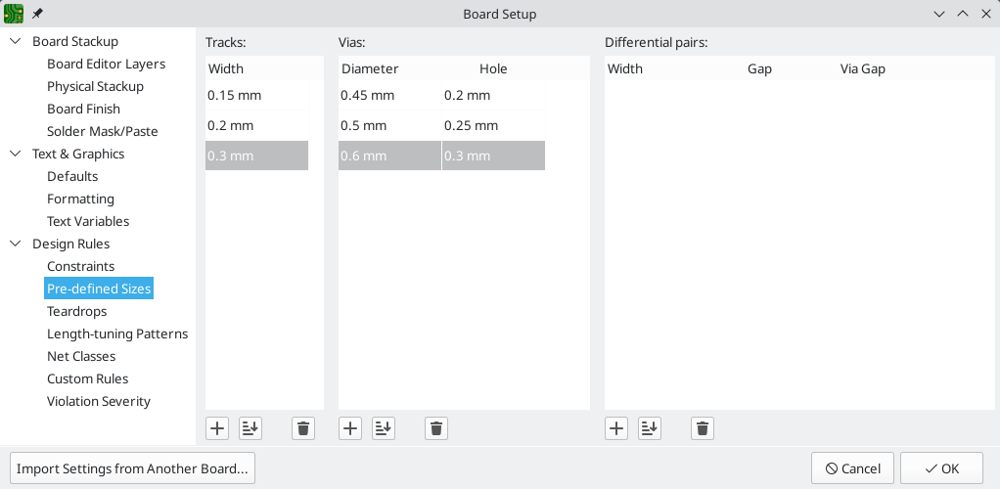

[[board-setup-teardrops]]
==== Teardrops

The teardrops section lets you set default parameters for various types of teardrops. There are
different settings for teardrop connections to round objects, rectangular objects, and teardrop
connections between tracks. The default teardrop parameters can be overridden when teardrops are
added, and also changed in the properties for individual connected items. See the
<<editing-teardrops,teardrops documentation>> for more information about each setting.

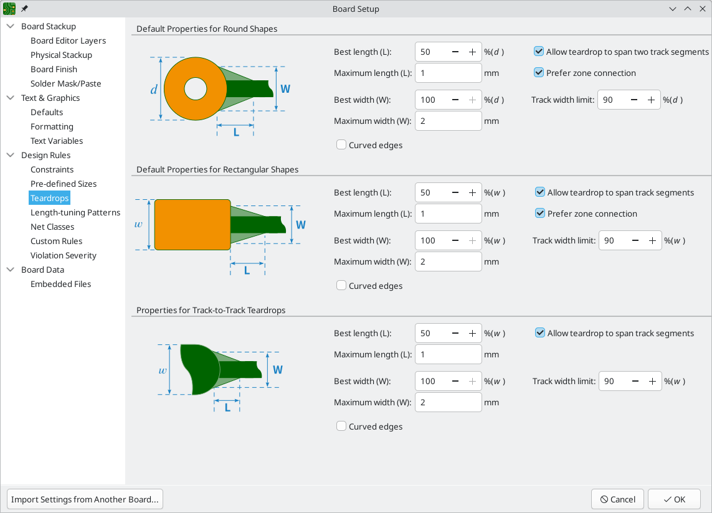

==== Length-tuning patterns

The length-tuning patterns section lets you set default parameters for each type of length-tuning
pattern (single-track length, differential-pair length, and differential-pair skew). These defaults
can be overridden in the properties of each tuning pattern added to the board. See the
<<length-tuning,length tuning documentation>> for more information.

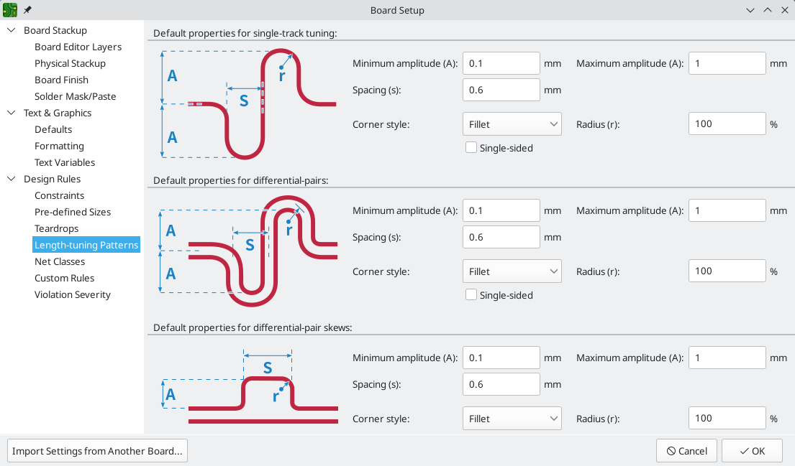

==== Tuning profiles

Tuning profiles let you define per-layer routing parameters for single-ended and differential tracks with specific impedance requirements.
You can automatically calculate track width and gap based on the board stackup and target signal impedance.
Tuning profiles can be assigned to net classes, after which the interactive router will use the specified values.
<<drc,DRC can optionally generate violations>> for tracks that don't match their tuning profile's parameters.

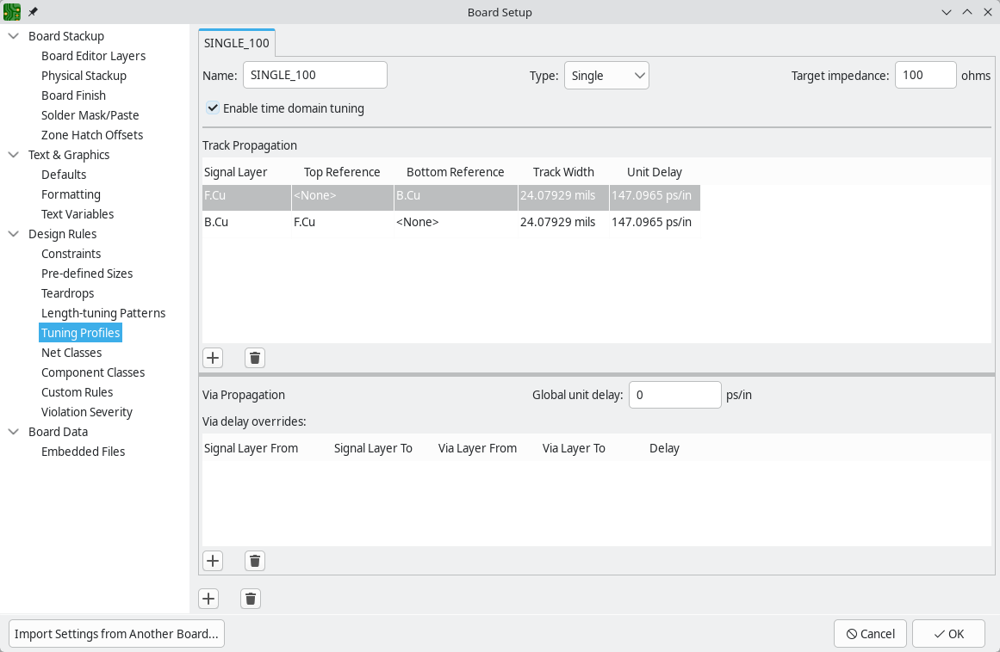

To add a tuning profile, press the  button.
You must specify a name for the tuning profile and select whether it applies to single tracks (**Single**) or differential tracks (**Differential**).
The **Target impedance** is optional, but required for the tool to calculate track geometry.
If **Enable time domain tuning** is checked, the length tuner will use time domain tuning when tuning tracks assigned this tuning profile;
otherwise the tuner will tune based on track length.

The **Track Propagation** section lets you define per-layer track geometries and propagation delays.
Each row in the table represents tracks on a different layer.
Press the  button below the table to add a new row,
or press the  button to remove the selected row.

For each row, you can select the **Signal Layer**, the **Bottom Reference** layer, and optional **Top Reference** layer (for stripline geometries).
Each row (signal layer) also has **Track Width** and **Unit Delay** values, and differential pairs additionally have a **Diff Pair Gap** value.

You can enter width, gap, and delay values manually (after calculating them with an external tool) or press the  button in each field to calculate them automatically.
The width and gap values are calculated based on the target impedance and the stackup thickness between the signal and reference layer(s).
For differential pairs, at least one of the width and gap must be manually entered; the other can be calculated.
The delay value is calculated based on the track geometry.
The calculator assumes a microstrip or stripline geometry, depending on whether one or two reference layers, respectively, are specified.
To use the calculators, you must enter a **Target Impedance** for the profile and configure the <<board-setup-stackup,board's stackup>>.

The **Via Propagation** section lets you define propagation delays for vias.
The **Global unit delay** field is the general propagation delay per unit distance for vias.
You can override this general unit delay by adding overrides for individual layer pairs in the table below.

Each row in the table represents vias between specific layer pairs.
Press the  button below the table to add a new row,
or press the  button to remove the selected row.

Each override has **Signal Layer From**, **Signal Layer To**, **Via Layer From**, and **Via Layer To** layers.
Signal Layer From/To are the layers on which the signal tracks connect to the via.
Via Layer From/To are the start and end layers of the full via structure.
Through vias start and end at the top and bottom layers of the board.
Other types of vias can start and end on inner layers, depending the stackup and via geometry.

Each override also has a **Delay** value, with which you specify the propagation delay for that type of via.

To remove an entire tuning profile, press the  button at the bottom of the page.

You can use tuning profiles to route tracks with specific geometries by assigning the tuning profile to a net class.
The interactive router will then use the tuning profile's geometry values as net class width and differential pair gap values when you route tracks that belong to that net class,
the length tuner will use the propagation delays for time-domain tuning,
and <<drc,DRC violations can optionally be generated>> for tracks that do not match the specified geometry.

To assign a tuning profile to a net class,
go to the <<board-setup-net-classes,**Net Classes** page of Board Setup>>,
then choose a tuning profile in that net class's **Tuning Profile** column.
You may need to scroll the table or unhide the column in order to see it.

===== When to enable time-domain tuning

The **Enable time domain tuning** checkbox controls whether the length tuner operates
in time-domain mode (matching propagation delay) or length-domain mode (matching
physical trace length) for nets assigned to this tuning profile.

Enable time-domain tuning when:

- Matched nets are routed on multiple layers with different propagation velocities
  (e.g., a mix of microstrip and stripline routing).
- Your design specification defines timing budgets in picoseconds rather than
  millimeters.
- Via transitions between layers with different dielectric properties contribute
  meaningful delay differences that length matching alone cannot capture.

When time-domain tuning is disabled, the tuning profile still provides per-layer track
geometry (width and gap) for the interactive router and DRC, but the length tuner
matches physical length rather than propagation delay.

NOTE: You can override the tuning mode on a per-net basis using custom DRC rules.
      A `length` or `skew` constraint written with time units (e.g., `500ps`) will
      force the length tuner into time-domain mode for matching nets, regardless of
      the tuning profile setting.

===== Understanding track propagation parameters

Each row in the **Track Propagation** table represents a signal layer and its
reference plane(s).  The combination of signal layer and reference layer(s) determines
the transmission line geometry:

- **One reference layer** (bottom reference only): The calculator assumes a
  *microstrip* geometry.  This is typical for outer layers where the trace sits above
  or below a single reference plane.
- **Two reference layers** (bottom and top reference): The calculator assumes a
  *stripline* geometry.  This is typical for inner layers where the trace is
  sandwiched between two reference planes.

The propagation velocity (and therefore the unit delay) differs between microstrip and
stripline geometries because the effective dielectric constant is different.  Stripline
traces are fully enclosed in dielectric material and have a higher effective dielectric
constant, resulting in slower propagation (higher unit delay per mm).  Microstrip traces
are partially exposed to air, resulting in faster propagation (lower unit delay per mm).

The **Unit Delay** value for each layer is expressed as propagation delay per unit
distance (for example, ps/mm).  You can enter this value manually if you have
calculated it with an external impedance calculator, or press the
 auto-calculate button to have KiCad compute
it from the board stackup and trace geometry.

TIP: After making changes to the board stackup (layer thicknesses, dielectric materials),
     press the  button in each delay field to
     recalculate the unit delays.  The delay values are not automatically updated when the
     stackup changes.

===== Understanding via propagation parameters

The **Via Propagation** section controls how via delays are calculated in time-domain
mode.

The **Global unit delay** is the default propagation delay per unit distance for all
vias.  This value is multiplied by the via's electrical height (the stackup distance
between the layers the signal actually uses, not the full via span) to produce the
via's delay contribution.

For more precise control, you can add **per-layer-pair overrides** in the table below
the global delay field.  Each override specifies an absolute delay value for a via
transition between specific layers.  Overrides take priority over the global unit
delay calculation.

Each override row has four layer fields:

- **Signal Layer From** and **Signal Layer To**: The copper layers on which the routed
  tracks connect to the via.
- **Via Layer From** and **Via Layer To**: The start and end layers of the full via
  structure (e.g., `F.Cu` and `B.Cu` for a through via).

This four-layer specification allows you to define different delays for the same
physical via structure depending on which layers the signal actually transitions
between.

===== How tuning profiles, net classes, and the length tuner work together

The relationship between these three features is:

1. A _tuning profile_ defines the per-layer track geometry and propagation delay
   parameters for a specific impedance target.
2. A _net class_ groups nets that share common routing parameters.  Assigning a
   tuning profile to a net class applies the profile's geometry and delay values to
   all nets in that class.
3. The _length tuner_ reads the tuning profile associated with a net's net class.  If
   the profile has time-domain tuning enabled, the tuner uses the profile's per-layer
   delay values to calculate and match propagation delay.  If time-domain tuning is
   not enabled, the tuner falls back to matching physical length.

When the interactive router routes a track belonging to a net class with an assigned
tuning profile, it automatically uses the track width and differential pair gap defined
in the tuning profile for the current layer.  This ensures that the routed geometry
matches the assumptions used in the propagation delay calculations.

[[board-setup-net-classes]]
==== Net classes

The Net Classes section allows you to configure routing and clearance rules for
different classes of nets.

More than one net class can be assigned to a net. For nets with multiple net
classes assigned, an effective aggregate net class is formed, taking any net
class properties from the highest priority net class which has that property
set. Net class priority is determined by the ordering in the Schematic or Board
Setup dialogs. The `Default` net class is used as a fallback for any missing
properties after all explicit net classes have been considered; this means that
nets may be part of the `Default` net class even if they have other net classes
explicitly assigned.

xref:../eeschema/eeschema.adoc#schematic-setup-netclasses[Net classes may be created and edited]
in either the Schematic or Board Setup dialogs.

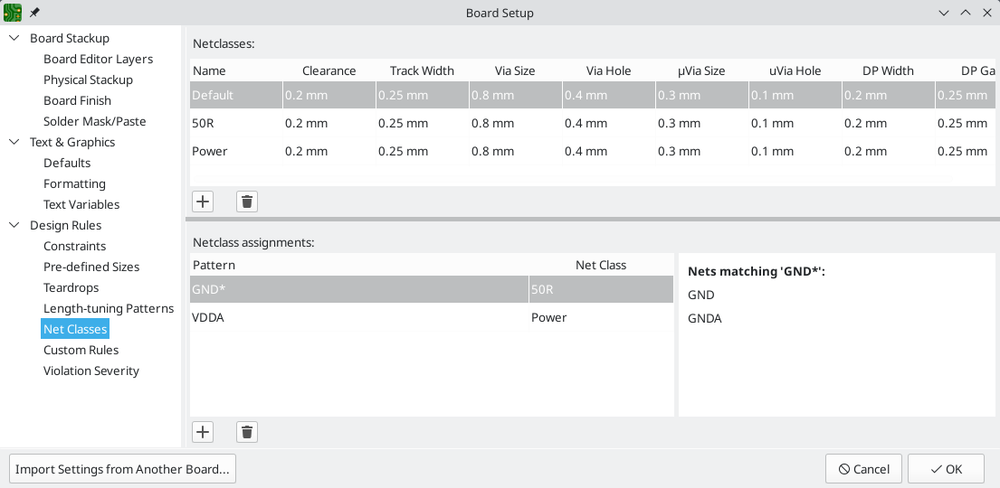

The upper portion of the Net Classes section contains a table showing the net
classes in the design and the design rules that apply to each net class.
Some columns in the table may be hidden or scrolled to the side.
You can show or hide columns in the table by right-clicking on the table header and checking or unchecking columns in the menu.

Every class has values for copper clearance, track width, via sizes, and differential
pair sizes.
These values will be used when creating tracks and vias unless a more specific rule overrides them (see Custom Rules below).

NOTE: No rule may override the minimum values set in the Constraints section of Board Setup.  For
      example, if you set a net class clearance to `0.1 mm`, but the Minimum Clearance in the
      Constraints section is set to `0.2 mm`, nets in that class will have a clearance of `0.2 mm`.

The track widths and via sizes defined for each net class are used when the track width and via size controls are set to "use netclass values" in the PCB editor.
These widths and sizes are considered the default, or optimal, sizes for that net class.
They are not minimum or maximum values.
Manually changing the track width or via size to a different value from that defined in the Net Classes section will not result in a DRC violation.
To restrict track width or via size to specific values, use <<custom-design-rules,Custom Rules>>.

You can assign a <<board-setup-tuning-profiles,tuning profile>> to a net class in the **Tuning Profile** column.
This assigns per-layer track geometry (track width and differential pair gap) and propagation delays for tracks and vias belonging to that net class.
Like other net class values, the interactive router uses these values for routing tracks.
The length tuner also uses the propagation delays from the tuning profile when tuning tracks in time-domain mode.
<<drc,DRC violations can optionally be generated>> for tracks that don't match their tuning profile's geometry by setting the severity of the "Tuning profile track geometries" violation to either Warning or Error.

Each net class can also have a color assigned to it using the **PCB Color** column.
Depending on how net colors are configured in the <<appearance-panel,appearance panel>>,
net class colors can override the default color for ratsnest lines or copper objects.
In addition to arbitrary colors for each net class,
you can set all net classes to use the same color as configured for them in the schematic editor by clicking the **Import colors from schematic** button.
To use a layer's default color instead of overriding it with a custom net class color,
set the net class color to transparent.

The lower portion of the Net Classes section lists pattern-based net class assignments.
Working with pattern-based net class assignments is explained in the
xref:../eeschema/eeschema.adoc#schematic-setup-netclasses[Schematic Editor documentation];
pattern-based assignments can be edited in either the Board or Schematic Setup windows.

Note that pattern-based assignments can be created directly from the PCB editing canvas by right clicking a copper track or zone and clicking **Assign netclass...**.
Net classes can also be assigned in the schematic using
xref:../eeschema/eeschema.adoc#netclass-directive [net class directives or labels]
instead of pattern-based assignments.

[[component-classes]]
==== Component classes

The Component Classes section allows you to create rules that automatically assign components to component classes.
In addition to these automatic assignments, you can xref:../eeschema/eeschema.adoc#component-classes[manually assign component classes in the Schematic Editor].

Component classes are named groupings of components:
they are assigned to symbols in the schematic or to footprints in the board,
but however they are assigned they apply to both the symbols and the corresponding footprints.
They can be used to group symbols into channels for <<multichannel,multichannel designs>>
and can also be used to group footprints in <<custom-design-rules,custom DRC rules>>.
Components can have more than one class.

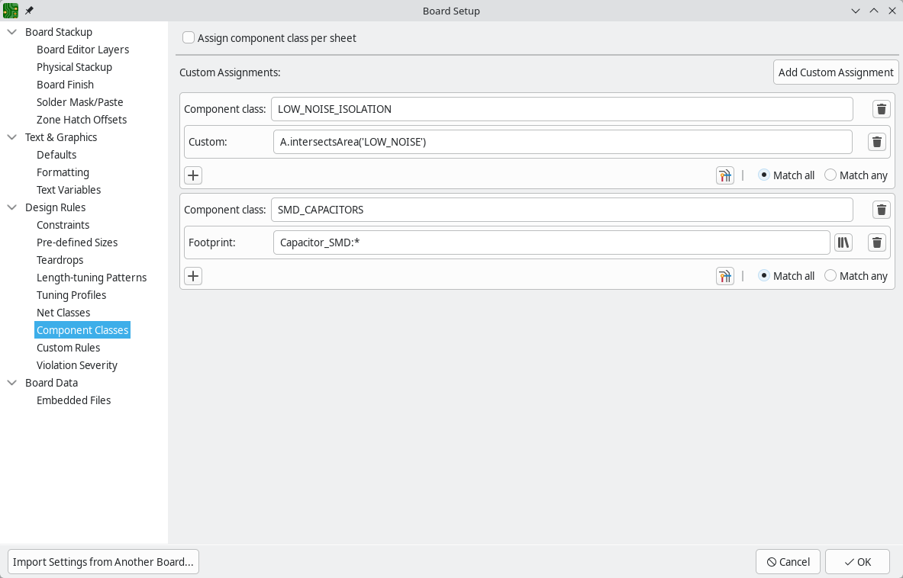

Enabling the **Assign component class per sheet** will create a component class for every sheet in the schematic and assign each component in the sheet to that sheet's component class.

You can add a rule for assigning a component class by clicking the **Add Custom Assignment** button.
Enter the name of the component class you want to assign in the **Component class** textbox, then add a condition for when to assign the class by pressing the  button and selecting a type of condition from the menu that appears.

The following types of conditions are available:

- **Reference**: matches by footprint reference designator.
  More than one reference designator can be given as a comma-separated list.
  The reference field support wildcards:
  `*` matches any number of any characters, including none,
  and `?` matches any single character.
  Pressing the  button uses the selected footprints' reference designators in the condition.
- **Footprint**: matches by footprint library and identifier.
  The footprint field support wildcards:
  `*` matches any number of any characters, including none,
  and `?` matches any single character.
  Pressing the  button opens a window to choose a footprint from your libraries.
- **Side**: matches by side of the PCB (front, back, or any).
- **Rotation**: matches by footprint rotation angle.
- **Footprint Field Value**: matches by the value of a specified footprint field.
  The field name and value support wildcards:
  `*` matches any number of any characters, including none,
  and `?` matches any single character.
- **Sheet**: matches by the name of the schematic sheet containing the footprint's linked symbol.
- **Custom Expression**: matches by a <<custom-design-rules,custom DRC rule condition clause>>, which matches footprints that satisfy the clause.
  For example, `A.intersectsArea('some_area_name')` matches any footprints that intersect the named area `some_area_name`.

You can add multiple conditions to a single rule.
If **Match all** is selected, the component class will be assigned to any components that match all of the conditions.
If **Match any** is selected, the component class will be assigned to components that match any of the conditions.

You can test a component class rule by pressing the  button,
which highlights all footprints that match the rule in the editing canvas.

To delete a condition, press the  button next to the condition.
To delete a rule and all of its conditions, press the  button next to the component class name.

==== Custom rules

The Custom Rules section contains a text editor for creating design rules using the custom rules
language.  Custom rules are used to create specific design rule checks that are not covered by the
basic constraints or net class settings.

Custom rules will only be applied if there are no errors in the custom rules
definitions.  Use the Check Rule Syntax button to test the definitions and fix any problems before
closing Board Setup.

See <<custom-design-rules,Custom Design Rules>> in the Advanced Topics chapter for more information on the custom rules
language as well as example rules.

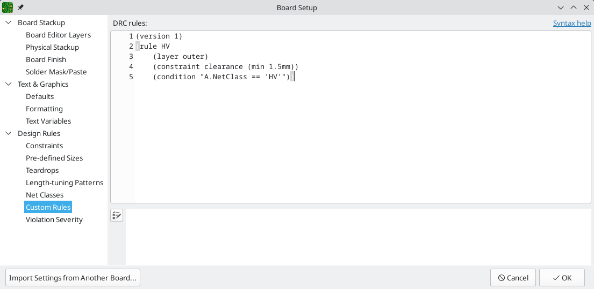

[[board-setup-violation-severity]]
==== Violation severity

The Violation Severity section allows you to configure the severity of each type of design rule
check.  Each rule may be set to create an error marker, a warning marker, or no marker (ignored).

NOTE: Individual rule violations may be ignored in the Design Rule Checker.  Setting a rule to
      Ignore in the Violation Severity section will completely disable the corresponding design
      rule check.  Use this setting with caution.

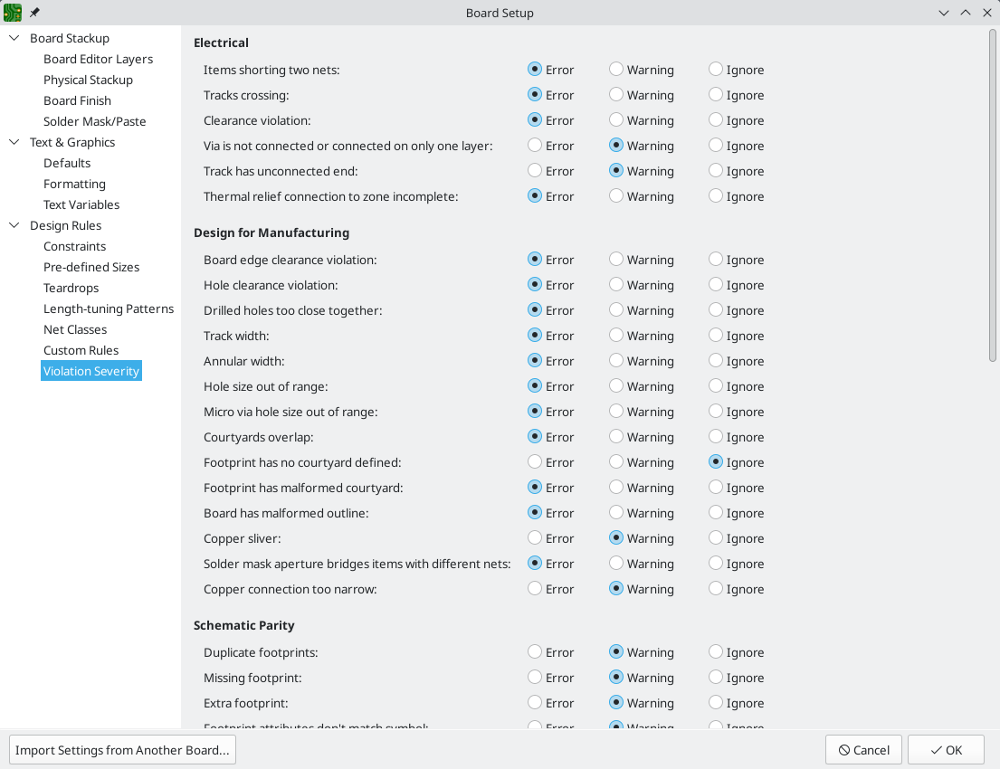

For descriptions of each violation type, and how to ignore individual violations without disabling
all violations of that type, see the <<design-rule-checking,DRC documentation>>.

[[pcb-embedding-files]]
=== Embedding files

External files can be embedded within a board file. Embedding a file stores a copy of the file
inside the board file. The design can then refer to the embedded copy of the file instead of the
external file, which makes the project more portable as it doesn't rely on an external file.
Fonts, datasheets, drawing sheets, SPICE models, and footprint 3D models can be embedded and used within KiCad. Other
arbitrary files can also be embedded to store them in the project for later export, but they are
not used by any KiCad functionality. Files embedded in a board necessarily increase the board's
file size, although files are compressed before being embedded to minimize the space required.

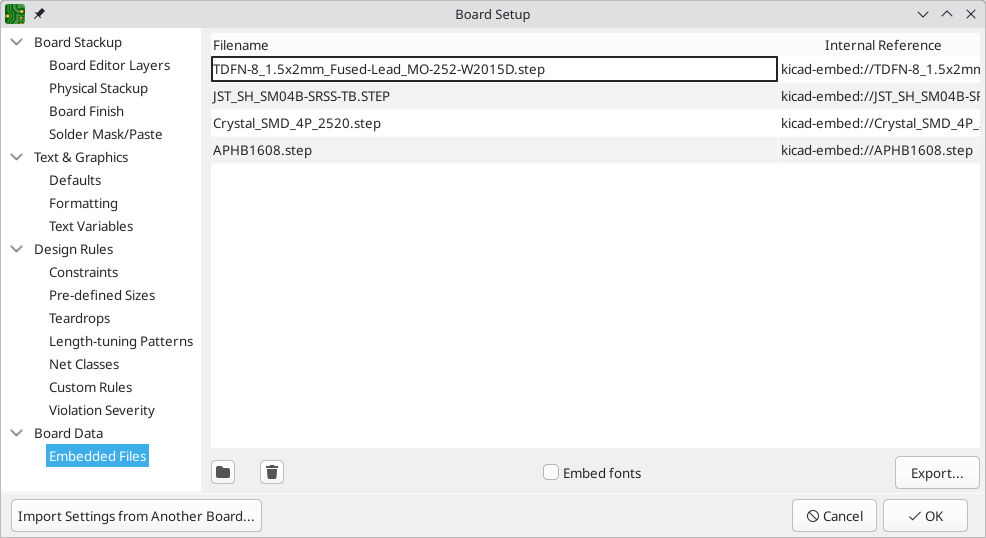

Embedded files are managed in the Embedded Files section of Board Setup. All files embedded in a board
are shown here. To embed a file inside a
board, click the  button and select the file. The file is
then embedded inside the PCB and is listed in the embedded files list along with its
__embedded reference__. The embedded reference is a unique identifier for the embedded file that begins with
`kicad-embed://`. You can use the embedded reference elsewhere in the Board Editor to refer to the
embedded file as if it were an external file path. You can copy the embedded reference by right
clicking and selecting **Copy Embedded Reference**. To remove an embedded file, click the
 button. Any remaining links to the removed file will become
invalid.

NOTE: 3D models and drawing sheets can be embedded directly using the file browser when you add them
      to a footprint (<<editing-symbol-properties,3D models>>) or to a board
      (<<sheet-title-block,drawing sheets>>) by enabling the **Embed Files** option in the file
      browser.  This is a single-step shortcut for adding the files in Board Setup and then
      referring to them by their embedded reference; the result is the same.

To embed any fonts used in a board, check the **Embed fonts** checkbox. All fonts used in the board
design will be embedded, so text using that font can be edited on any computer regardless of whether
the font file is installed.

You can also <<fp-embedding-files,embed files in a footprint>>, either in the board copy of a
footprint or in a library. Such files will be available within the footprint instance but not within
the larger board design or within other footprints. Files embedded in a footprint are deduplicated
when the footprint is added to a board: if a file is embedded in a footprint, and multiple instances
of that footprint are added to the board, only one copy of the file will be embedded, and all of the
footprint instances will refer to the same embedded file.

As an example, to embed a 3D model in a project and use it within several footprints, you could embed
the model using the Board Setup dialog, copy the internal reference, and paste the internal reference
as a 3D model path in each footprint that uses that model. Alternatively, you could embed the model
within a single footprint, either in the board or in the source footprint library. In this case, the
footprint itself is portable if you export the footprints from the board, and the model embedding is
managed in the footprint's properties rather than Board Setup. A more convenient way to achieve the
same thing, however, is to open the footprint's properties dialog, add a 3D model file, and enable
the **Embed File** option in the file browser. Again, this could be done for a footprint in the
board or for a footprint in the source footprint library.

NOTE: You can embed all of your board's footprints at once using **Tools** -> **Collect and Embed 3D Models**.
      This takes every external 3D model referenced by the board's footprints and embeds the models in the board.
      The 3D model references in each footprint are replaced by references to the corresponding embedded files.

Files can also be embedded in xref:../eeschema/eeschema.adoc#sch-embedding-files[schematics].

=== Importing settings

You can import part or all of the board setup from an existing board.  This technique can be used
to create a "template" board that has the settings you want to use on multiple designs, and then
importing these settings from the template board into each new board rather than entering them
manually.

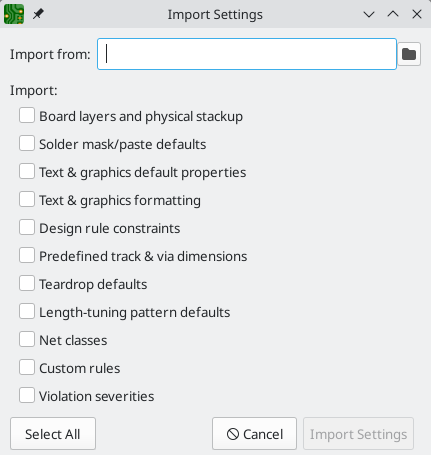

To import settings, click the **Import Settings from Another Board...** button at the bottom of the
Board Setup dialog and then choose the `kicad_pcb` file you want to import from.  Select which
settings you want to import and the current settings will be overwritten with the values from the
chosen board.

The settings that are available to import are:

* Board layers and physical stackup
* Solder mask/paste defaults
* Text and graphics default properties
* Text & graphics formatting
* Design rule constraints
* Predefined track & via dimensions
* Teardrop defaults
* Length-tuning pattern defaults
* Net classes
* Custom rules
* Violation severities
