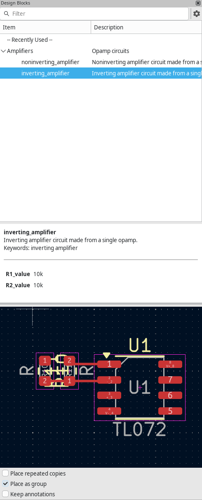
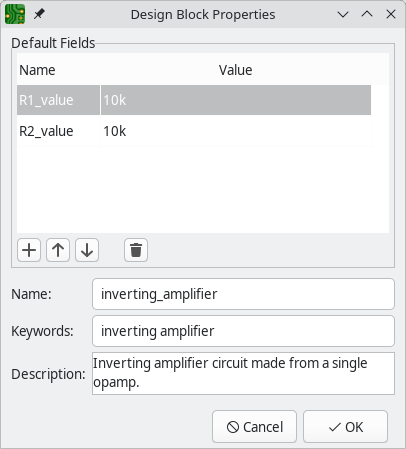

:experimental:

[[pcb-design-blocks]]
== Design blocks

Design blocks allow you to save a portion of a schematic and/or layout and reuse it later.
You can reuse design blocks within the same project or between different projects.
Design blocks are saved and organized in design block libraries, much like symbols and footprints.
A single design block can contain a schematic fragment, a layout fragment, or both.

When you instantiate a schematic design block in a schematic,
the saved schematic fragment is inserted into the current schematic,
either in the current sheet or in a new subsheet.
Instantiating a layout design block directly adds saved board fragment to the board.
If a design block contains both schematic and layout fragments,
you can apply the saved layout to the footprints that correspond to the symbols in the schematic fragment.

Typically, design blocks are created first as a schematic fragment, with layout added later.
Reusing schematic fragments in design blocks is covered in the
xref:../eeschema/eeschema.adoc#schematic-design-blocks[Schematic Editor manual].

To use layout design blocks, first show the Design Blocks panel by clicking
**View** -> **Panels** -> **Design Blocks**.
This opens a docked panel on the right side of the schematic editor.
To close the panel, use the same menu entry again,
click the close button in the top right of the panel,
or right click in the panel and choose **Hide Library Tree**.

The Design Blocks panel lets you create design block libraries and create, edit, and place design blocks in the PCB.

[[creating-and-managing-design-blocks]]
=== Creating and managing design blocks

Design blocks are saved in design block libraries, so you need to add a library
before you can save any design blocks.

==== Creating a new design block library

To create a new library, right click in the library tree and select **New Library...**.
This opens a file browser for you to choose a location and name for the new library.
Design block libraries are saved as a folder;
the folder name is the library name plus the suffix `.kicad_blocks`.

The file browser also lets you choose whether the new library should be added to the global design block library table or the project design block library table.
Libraries in the global library table will be available to all projects,
while libraries in the project library table will only be available in the current project.

NOTE: The global and project design block library tables are managed using
      **Preferences** -> **Manage Design Block Libraries...**.
      This includes deleting and renaming design block libraries.
      The design block library tables behave in the same way as the symbol and footprint library tables.
      For more information about managing library tables, see the
      <<managing-footprint-libraries,footprint library table documentation>>.

After choosing a name, location, and library table, a new, empty library is created.
When you create new design blocks, you can save them in this library.

==== Creating a new design block

In the PCB Editor, design blocks can be created either from the entire contents of a board or from a selection of board objects.
To create and save a new design block, select the desired source objects, either by opening the desired sheet or selecting the objects in the editing canvas.
Then right click the design block library that will contain the block and select
**Save Board as Design Block...** or **Save Selection as Design Block...** as appropriate.

NOTE: To save a layout fragment to an existing design block,
      including a design block that contains a schematic but no layout fragment,
      don't create a new design block.
      Instead, <<updating-an-existing-design-block,update the existing design block>>.

This brings up the Design Block Properties dialog, where you can edit the
properties of the new design block.

* **Name**: this is the name of the new design block, which is shown in the library tree and the preview pane.
  It is also used when filtering design blocks with the filter textbox.
  When design blocks are added as a group or as a schematic sheet,
  this is the default name of the new group or sheet.
* **Keywords**: these are space-separated keywords describing the design block.
  They are displayed in the design block preview pane and used when filtering
  design blocks with the filter textbox.
* **Description**: this is a description of the design block, which is shown in
  the library tree and the preview pane. It is also used when filtering design
  blocks with the filter textbox.
* **Default Fields**: these are key/value pairs which are included as
  xref:../eeschema/eeschema.adoc#hierarchical-schematics[hierarchical sheet fields] when the design block's schematic is
  placed as a sheet.
  Fields are ignored when the design block is not placed as a sheet.

You can edit a design block's properties after creating it by right clicking
the design block in the design block library tree and selecting
**Properties...**.

[[updating-an-existing-design-block]]
==== Updating an existing design block

To update the layout of an existing design block,
first <<using-pcb-design-blocks,place the design block>> you want to modify,
then edit the layout as desired.
If the design block exists but does not contain a layout portion,
place the design block in the schematic,
<<forward-annotation,update the pcb from the schematic>> to add the linked footprints to the board,
then edit the layout as desired.

When the layout changes are complete, save the modified layout to the original design block:
select the board elements you want to save as the design block,
then right click the name of the design block you want to modify and click
**Update Design Block from Selection**.
The existing contents of the design block are replaced by the selection.

Depending on how the design block was placed in the schematic,
there are several other possible ways to save the modified schematic into the design block.
If the current board only contains what you want to save into the design block,
you can right click the name of the design block in the Design Block panel and click
**Update Design Block from Board**.
The existing contents of the design block are replaced by everything in the board.
If the design block was placed as a group, you can right click the group in the canvas and choose
**Save to Linked Design Block**.

[[using-pcb-design-blocks]]
=== Using design blocks in a board

There are two ways to use layout design blocks in a board, which are useful in different situations.

- Design blocks can be directly added to a board,
  in the same way that schematic design blocks are directly added to a schematic.
  When a design block is added this way, its contents are not associated with any symbols from the schematic.
  This can be useful to add footprints or other board items in a predetermined arrangement when those items do not correspond to anything in the schematic.
  For example, mounting holes in a particular pattern could be added this way.

- If a design block was used in the schematic,
  you can go through the normal <<forward-annotation,Update PCB from Schematic>> flow to add the schematic design block's symbols' assigned footprints to the board,
  then apply the design block's saved layout to those footprints.
  This lets you reuse both a schematic fragment and its linked layout.

Both ways are explained in more detail below.

==== Directly placing design blocks in a board

To directly place a layout design block in a board,
without any schematic symbols that correspond to the contents of the layout design block,
you can place the layout design block using the Design Blocks panel.

The Design Blocks panel contains a library tree that lists your design block
libraries and the design blocks contained in each library. Each library can be
expanded or collapsed to show or hide the design blocks in that library. There
is a **Recently Used** pseudo-library at the top of the tree that contains any
design blocks that you have recently placed. You can pin any libraries to the
top of the list by right clicking the library and selecting **Pin Library**.

You can filter design blocks by their name, description, and keywords using the
filter textbox at the top of the Design Blocks panel.
By default, matches are sorted by best match,
but you can change to sorting alphabetically by selecting **Sort Alphabetically** under the  menu.

When you select a design block in the library tree, the design block's name and
metadata are displayed below the library tree along with a graphical preview of
the design block. The metadata includes the block's description and keywords.

To add a design block to the schematic, double click it in the library tree or
right click a design block and select **Place Design Block**.

There are several options controlling how the design block is placed:

* If the **Place repeated copies** checkbox is enabled,
  KiCad will begin placing the design block again when you finish placing the previous block.
  To cancel placing the next block, press kbd:[Esc] or right click and select **Cancel**.

* If the **Place as group** checkbox is enabled,
  the contents of the design block will be added to a <<groups,group>> in the board,
  and the group's library link will be set to point to the source design block and library.
  It is not required to place design blocks as a group,
  but some design block functionality is not available unless the design block is grouped.
  See the <<grouped-design-blocks,Grouped design blocks>> section for more information.

* If the **Keep annotations** checkbox is enabled,
  KiCad will insert the design block without changing the footprint annotations as defined in the saved design block.
  If it is not enabled, KiCad will clear the footprint annotations while inserting the design block.

Once placed in a schematic, the contents of a design block behave the same as
any other schematic objects and can be edited, moved, deleted, etc. exactly as
if they were added to the schematic normally.

==== Applying layouts to design blocks from a schematic

If you want to reuse a layout on some footprints that are linked to symbols in your schematic,
you can use design blocks to achieve this.
You will need a design block that contains both schematic and layout fragments.
After you add the design block in the schematic, you can apply the saved layout to the corresponding footprints.

NOTE: Also consider the <<multichannel,multichannel tool>> as an alternative workflow for reusing layout within a project.

The process for applying a design block's saved layout is as follows:

1. <<creating-and-managing-design-blocks,Create a design block>> that contains both schematic and layout components.
2. xref:../eeschema/eeschema.adoc#using-schematic-design-blocks[Add the design block to the schematic].
  Make sure to place the schematic design block as a group.
3. <<forward-annotation,Update the PCB from the schematic>>.
  Make sure to enable the **Group footprints based on symbol group** option.
  This adds footprints to the board corresponding to the symbols in the schematic design block and groups them together.
  The group is set up with a <<grouped-design-blocks,library link>> that points to the correct design block.
4. In the PCB Editor, select the group of footprints that corresponds to the schematic design block.
  Right click it and choose **Apply Design Block Layout**.
  This rearranges the footprints according to the design block layout,
  draws tracks between pads as appropriate,
  and adds any other contents from the design block layout such as graphics or text.
  The new items are also added to the group.

[[grouped-design-blocks]]
=== Grouped design blocks

When you place a design block in a board,
you have the option to place the block as a group.
You also have the option to group the design block's board contents when transferring a design block from the schematic, as long as the design block was also grouped in the schematic.
In addition to keeping the design block together as a single unit,
some design block features can only be used if the design block's contents are grouped.
In particular, design blocks must be grouped in both the schematic and PCB if you plan to apply a layout to the design block in the PCB.

The following design block features can be used when a design block is grouped:

- Place additional instances of a design block by right clicking the grouped design block and clicking **Place Linked Design Block**.

- Update the library version of a design block to match a design block in the PCB by right clicking the grouped design block and clicking **Save to Linked Design Block**.

- Copy the schematic group to the PCB, grouping the footprints corresponding to the design block's symbols,
  by <<forward annotation,updating the PCB from the schematic>>.

- Apply a design block layout to the footprints in a design block by right clicking the grouped footprints in the PCB and clicking **Apply Design Block Layout**.

- As an alternative workflow to applying the layout saved in a design block,
  use the <<multichannel,multichannel tool>> to repeat a layout from one group to another.
  With this workflow,
  you can place a design block as a group in the schematic,
  transfer the group to the PCB,
  manually perform the layout for one design block's group,
  and then use the multichannel tool to replicate the layout of the first group to the other groups.

When starting from a schematic design block,
the easiest way to group a design block is to enable the **Place as group** checkbox when you place the design block in the schematic.
Then transfer the group to the PCB while <<forward annotation,updating the PCB from the schematic>> by enabling the **Group footprints based on symbol groups** option.

When directly placing a layout design block,
you can enable the **Place as group** checkbox when you place the design block in the PCB.

If you didn't place a design block as a group, but want to group it later, that's also possible.
First, select all of the contents of the design block, then <<groups,group>> them.
It is important that the group includes exactly the contents of the design block,
with no missing or extra items.
In the group's properties, set the **Library link** so that it matches the design block's name and library, in the format `<library>:<block>`.
For example, the library link for the `inverting_amplifier` design block in the `amplifiers` design block library would be `amplifiers:inverting_amplifier`.
