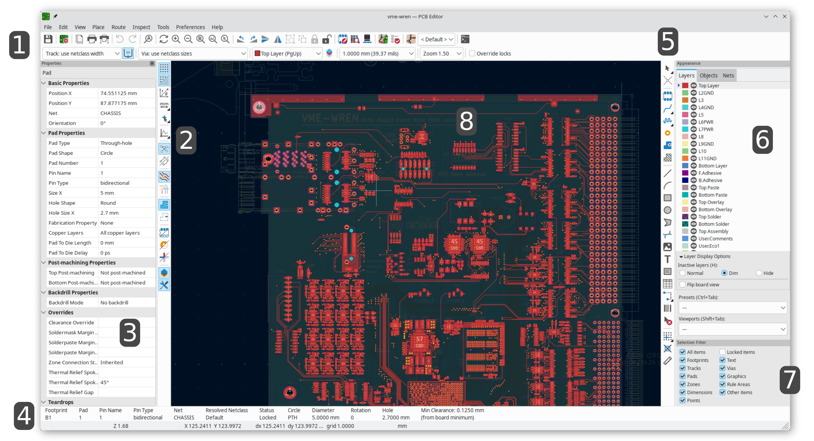

== Introduction to the KiCad PCB Editor

The KiCad PCB Editor is a PCB layout application distributed as a
part of KiCad and available for the following operating systems:

* Linux
* Apple macOS
* Windows

Regardless of the OS, all KiCad files are 100% compatible from one OS to
another.

The PCB Editor is an integrated application where all functions of placing
footprints, routing tracks, library management, and data transfer to and from
the schematic capture software are carried out within the editor itself.

The KiCad PCB Editor is intended to communicate directly with the KiCad
Schematic Editor for designing printed circuit boards from schematics without
using any intermediate files. It can also import netlist files, which list all
the electrical connections, from other packages.

The PCB Editor includes a footprint library editor, which can create and
edit footprints and manage libraries.
It also integrates the following additional but essential functions needed for
modern PCB design software:

* Design rules check (DRC) for automatic detection of design rule violations
  such as incorrect and missing connections, copper clearance and minimum width
  violations, and many other design issues
* Scriptable design rules for specifying rules with complex constraints and
  conditions
* An interactive router with multiple modes of operation (push-and-shove,
  walkaround, highlight collisions) and support for differential pair routing
  as well as length and skew tuning
* Export of fabrication and plot files in many formats (Gerber, IPC-2581,
  ODB{pp}, GenCAD, PDF, PostScript, and SVG)
* A 3D viewer and 3D model generation in many formats (STEP, GLB, BREP, XAO,
  PLY, STL, IDF, and VRML)

=== The PCB Editor user interface
:experimental:

// note: SVG template for this at kicad-doc/helpers/pcbnew_user_interface.svg

The main PCB Editor user interface is shown above, with some key elements indicated:

1. Top toolbars (file management, zoom tools, editing tools)
2. <<left-toolbar-display-controls,Left toolbar (display options)>>
3. <<editing-object-properties,Properties panel>>
4. Message panel and status bar
5. <<placement-and-drawing-operations,Right toolbar (drawing and design tools)>>
6. <<appearance-panel,Appearance panel>>
7. <<selection,Selection filter panel>>
8. Editing canvas

=== Navigating the editing canvas

The editing canvas is a view onto the board being designed.  You can pan and zoom to different
areas of the board, and also flip the view to show the board from the bottom.

By default, dragging with the middle or right mouse button will pan the canvas view and scrolling
the mouse wheel will zoom the view in or out.  You can change this behavior in the Mouse and
Touchpad section of the preferences (see
<<configuration-and-customization,Configuration and Customization>> for details).

Several other zoom tools are available in the top toolbar:

*  zooms in on the center of the
  viewport.

*  zooms out from the center of
  the viewport.

*  zooms to fit the
  frame around the drawing sheet.

*  zooms to
  fit the items within the drawing sheet.

*  allows you to
  draw a box to determine the zoomed area.

The cursor's current position is displayed at the bottom of the window (X and
Y), along with the current zoom factor (Z), the cursor's relative position (dx,
dy, and dist), the grid setting, and the display units.

The relative coordinates can be reset to zero by pressing kbd:[Space]. This is
useful for measuring distance between two points or aligning objects.

=== Hotkeys

The kbd:[Ctrl+F1] shortcut displays the current hotkey list. The default hotkey
list is included in the <<pcbnew-actions-reference,Actions Reference>> section
of the manual.

The hotkeys described in this manual use the key labels that appear on a
standard PC keyboard. On an Apple keyboard layout, use the kbd:[Cmd] key in
place of kbd:[Ctrl], and the kbd:[Option] key in place of kbd:[Alt].

Many actions do not have hotkeys assigned by default, but hotkeys can be
assigned or redefined using the hotkey editor (**Preferences** ->
**Preferences...** -> **<<preferences-controls,Hotkeys>>**).

NOTE: Many of the actions available through hotkeys are also available in context menus.  To access
the context menu, right-click in the editing canvas.  Different actions will be available depending
on what is selected or what tool is active.

Hotkeys are stored in the file `user.hotkeys` in KiCad's configuration
directory. The location is platform-specific:

* Windows: `%APPDATA%\kicad\10.0\user.hotkeys`
* Linux: `~/.config/kicad/10.0/user.hotkeys`
* macOS: `~/Library/Preferences/kicad/10.0/user.hotkeys`

KiCad can import hotkey settings from a `user.hotkeys` file using the **Import
Hotkeys** button in the hotkey editor.
